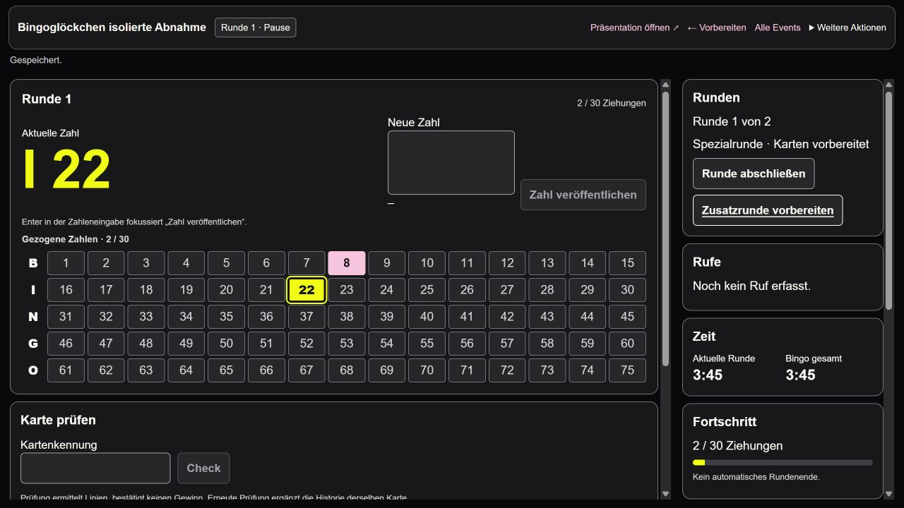
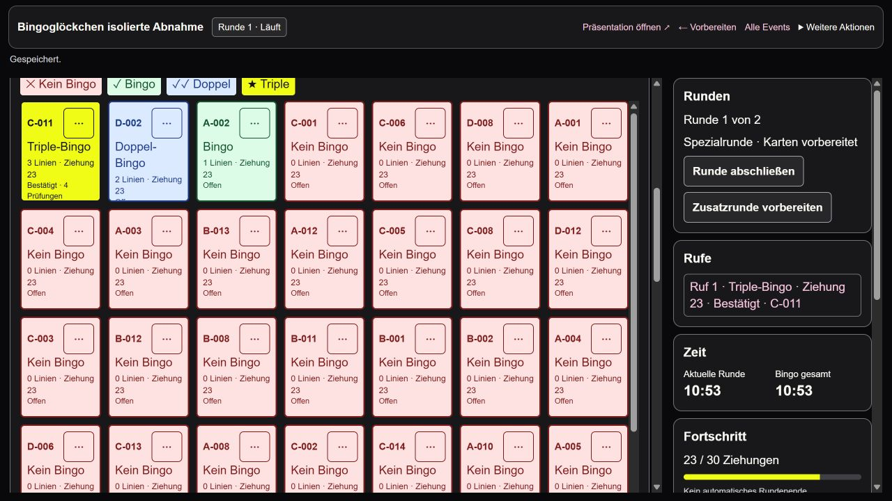
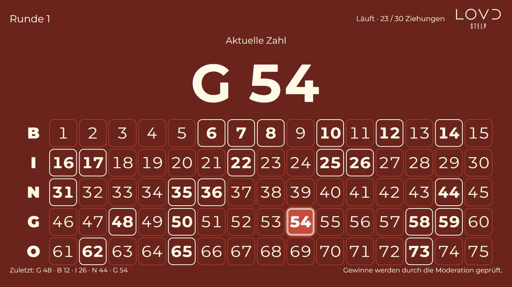
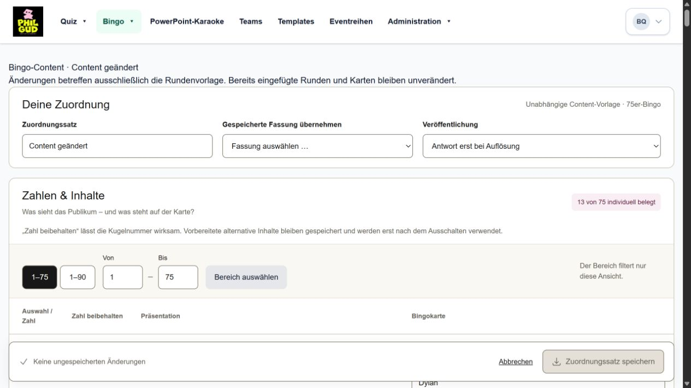
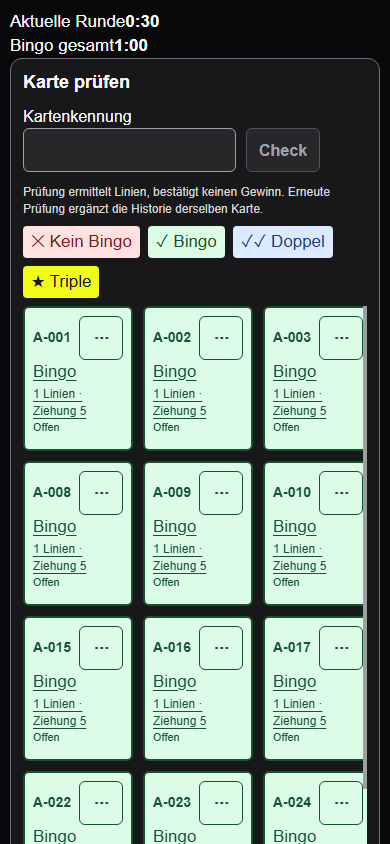
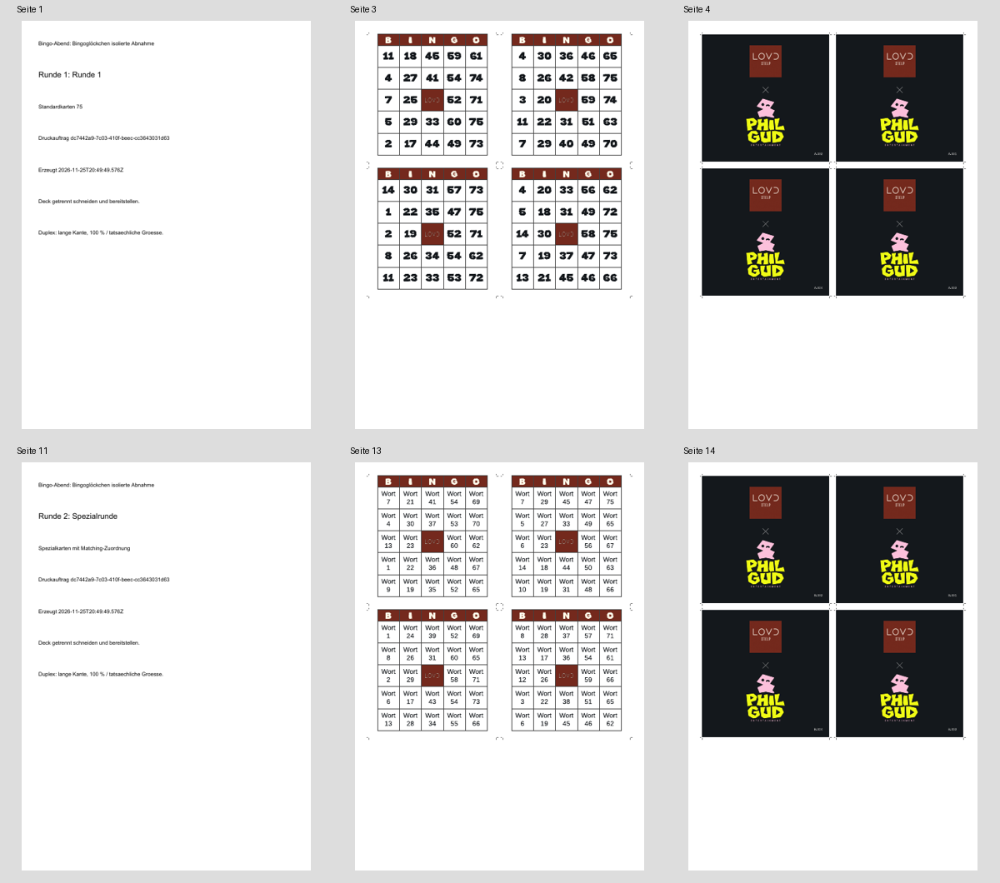

# Bingoglöckchen – technischer Prüfbericht

Basis: `main` / `8f049b8182cf498079d7ad26aec3fc64dcf842d7`.
Branch: `codex/bingo-moderation-display`. Auftrag aus
`Codex-Auftrag_Bingogloeckchen-Moderation-und-Anzeige.md`, ausdrücklich zur Umsetzung
bestätigt. Keine Production-Operation, kein Merge und keine Reparatur alter Karten.

## Stand und Architektur

Implementiert: obere zentrierte Buchstabe/Zahl-Anzeige, feste B/I/N/G/O-Zeilen,
strenge Eingabe, größere Moderationssteuerung, laufende aktive Uhren, automatische
persistierte Kartenprüfung mit vier Ergebnisstufen, gruppierte Wiederholungen und
separatem Kartennachweis, frühere Ziehungskorrektur, getrennte Bingo-Content-
Navigation und kopierte Rundenvorlagen, sicherer Rundenschutz sowie gemeinsamer
Abenddruck mit neuer/älterer Auftragshistorie und expliziter Bestandskartenprüfung.

Regeln, Speicherung, Rechte und Rendering bleiben getrennt. AP1 ermittelt Linien;
das V2-Journal speichert Prüfsnapshots und ausdrückliche Entscheidungen. UI liest
und steuert bestehende Dienste. Vorlage und Medien werden beim Einfügen unabhängig
kopiert. Der Druckauftrag referenziert genau seine neu erzeugten Serien und nutzt
die bisherigen Originalrenderer. Vollständiger Vertrag:
[Bingoglöckchen-Bedienung](../architecture/bingo-bell-operation.md).

Wesentliche Dateien:

| Bereich | Dateien |
| --- | --- |
| Anzeige/Eingabe | `app/bingo/live/BingoBoard.tsx`, `board.module.css`, `numberDisplay.ts` |
| Moderation | `EventModerationPanel.tsx`/CSS, `LiveTimes.tsx`, `DrawCorrection.tsx` |
| Prüfungen | `cardChecks.ts`, `CardChecksPanel.tsx`, `CardCheckView.tsx`, `eventRun.ts`, `eventRepository.server.ts`, Actions und `/pruefungen/[checkId]` |
| Content | `app/bingo/content/*`, vorhandener Matching-Editor/-Dienst, `WorkspaceNavigation.tsx` |
| Vorbereitung/Druck | `PreparationPanel.tsx`, Policy/Repository/Reader, `EveningPrintPanel.tsx`, `eveningPrint.server.ts`, Kartenroute und neue Abend-PDF-Route |
| Kartenprüfung | `cardAudit.server.ts`, `auditActions.ts` |
| Schema/Sicherung | Prisma-Schema/Client, additive Migration, enger Content-Zeilenvalidator |
| Regressionen | `cardChecks.test.ts`, `bellControls.browser.test.ts`, `bingo-bell.acceptance.ts`, bestehende Integrations-/Export-/Event-Browserprüfungen |

## Prüfergebnisse

| Prüfung | Tatsächlicher Nachweis |
| --- | --- |
| Prisma | Client erzeugt, Schema validiert |
| TypeScript | `npm run typecheck` bestanden |
| ESLint | Alle 39 damals neuen/geänderten Implementierungs- und Testdateien bestanden; zusätzliche gezielte Korrekturen werden erneut geprüft |
| Fachlogik | Grenzen 1/15/16/30/31/45/46/60/61/75, ungültige Schreibweisen, alle vier Ergebnisse, Snapshotgrenzen, Wiederholungen und ausdrückliche Entscheidung/Korrektur bestanden |
| Board | Bestehender echter Chromium-Test: 30 Fälle, beide Marken, 1280×600 / 1366×768 / 1920×1080, eigene Farben, Text, Skalierung, Vollbild, Fontladung und Polling bestanden |
| Karten/Druck-Bestand | `test:bingo-preparation`: 40 Tests bestanden, einschließlich SRA3, Originalfonts/-logos, Textkarten und historischen Exporten |
| Neue Browserregression | 1366×768 und 390×844 tatsächlich gemessen: 32 Karten, sieben Spalten, achte Karte in Zeile zwei, vier Reihen, weitere Ergebnisse erhalten, kein Seitenüberlauf, Wiederholung/Fokus, explizite Entscheidung und Uhr/Pause bestanden |
| PostgreSQL | Echter isolierter Gesamtlauf bestanden: additive leere/befüllte Migration, bestehende Rechte/CAS/Parallelfälle, Vorlagenkopien einschließlich Musikmedien, unabhängige Content-Bearbeitung, sichere Entfernung, atomarer Abendauftrag und Retry |
| Historische Daten | Alte Karten-IDs, Belegung, Kennungen und Layoutchecksummen vor/nach Erweiterung unverändert |
| Vollständige Wiederherstellung | Isolierter schemaweiter Dump/Restore einschließlich neuer Tabellen, Zeilen, Konfigurationen, Medienbytes und unveränderlicher alter/neuer Livehistorie verglichen; bestanden |
| Gesamte lokale Suite | Zwei `npm test`-Läufe durch vorhandene Windows-Chrome-Dateisperren beim Profilstart/-Cleanup unterbrochen (`EBUSY`/`EPERM` in GameDraftForm/GameTeamsPanel). Betroffener `test:game-drafts`-Wiederholungslauf: 13/13 bestanden. Kein fachlicher Fehler daraus abgeleitet; CI separat prüfen. |

Der letzte vollständige PostgreSQL-Lauf nutzt ausschließlich die neu erzeugte
lokale Datenbank `bingo_ap2_qa_1795636711573`; 1.716 gespeicherte Karten, **0 ungültig**.
Zusätzlich besteht die explizite nur lesende Prüfung der 54 Karten des
Browserabends. Dies ist **keine Prüfung produktiver Karten**. Der neue
Kartenbereich bietet den identischen read-only Prüfweg für vorhandene Bestände;
es gibt keine automatische Reparatur.

Die historische Integrationsbasis des Projekts bleibt unverändert: Modellbaseline
plus exakt geprüfte additive Migrationen, kein behaupteter lückenloser Replay
aller historischen Bootstrap-Migrationen. Vorhandene `pg`-Deprecation im
Integrationstest ist separat erkennbar und kein neu eingeführtes Verhalten.

## Tatsächlicher lokaler Bedienweg

Lokale isolierte Vorschau: [Bingo-Moderation](http://localhost:3067/bingo/8fa86526-ca02-47f5-aaf7-30cfa18c9931/moderation),
[Präsentation](http://localhost:3067/bingo/8fa86526-ca02-47f5-aaf7-30cfa18c9931/praesentation),
[Abendkarten und Druck](http://localhost:3067/bingo/8fa86526-ca02-47f5-aaf7-30cfa18c9931/karten),
[Content](http://localhost:3067/bingo/content).
Nur lokal erreichbar, eigenes synthetisches Konto; keine Zugangsdaten im Bericht.
Keine gehostete Vercel-Preview oder deren Abnahme behauptet.

Echter Appablauf bei gemessenen 1280×720: `1e1` verhindert Veröffentlichung,
`22` zeigt `I 22`; Veröffentlichung erreicht Moderation und separates Publikum.
Unbekannte Karte meldet den geforderten Fehler. `c-011` erkennt dieselbe Karte,
ergänzt Historie und setzt den Eingabefokus zurück. Kartennachweis öffnet einen
eigenen Tab mit vollständiger Karte und gespeicherten Zahlen. Korrektur von
Ziehung 1 bei zwei Ziehungen: Dublette 22 abgewiesen, 1→8 mit Begründung bewusst
gespeichert; aktuelle Zahl bleibt I 22. Pausenuhr bleibt ohne Klick unverändert.

Anschließend ausschließlich im entbehrlichen Browserabendsdatensatz vorbereitete
32 verschiedene Kartenprüfungen nach 23 Ziehungen: alle vier Stufen sichtbar,
fünfte Reihe erhalten. Wiederholung ergibt weiterhin 32 Kartenkacheln. Eine
Triple-Bingo-Bestätigung erfolgt erst nach Begründung, „Entscheidung prüfen“ und
Bestätigung; zuvor keine automatischen Gewinnrufe. Seitenbereich zeigt den
bestätigten Ruf. Der unabhängige Content-Matching-Editor öffnet seine gespeicherten
Musik-/Textzuordnungen. Abenddruck zeigt genau diesen Abend, neuesten Auftrag und
ältere Historie; „nur lesend prüfen“ ergibt 54/54 gültige Karten.

Die IAB-Viewport-Überschreibung blieb tatsächlich bei 1280×720. Daher werden
hierfür keine erfundenen 390-/1366-IAB-Nachweise angegeben: Diese Größen wurden im
zusätzlichen echten Chromium-Komponententest gemessen und separat aufgenommen.
Kein physischer Smartphone-, Bildschirmtastatur- oder Beamernachweis.

## Gemeinsame PDF

Ein Auftrag mit **13 Karten je Runde**, eine Standard- und eine Spezialrunde:
26 unterschiedliche Karten in einer Datei, 20 echte A4-Seiten. Je Runde ein
Trennblattpaar plus vier vollständige bzw. teilweise belegte Vorder-/Rückseiten-
Paare. Unabhängige Poppler-/PDF-Prüfung bestätigt 26 eindeutige Kennungen der
beiden ursprünglichen Decks A/B. Später erzeugte Decks C/D sind ausgeschlossen.
Vorder-/Rückseiten mit ursprünglichen Logos, Schrift und passender Textzuordnung
wurden gerendert und visuell kontrolliert. Eine zweite Erzeugung mit 14 je Runde
fügt einen separaten Auftrag hinzu und lässt die erste Datei exportierbar.

## Migration und offene Grenzen

Migration `20261125120000_bingo_round_content`: drei additive Tabellen, restriktive
Referenzen; keine Bestandsdatenänderung, neue ausführbare Funktion oder geänderte
historische Migration. Keine Anwendung auf Production. Alte Reader verstehen
neue Prüfbefehle nicht; ein Rückweg benötigt kompatiblen Readercode, keine
Löschung von Historie.

- Fachliche Nutzerabnahme und ein späterer Production-Auftrag stehen aus.
- Vollständige CI am PR muss den lokalen Windows-Profilsperrfehler unabhängig
  einordnen; keine pauschale Aussage „alles grün“ ohne tatsächliche Checks.
- Medien-Content verwendet ausdrücklich den bestehenden berechtigten
  Quellen-/Medienkontext einer Reihe; dessen gespeicherte Assets bleiben erhalten.
  Beim Einfügen werden eigene Zielabend-Referenzen/Bytes hergestellt.
- Alte Kurzkennungen sind nur innerhalb eines Abends eindeutig. Bei gleichlautender
  Kurzkennung eines alten Abends ist die global eindeutige vollständige Kennung
  erforderlich; keine nachträgliche Umnummerierung.
- Sammelerzeugung erfordert NEW je Runde und einen nicht laufenden Abend.
  Alte Serien bleiben zusätzlich zugeordnet, bis jemand sie bewusst entfernt.
- Gemeinsame PDF maximal 20 MB; darüber klare Fehlermeldung und bestehende
  Einzelserienexporte. Physischer Duplex-/Schnitttest bleibt gesondert nötig.

Kein Production-Backup, Production-Deployment, Eingriff in Quizdaten oder echte
Bewertungen im Rahmen dieser Umsetzung.

## CI-Korrektur am ersten PR-Stand

Der erste Push `17789617` machte zwei notwendige Fixture-Erweiterungen sichtbar:
Die historische **vor Bingo** liegende Restore-Probe muss auch die drei neuen
Modelle ausdrücklich ausschließen; ihre bestehende Vollständigkeitsassertion
bleibt erhalten. Aktuelle Game-Draft-/Team-/Shared-Design-Integration benötigt die
neue additive Migration, bevor aktueller Anwendungscode seine Content-Referenzen
prüft. Die alten Migrations-/Rechte-/Snapshotassertionen bleiben unverändert.
Zusätzlich werden vollständige Textzuordnungen ausschließlich beim Öffnen eines
Kartennachweises geladen, nicht pro geprüfter Karte in regelmäßigen Statusabrufen.

Der zusätzliche lokale Posttest-Lauf traf im vorhandenen Content-Suchbrowsertest
auf eine zeitabhängig fehlende Schaltfläche; der unveränderte Test besteht separat.
Diese lokalen Wiederholungen ersetzen keine erfolgreiche CI am endgültigen Commit.

Die drei aktuellen Game-/Team-/Shared-Design-Fixtures bestehen nach Aufnahme der
Migration auch lokal (4/4). Der lokale PostgreSQL-18-Katalog führt NOT NULL als
eigene Constraintzeilen; die ursprünglichen PK/FK/CHECK-Anzahlen werden getrennt
von der unveränderten Spalten-/Nullabilityinventur geprüft. Beim Löschschutz ist
zusätzlich der PostgreSQL-18-RESTRICT-Code zugelassen, gebunden an exakt dieselbe
`fk_quiz_teams_teams`-Constraint. Rechte und Datenerhalt bleiben geprüft.

Auch die direkte Auswahl Standard/Content im Editor einer bereits angelegten,
noch unbenutzten Runde ist ergänzt. Übernahme kopiert den Inhalt ausdrücklich;
bestehende Karten oder Ausgabehistorie sperren diesen Austausch. Der dazugehörige
PostgreSQL-Test prüft Übernahme, spätere Entfernung einer unbenutzten Runde und
Abweisung an einer Runde mit Karten.
