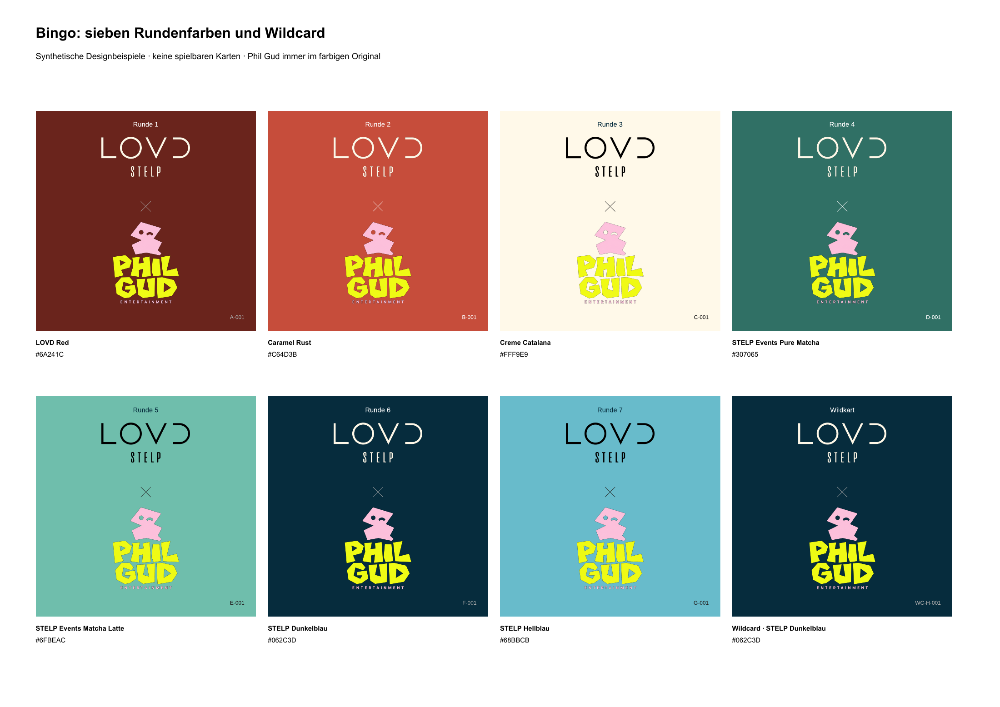
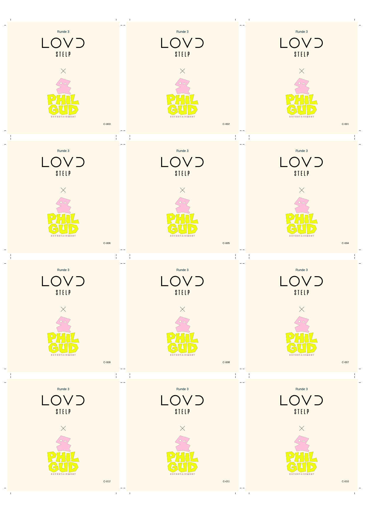
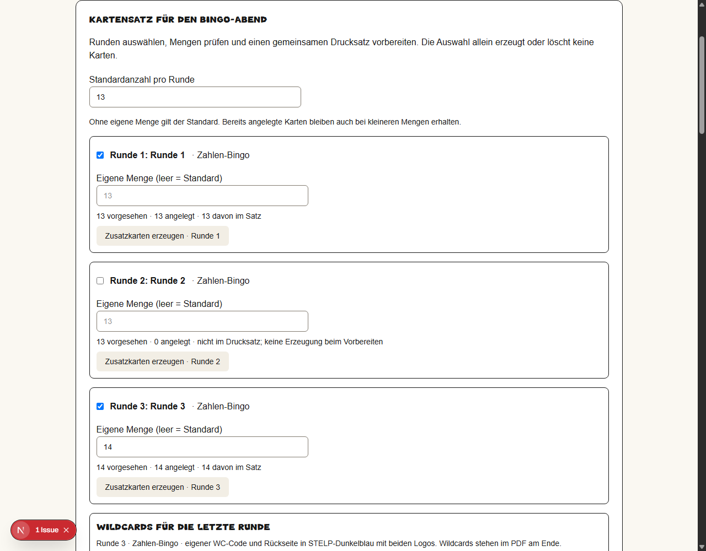
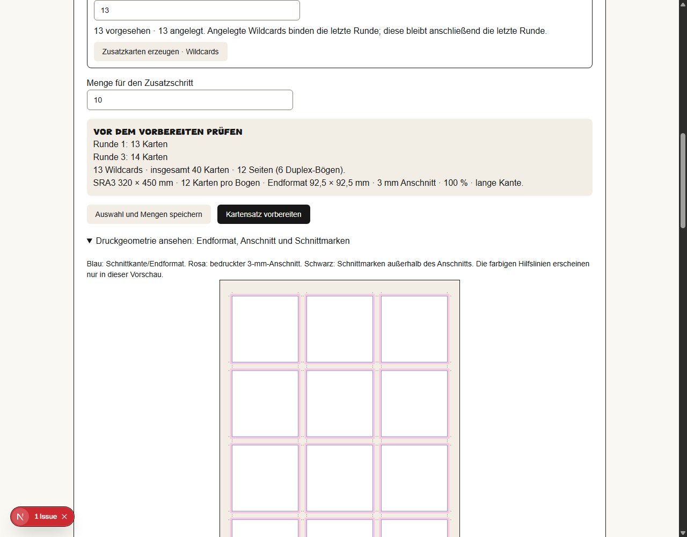
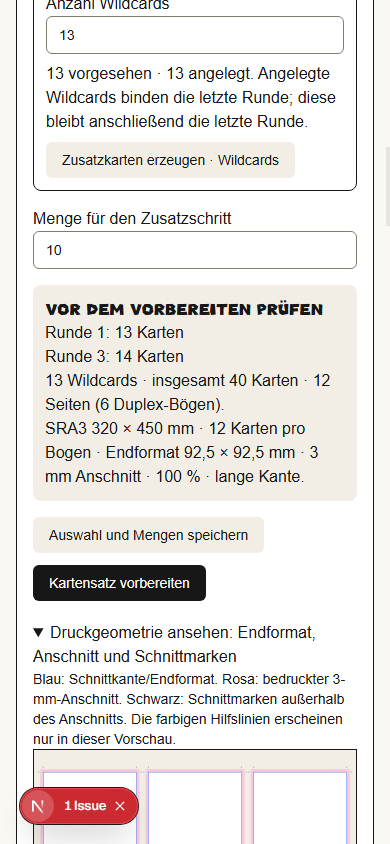
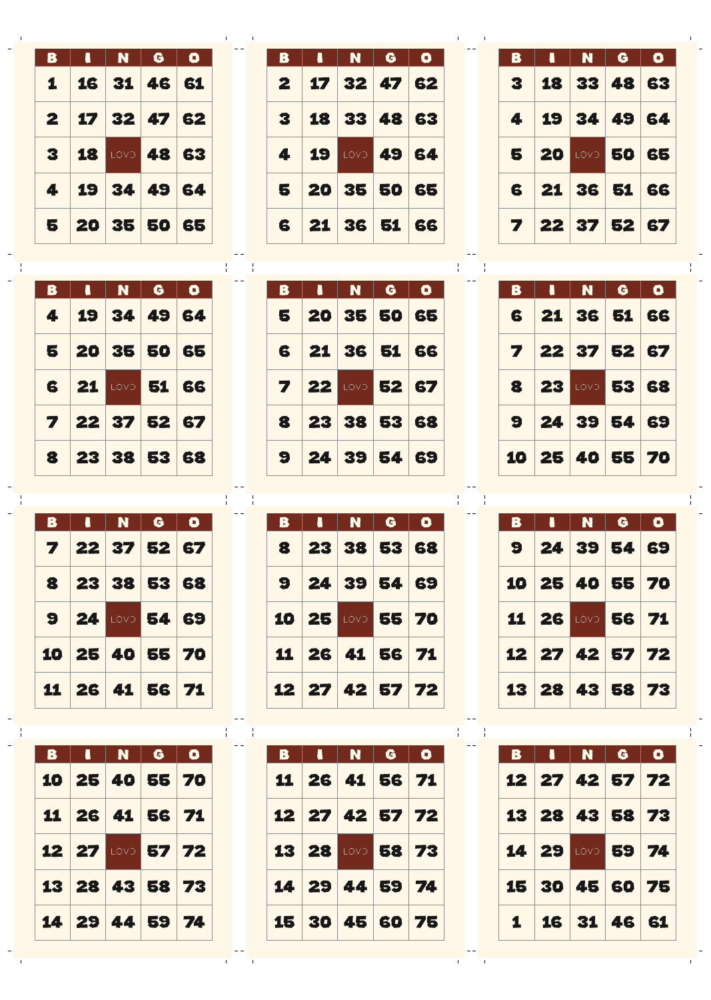
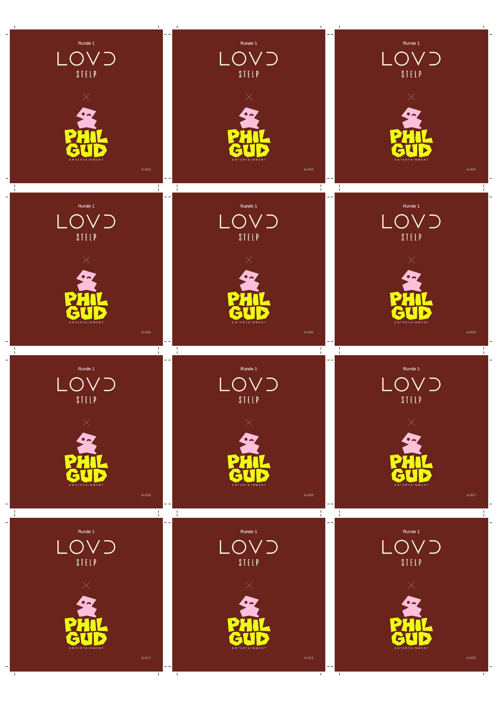
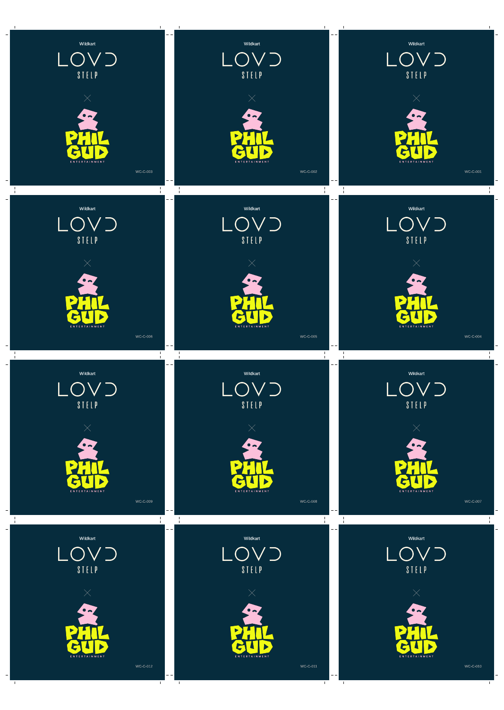
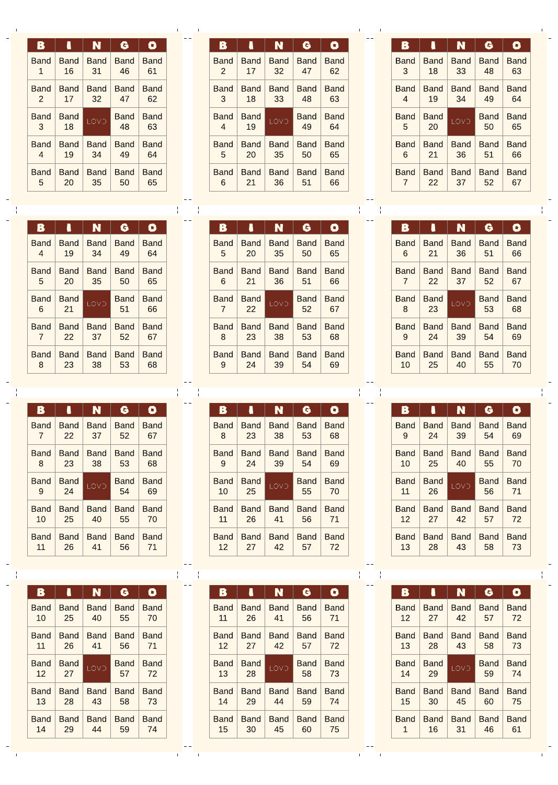

# Technische Abnahme: Bingo-Abendkartensatz und SRA3-Druck

28.11.2026. Grundlage: `main`/PR #197, Commit
`8dd64266678841c0702d476ae8270f5450dc551a`. Separater Feature-Branch
`codex/bingo-evening-card-set`. Keine Änderung produktiver Daten, kein Merge,
kein Production-Backup oder Production-Deployment im Rahmen dieser Umsetzung.
Die frühere reine Druckanalyse bleibt von diesem Umsetzungsbericht getrennt.

## Ergebnis und Bedienung

Ein zentraler **Kartensatz für den Bingo-Abend** ergänzt den vorhandenen
Kartenbereich. Standardmenge bei Neuanlage, eigene Rundenmengen, Druckauswahl und
Wildcards werden gespeichert. Vorbereiten verwendet vorhandene Karten; fehlende
Erstmengen werden bewusst erzeugt. Für einen schon vorhandenen, aber zu kleinen
Bestand ist ausdrücklich **Zusatzkarten erzeugen** erforderlich. Alte Serien,
Codes, Druckversionen und Laufmitgliedschaften werden nicht überschrieben.

Wildcards verwenden das Mapping der tatsächlichen letzten Runde, haben eigene
`WC-…`-Kennungen und eine Rückseite in STELP-Dunkelblau aus der Sieben-Farben-Palette. Die
letzte Runde bleibt nach ihrer Erzeugung die letzte Runde. Die PDF enthält nur
ausgewählte Runden und abschließend einen eigenen Wildcard-Abschnitt.

Verbindliche Details: [Living Specification](../architecture/bingo-evening-card-set.md).

## Durchgeführte Prüfungen

Projektprüfungen: Typecheck, ESLint der geänderten Dateien und lokaler Build
bestanden. `npm test` bestand die Vor- und Haupttests, erreichte in den Nachtests
jedoch Windows-Profilsperren beim Aufräumen vorhandener Chrome-Browsertests.
Die neue technische Datenbank-/PDF-/HTTP-Abnahme ist unabhängig davon bestanden.
Die vollständigen Linux-CI-Prüfungen des exakten PR-Heads sind im PR nachzuverfolgen.

| Prüfung | Nachweis / Ergebnis |
| --- | --- |
| Mengen/Geometrie | Standard 100, Überschreibung 120, unabhängige Auswahl/Wildcards; ungültige Mengen, doppelte Runden und Zusatzfelder abgewiesen |
| Neuanlage | Tatsächliche atomare Eventanlage mit drei Runden und Standard 13; noch keine Karten |
| Speichern/Reload | Auswahl, globale Menge, Überschreibung und Wildcardmenge bleiben erhalten; Speichern erzeugt keine Karten |
| Beispiel-Sammelsatz | Runde 1: 13, Runde 2 abgewählt, Runde 3: 14, Wildcards: 13 → 40 Karten, 12 SRA3-Seiten |
| Themen-Wildcards | Alle 75 eingefrorenen Begriffe der letzten Runde übernommen, deren Textkarten gerendert |
| Codeauflösung | Normaler Code bleibt normal, ausdrücklich auch der mögliche Serienpräfix `WC` (`WC-001`); `WC-C-001` löst die richtige Karte auf; `C-001` löst diese Wildcard nicht auf |
| Erneutes Vorbereiten/Download | Keine zusätzliche Karte; Manifest hält dieselben IDs und Druckstände |
| Zusatzschritt | Explizit zwei normale Karten; Retry erzeugt keine doppelten Karten; weitere 507 Wildcards atomar in zwei Teilserien |
| Historie | Bestehende IDs, Zellen, Codes und Layoutprüfsummen vor/nachher identisch; alte Druckmanifeste nach Zusatzschritt identisch |
| Laufgrenzen | Erste Runde enthält keine Wildcard-Decks; neuer Bestand im laufenden Abend gesperrt; fremde Rundenzuordnung in DB abgewiesen |
| Autorisierung | Unberechtigte Nutzer abgewiesen; eigene Autorisierung auch bei Wiederholungen und Downloads |
| PDF-Grenzen | Alle zwölf Seiten 320 × 450 mm; zwölf 92,5-mm-Endformate je vollem Bogen; kein gemischtes Trennformat |
| V3/V4 | Neue Ausschießung mit beiden tatsächlichen Vektorrenderern geprüft; keine Skalierung, kein DB-Zugriff im Ausschießen, gefrorene Eingaben unverändert |
| Anschnitt | 3 mm rundum, 96 tatsächliche Farbmesspunkte in normalen/Wildcard-Rückseiten gerendert und geprüft |
| Marken/Abstände | Marken 4–5,5 mm außerhalb der Schnittkante, außerhalb des 3-mm-Anschnitts; 12-mm-Zwischenraum, 1-mm-Markenspitzenabstand |
| Duplex | Vollraster-Spiegelung, Reihen unverändert; PDF-Transformationen und Codezuordnung einschließlich Teilbogen geprüft |
| Read-only-Grenze | Beide PDF-Routen und Kartenübersicht importieren keine Karten-Erzeugung oder Quellasset-Ingestion |
| Migration | Exakte additive SQL-/Schemabytes; keine alten Zeilen verändert, neue Tabellen leer; FK-/Unveränderlichkeits-/Letztrunden-Constraints und Transaktionsrückweg geprüft |
| Backup-Kompatibilität | Vollständiger isolierter Dump/Restore einschließlich neuer Tabellen, Manifest-Assets und strikter Routine-/Triggerprüfung bestanden |
| Browser | Echter lokaler Next.js-Login, Neuanlage, Mengen/Abwahl, Speichern/Reload, Vorbereiten und zwei authentifizierte PDF-GETs bestanden |
| Mobil | 390 × 844 ohne horizontalen Überlauf; Desktop 1280 px zusätzlich geprüft |

Automatisierte PostgreSQL-Abnahme: `bingo-preparation.integration.test.ts` mit
`bingo-card-set.acceptance.ts`; exakter Rückwegtest:
`bingo-card-set.integration.test.ts`. Ausschließlich neu erzeugte lokale
Wegwerfdatenbanken. Die bestehende gesamte Bingo-/Matching-/Lauf-/Restore-Abnahme
wurde mit ausgeführt. Der neue Release-Plan liegt im Feature-PR, ohne zusätzlichen
Operations-PR und ohne Änderung an Environment-/Owner-Freigaben.

Lokaler Browserlauf: [Prüfprotokoll](assets/bingo-card-set/http-results.json).
PDF-Messung: [Werte und Grenzen](assets/bingo-card-set/pdf-measurements.json).
Das vollständige [synthetische Beispiel-PDF](assets/bingo-card-set/beispiel-sra3.pdf)
enthält die hier gerenderten Karten und kann bei 100 % geprüft werden.

## Ergänzung: sieben Farben und beide Logos

Vom Nutzer am 28.11.2026 korrigiert: keine achte/violette Wildcard-Farbe,
LOVD und Phil Gud auf jeder Rückseite, Phil Gud immer im farbigen Original,
alle sieben Kartenflächen durchgehend eingefärbt. Die zusätzliche Wildcard-
Beschriftung entfällt; oben steht stattdessen „Wildkart“ anstelle der Rundennummer; der WC-Code bleibt.

[Übersicht aller sieben Farben plus Wildcard](assets/bingo-card-set/farben-und-logos-uebersicht.pdf)
· [SRA3-Duplex-Beispiele](assets/bingo-card-set/sieben-farben-sra3.pdf)
· [Quellfarben und Bildbyte-Nachweis](assets/bingo-card-set/farben-und-logos-nachweis.json).
Zusätzlich geprüft: 960 gerenderte Farbpunkte über alle sieben Farben und
die Wildcard, durchgehende Flächen bis in den Anschnitt, null weiße Pixel in
den beigen Karteninnenflächen und die Kopfzeile „Wildkart“ statt „Runde 7“, ohne Zusatztexte in der Kartenmitte.
Die beiden Logo-Zeichenoperationen werden für V3 und V4 geprüft; die Phil-Gud-
Bildbytes bleiben bei jeder Farbe identisch zum farbigen Original.

Die weißen Stege auf dem Druckbogen liegen außerhalb der fertig geschnittenen
Karten und ihres 3-mm-Anschnitts. Auf den Karten selbst gibt es keine weißen
Logo-Unterleger oder Aussparungen. Der Farb-/Logo-Nachweis und die neuen Beispiele
sind rein synthetisch; bestehende Karten, Abende und Snapshots wurden nicht verändert.

## Tatsächliche Screenshots und PDF-Renderings

## Offene fachliche Abnahme und Grenzen

Die technische lokale Prüfung ersetzt keine ausdrückliche fachliche Freigabe.
Eine neue gehostete Preview ist hier nicht freigeschaltet oder bereitgestellt;
die geprüfte Vorschau lief lokal mit synthetischen Daten. Das Beispiel-PDF liegt
lokal unter `output/pdf/bingo-abendkartensatz-sra3.pdf`.

Beim parallelen Windows-Gesamtlauf schlugen bestehende Matching-Suchdialog- und
Matching-Medien-Browsertests
beim **Aufräumen ihrer Chrome-Temp-Profile** mit `EPERM` fehl, nicht bei einer
fachlichen Assertion. Der unveränderte Suchdialogtest bestand separat. Die Drucksuite bestand
zusätzlich ohne parallele Testdateien (47 Tests); die Assertions und CI-Schutzregeln
werden dafür nicht verändert. Dieser Betriebssystembefund ist vom neuen
Kartensatz getrennt; eine sachfremde Änderung am Matching-Dialog erfolgt nicht.

Ein physischer Duplex-Test bei **100 % / tatsächliche Größe, lange Kante** auf dem
vorgesehenen Drucker steht aus. Softwareseitige Maße/Spiegelung/Anschnitt sind
nachgewiesen, die mechanische Druckerregistrierung nicht. Kein Versprechen über
Blitzer bei beliebigen Geräteabweichungen.

PDF-Seiten können nicht zwölf verschiedene TrimBox-/BleedBox-Paare besitzen.
Die Seitenboxen beschreiben SRA3; eindeutige Einzelkarten-Koordinaten sind im PDF
als `ausschiessung.json` eingebettet und durch externe Schnittmarken gekennzeichnet.
Die farbigen Geometrie-Hilfslinien erscheinen nur in der Oberfläche, nicht im Druck.

Der bestehende Exportschutz von 20 MB bleibt erhalten. Bei Überschreitung gibt es
eine verständliche Fehlermeldung und keine Teil-PDF; gespeicherte Karten bleiben
erhalten. Sehr große Sätze können daher kleinere gewünschte Druckmengen erfordern.
Bereits angelegte Wildcards dürfen nicht auf eine nachträglich neue letzte Runde
umgedeutet werden; diese Umordnung ist bewusst gesperrt.
