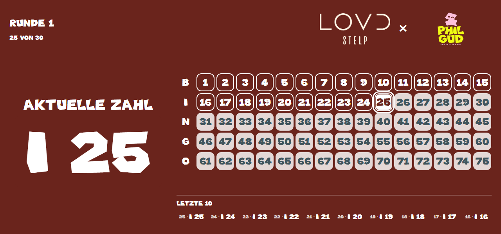
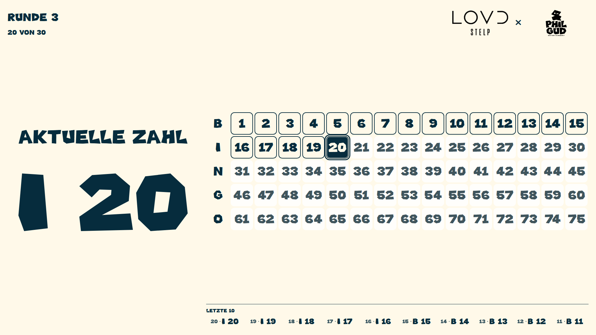
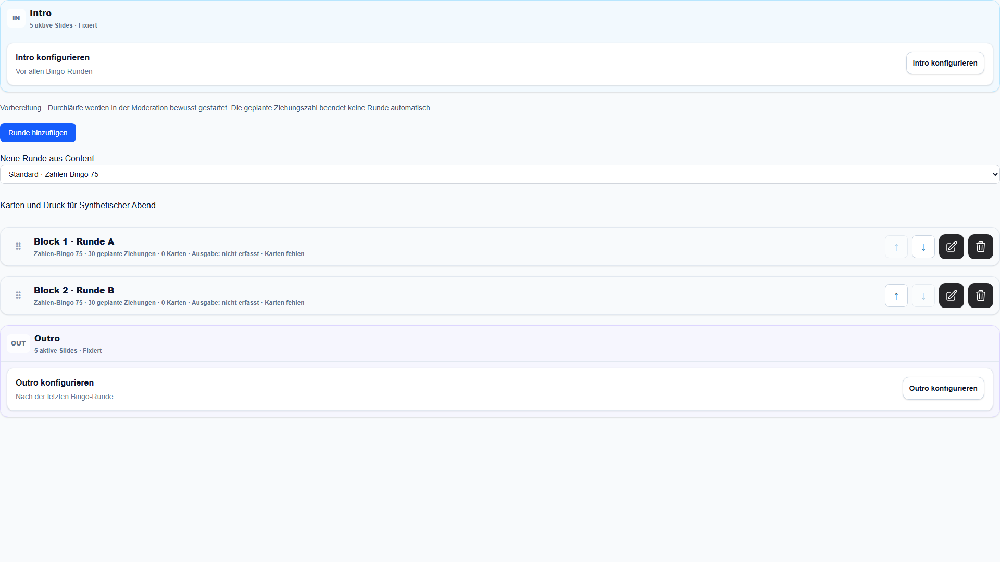
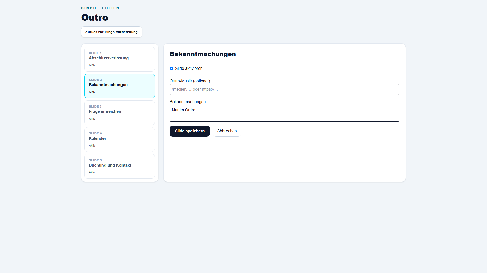
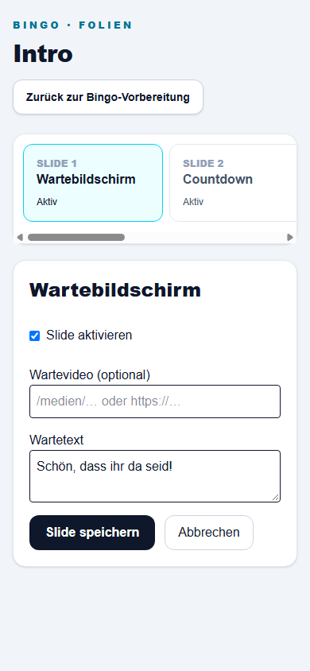
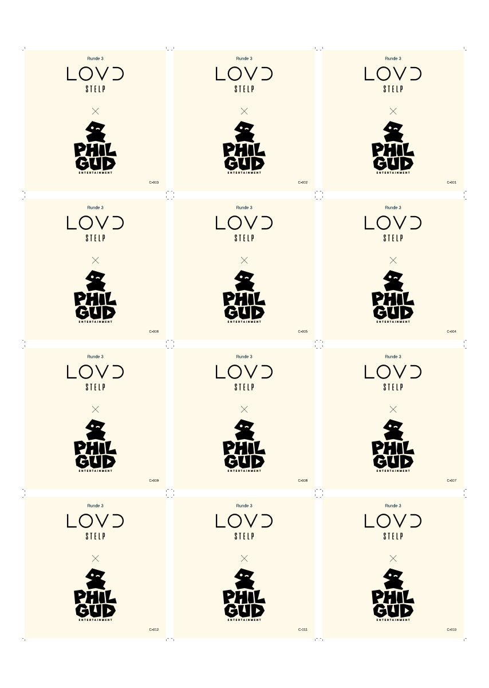

# Bingo: Farben, Präsentation und Intro-/Outro-Pflege

Stand: 27.11.2026. Umsetzung des Auftrags „Bingo-Präsentation, Rundenfarben und
Intro-/Outro-Verwaltung“ auf `codex/bingo-presentation-colors`, Basis main
`31cdad91f284a851b26f869e33b543fa76398323`. Kein Merge oder Production-Release.

## Fachliche Umsetzung

| Anforderung | Nachweis |
| --- | --- |
| Aktuelle Zahl links, vollständiges Zahlenfeld rechts | Echte DOM-Geometrie bei 1280×600, 1280×720, 1366×768 und 1920×1080; Zahl bleibt einzeilig |
| Letzte zehn Ziehungen einzeilig unter dem Raster | Positionen, Reihenfolge, Null-/Kurz-/Zehnerhistorie und fehlender Überlauf geprüft |
| Sieben exakte Standardfarben | HEX-Werte und mindestens 4,5:1 Schriftkontrast getestet; alle sieben Bühnen gerendert |
| Runde 8–10 | Wiederholung ab Farbe 1 ausdrücklich vom Nutzer bestätigt; bestehendes Rundenlimit bleibt zehn |
| Individuelle Rundenfarbe | Echte Speicherung, Reset auf Standard, HEX-Validierung und gestartete Runde gesperrt |
| Präsentation und neue Rückseiten | Wirksame Farbe im Lauf und Druckstand eingefroren; helle Farben mit dunkler Schrift/Logo-Silhouette |
| Kartenfront unverändert | Farben, Logo-Hash und Originalschriftbytes im neuen Capture gegen vorherigen Capture verglichen; historische Kartendaten unverändert |
| Kompaktes Intro vor / Outro nach Runden | Struktur und feste Positionen im Browser geprüft; eigene Konfigurationslinks |
| Konfiguration wie Quiz | Vorhandene Quiz-Block-/Editorstruktur als Referenz; Seitennavigation, Aktivierung, zentrale Felder, Speichern/Abbrechen |
| Erfolgreicher Save kehrt zurück | Browserprüfung und unabhängige Intro-/Outro-Konfiguration; Abbrechen mit Verwerfen/Beibehalten geprüft |
| Rundenblock mit Griff und Pfeilen | Header-/Blockstruktur, echte Tastatursortierung, vorhandene CAS-/Rechte-/Sperrprüfungen |
| Quiz/Karaoke unverändert | Keine Änderung an deren Oberflächen oder Actions; neue Layoutkomponenten besitzen nur Darstellungsslots |

## Technische Prüfungen

- Vollständiger vorhandener PostgreSQL-Bingo-Harness auf eigener lokaler
  synthetischer Datenbank: bestanden, einschließlich Integrität alter Karten,
  Journal, Rollen/CAS, mehrerer Runden, Druckversionen und Dump/Restore.
- Separater Farbmigrationstest auf vollständiger unabhängiger Baseline:
  bestanden; nur erwartete Schemaänderung, alte Zeilenprojektion unverändert,
  nullable Feld, HEX-Check und transaktionaler Rückweg bestätigt.
- Komplette Bingo-Suite lokal sequenziell: 61/61 bestanden. Ein erster paralleler
  Lauf traf den vorhandenen Windows-Chrome-Profilsperrfehler beim Cleanup des
  unveränderten Matchingtests; isoliert/sequenziell bestand er. Keine fachliche
  Assertion wurde dafür gelockert.
- Board-Regression: 30 Fälle beider Marken bei drei Größen bestanden, zusätzlich
  Zustände, verzögertes Schriftladen, Polling, Resize und schmale Ersatzansicht.
- Neuer Editor-/Farben-Browserharness: Desktop/Mobil, sieben Farben, zehn Runden,
  einzeilige Historie, Konfigurationssave/-abbruch und Tastatur-DnD bestanden.
- V3-PDF-Regressionslauf: bestanden, einschließlich unveränderter Frontdaten und
  Abweisung unlesbarer neuer Rundentitel. SRA3-Rückseiten mit Poppler tatsächlich
  gerendert. Dabei gefundener weißer Rundentitel auf Creme wurde für neue
  Druckstände durch eingefrorene kontrastreiche `roundInk` korrigiert.
- Enge Release-Plan- und Preview-Guards: manipulierte/zusätzliche Migration,
  Schema-/SQL-/Manifestabweichung, falscher Branch, falsche DB und Production
  werden abgewiesen. Bekannte historische Workflows bleiben unverändert geschützt.
- Typecheck und ESLint für geänderte Dateien werden vor Push ausgeführt;
  vollständiger Next.js-Build außerhalb der lokalen Sandbox erfolgreich.
  Der Sandbox-Build blieb beim lokalen Buildprozess stehen und wurde beendet;
  keine Production-Aktion oder Testlockerung daraus abgeleitet.

Die autorisierte gemeinsame Preview verwendet ausschließlich den exakten neuen
Branch und die vorhandene synthetische `bingo_evening_review`. Der separate
Preview-Migrationsentrypoint verifiziert Plan/Bytes, DB-Identität und vollständige
Historie; zulässig ist ausschließlich die eine Farbspalte oder ein bereits
vollständig angewendeter Stand. Kein generischer Production-Migrationseinstieg.
Die vorhandene Preview-Provenienzprüfung inklusive tatsächlichem CI-Checkout,
exakter Allowlist und zentraler Medienisolation bleibt aktiv. Der vorhandene
Automation-Bypass darf nur als Header zur Abnahme verwendet werden.

**Aktuelle CI-Läufe, exakter Preview-Commit, Preview-Link und Ergebnis der echten
gehosteten HTTP-/Server-Action-Abnahme werden im zugehörigen PR dokumentiert.**
Der Hosted-Harness erstellt ausschließlich eigene beschriftete synthetische
Bingo-Fixtures, prüft Save/Rückkehr, Farbe, neue Karten und Lauf-/Publikumsansicht
und beendet seinen eigenen Testlauf. Er führt keine Production-Aufrufe aus.

## Sichtprüfung

## Grenzen und Rückweg

Die im Auftrag genannten Quiz-Screenshots wurden nicht als zusätzliche Bilder
mitgeliefert. Als Referenz dient deshalb die tatsächliche bestehende
`QuizFragenSortableTable`-/`FixedSlideEditor`-Implementierung; kein behaupteter
pixelgenauer Abgleich mit nicht vorliegenden Bildern.

Kein physischer Druck-, Duplex-, Beamer- oder Akustiktest. Kleine Bühnen behalten
bewusst den Hinweis statt unlesbarer Raster. Historische PDFs werden nicht
umgefärbt; eine bereits vorhandene Serie und eine später geänderte Rundenfarbe
können deshalb bewusst unterschiedliche Farben haben. Neue Druckstände müssen
über die vorhandenen ausdrücklichen Aktionen erzeugt werden.

Historischer Neuinstallations-Replay bleibt NOT_RUN. Nach Schreiben neuer
Lauf-/Drucksnapshots mit `color`/`roundInk` ist ein blindes Code-Rollback auf
Parser ohne diese Felder nicht zulässig. Keine Datenrückschreibung oder Löschung
als Rückweg. Kein Production-Backup, Deployment oder Merge in diesem Auftrag.

### Besonderheit der isolierten synthetischen Preview

Die vorhandene Datenbank `bingo_evening_review` wurde als Schema ohne
Prisma-Historie importiert. Das wurde lesend bestätigt; die Farbfeld-Migration
war beim Befund noch nicht angewandt. Der exakte Preview-Helper erwartet deshalb
ausdrücklich keine Migrationstabelle und prüft die festgehaltene vollständige
Struktur von `bingo_rounds` (Spalten, Constraints, Indizes). Nach exakter
Commit-/Planprüfung führt er ausschließlich die freigegebenen SQL-Bytes der
Farbfeld-Migration transaktional aus, prüft die erwartete additive Struktur und
denselben Hash aller bisherigen Rundenfelder und rollt bei Abweichung zurück.
Ein bereits korrekt erweitertes Schema ist idempotent. Keine erfundene Baseline,
kein historischer Replay, kein allgemeines `migrate deploy` auf dieser Preview.
Production verwendet weiterhin die vollständige Historien- und Schemaprüfung.
