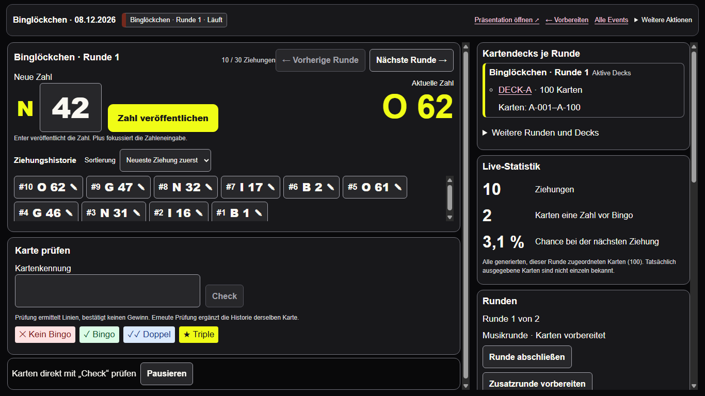
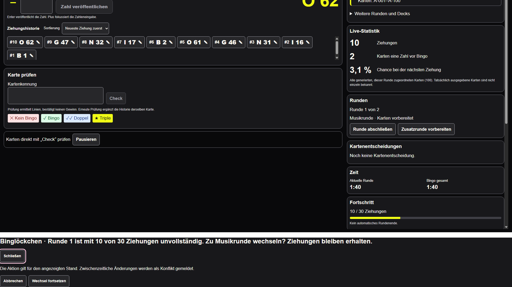
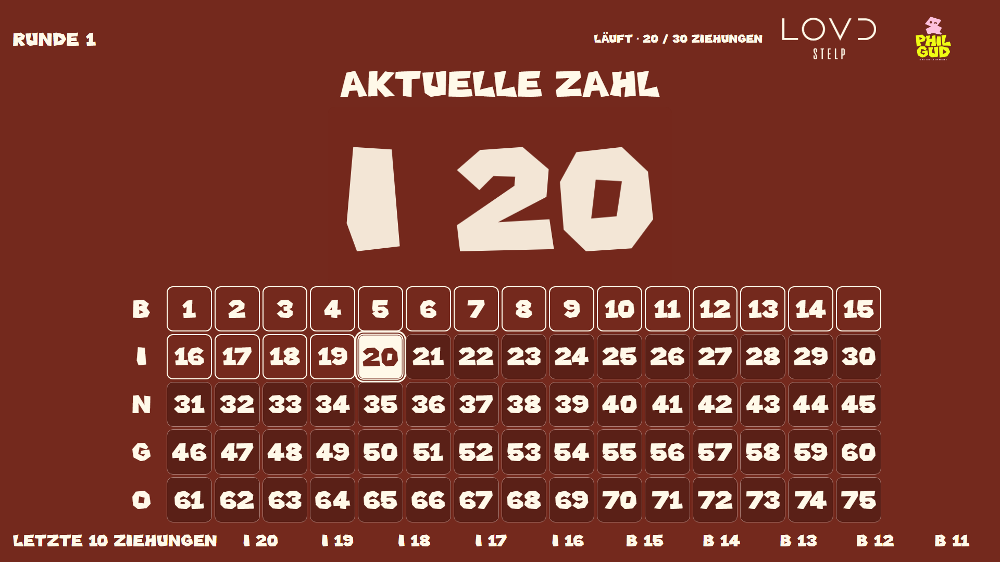

# Bingo-Intro, Rundensteuerung und Präsentation – technische Abnahme

Datum: 27.11.2026. Branch `codex/bingo-intro-round-navigation`, Ausgangsbasis
`2ca40b827853d4da5e816702a621015f0cf69921`.
Eigenständiger Umsetzungsauftrag; kein Teil eines früheren Production-Releases.

## Ergebnis

| Anforderung | Umsetzung und Nachweis |
| --- | --- |
| Kompaktes Intro oben, einzelne Slides | `PreparationPanel` zeigt den geschlossenen Intro-Konfigurator zuerst. `CeremonyEditor` wählt einzelne Slides und ihre Felder; Browser prüft geschlossene Ausgangsansicht und Einzelbearbeitung. |
| Unabhängige Einfügung nach jeder Runde | Vollständige JSON-Konfiguration pro stabiler Runden-ID; unabhängige Intro-/Rundentexte in Unit-, Browser- und echter PostgreSQL-Prüfung. Nach Rundenabschluss erscheint die konfigurierte Einfügung öffentlich. |
| Reihenfolge und Entfernen | Bestehendes dnd-kit mit Pointer- und Tastaturbedienung. Browser führt Tastatur-Drag-&-Drop aus; PostgreSQL prüft gespeicherte Reihenfolge und ungültige ID-Mengen. Bestätigtes Entfernen samt Schutz für Karten und Historie bleibt erhalten. |
| Größere Eingaben | Ziehungsfeld mindestens 76 px hoch, Schrift bis 56 px; Kartenkennung mindestens 64 px hoch, Schrift 28 px. Hauptaktionen bei 1280×720, 1366×768, 1920×1080 erreichbar. |
| Plus und Enter | Echtes Browser-Enter veröffentlicht genau einmal, leert und fokussiert die Eingabe. Plus/NumpadAdd wechselt aus der Kartenkennung zum Zahlenfeld. Nach Unmount greift der Shortcut nicht mehr. Textbutton bleibt sichtbar. V2-APPROVAL verwendet denselben ausdrücklichen Submit ohne zusätzlichen Dialog; AP3 bleibt unverändert. |
| Runden vor/zurück | Gespeicherter Plan, Warnung mit Ist/Soll und Ziel bei unvollständiger Runde, Abbrechen ohne Wechsel, ausdrückliches Fortsetzen. Browser prüft beide Wege. Unit-Test erhält Ziehungen beim Rückwechsel und sperrt geschlossene Runden weiter. PostgreSQL prüft Journal-Readback und Publikumsrundennummer. |
| Decks und echte Kennungen | Mehrere eingefrorene Decks bleiben vollständig sichtbar. Präfix und tatsächliche Ordinalgrenzen liefern Kurzcodebereiche. Browser wechselt von A-001–A-100 zu B-001–B-080; diese Werte stammen ausdrücklich aus der synthetischen Fixture, nicht aus Production. |
| Logo-Bereich / aktuelle Zahl | Unveränderte Originalassets ohne schwarze Plakette; größere Zahl und darüber passend bemessene Überschrift. Alle zehn Full-HD-Runden sowie Laptopgrößen gemessen. |
| Farben | Eine Familie aus Rundenfarbe und dunklerer Nuance statt pauschaler schwarzer Zellen; aktuelle Zahl weiterhin invertiert und mehrfach konturiert. Alle zehn Farbfamilien geprüft. |
| Letzte zehn Ziehungen | Beschriftete scrollfreie Fußzeile, neueste zuerst. Browser prüft 0/3/10/25 Ziehungen und maximal zehn Einträge. Allgemeiner Moderatorprüfhinweis entfernt. |
| Datenerhalt | Nur eigene lokale synthetische Fixtures verwendet. Vollständige bestehende Karten-, Journal-, Rechte-, CAS-, Matching-, Druck- und Wiederherstellungsregressionen erfolgreich. Keine Änderung eines bestehenden produktiven Events, seiner Karten, Ziehungen oder Bewertungen. |

## Ausgeführte Prüfungen

- Bingo-Regressionssuite seriell: **57/57 bestanden**, einschließlich realer
  Headless-Browser für Board, Medien, Kartenprüfung und Moderation.
- Zusätzlicher abschließender Verwaltungs-/Moderationsbrowser: **bestanden**,
  einschließlich unabhängiger Folienkonfiguration und Sortierung.
- Vollständiger PostgreSQL-Gesamtharness: **bestanden** (rund 93 Sekunden), eigener
  frischer Cluster ausschließlich auf `127.0.0.1:55474`, eigene wegwerfbare
  `bingo_ap2_qa_*`-Datenbank. Einschließlich neuer Sortier-/Navigationsnachweise,
  sechs × 100 Karten, zehn Rundenfarben und unveränderlicher historischer Daten.
  Vorhandene Dump-/Restore-Regressionen betreffen nur diese Testdaten; kein
  produktives Backup wurde erstellt oder angefordert. Testserver danach gestoppt.
- Quiz-Lifecycle, NavigationTransition, PresentationWindowSync und gemeinsamer
  Preisrenderer: **29/29 bestanden**.
- `npx tsc --noEmit --pretty false`: **bestanden**.
- ESLint für geänderte TypeScript-Dateien mit `--max-warnings 0`: **bestanden**.
- `npm run build`: **bestanden**, Next.js-Kompilation, TypeScript und statische
  Seitengenerierung erfolgreich.

Während der Entwicklung gefundene Probleme wurden behoben: ältere
Schema-Zwischenstände ohne Ceremony-/Live-Tabelle, Schriftüberlauf bei leerem
Board und zu tiefe Hauptaktionen nach Vergrößerung der Eingabeflächen. Der finale
Prüfstand enthält diese Korrekturen. Die lokale Integration meldet weiterhin eine
vorhandene `pg`-Deprecation zu parallelen Client-Queries; keine fehlgeschlagene
Prüfung und keine Änderung produktiver Verbindungsparameter.

## Sichtnachweise

Alle Bilder verwenden synthetische Daten. Moderation und Board verwenden die
produktiven Komponenten, CSS-Module, Fonts und Logos.

Weitere Nachweise im gleichnamigen Assetverzeichnis: 1280/1920 px Moderation,
390 px Mobilansicht, Rückkehr zum großen Board, alle zehn Full-HD-Farben,
Musik-Bingo, Preise, Abschlussverlosung und synthetisch sortierte Verwaltung.
Der Verwaltungs-Harness bündelt keine vollständige Next-/Tailwind-Seite; sein
Screenshot belegt Struktur und Reihenfolge, keine vollständige Verwaltungs-CSS-Abnahme.

## Grenzen und Freigabestand

- Technische lokale Abnahme durchgeführt; **fachliche Abnahme durch den Nutzer
  steht aus**.
- Gemäß Auftrag **kein Deployment**, daher auch keine gehostete Preview und kein
  Production-Smoke-Test. Kein Merge, kein Production-Backup und keine Änderung
  bestehender Live-Daten oder Schutzmaßnahmen.
- Physisches externes Zahlenfeld, reale Bildschirmtastatur und Saalprojektor
  wurden nicht getestet. Browsernachweise verwenden Standard-Enter und
  Plus/NumpadAdd. Bei schmalem Publikumsfenster bleibt der bestehende klare
  Vollbild-/Platzhinweis erhalten; das vollständige Board wird nicht unlesbar
  zusammengestaucht.
- Entfernen ist absichtlich nur für unreferenzierte Runden ohne Karten und
  Historie erlaubt. Laufende Abende werden nicht umsortiert.
- Keine Schema-Migration und keine neuen Dependencies. Nach neuen
  Navigationsereignissen bzw. Einfügungen benötigen ältere Codeversionen einen
  kompatiblen Reader; kein blindes Code-Rollback und keine Journalumschreibung.

Verbindlicher Vertrag: [Bingo-Intro und Rundennavigation](../architecture/bingo-intro-navigation.md).
