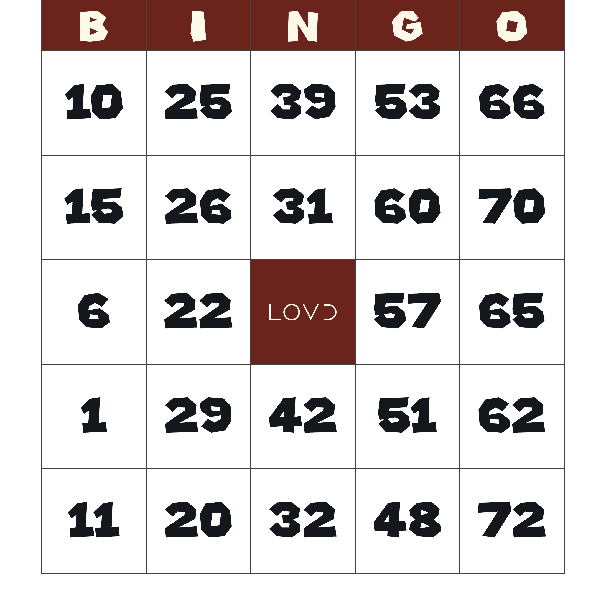
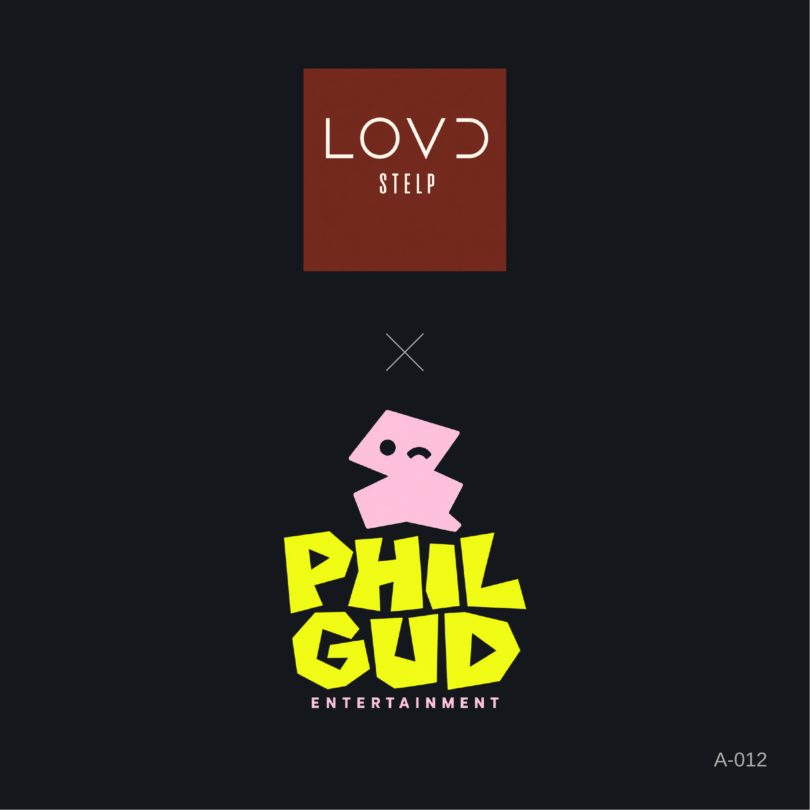
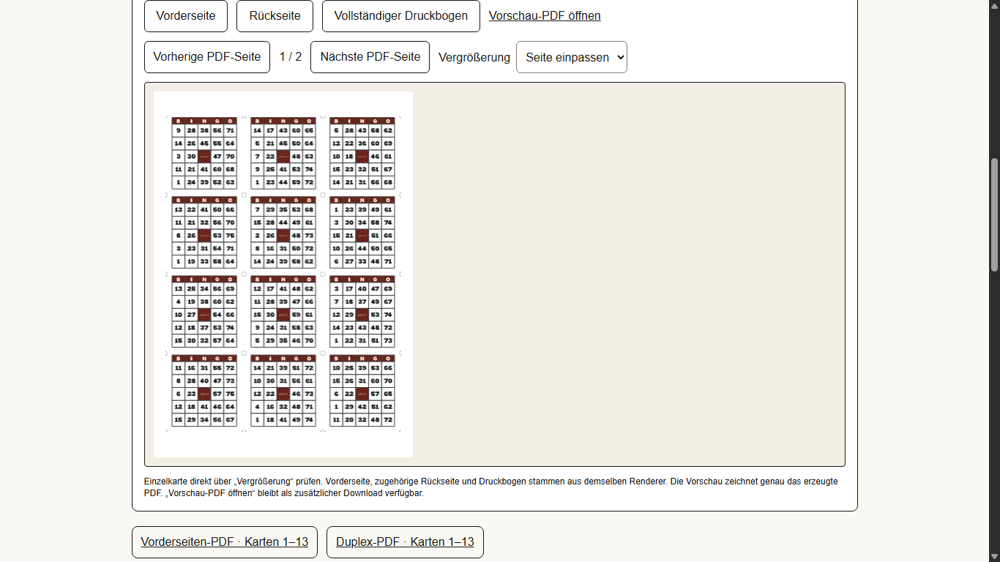

# PR174-Nachtrag: LOVD × Phil Gud auf Bingokarten

Aktueller Korrekturstand: 22.11.2026 auf `codex/bingo-sra3`. Der Auftrag gibt die kleinere Rückseitengeometrie und den regulären Production-Release ohne Backup frei. Release-Ergebnis wird nach den geschützten Checks ergänzt; ein physischer Probedruck bleibt offen.

## Direkt öffnende Abnahmedateien

- [Neues SRA3-Duplexmuster mit 13 Karten](https://github.com/justphilgud/pubquiz-web/raw/refs/heads/codex/bingo-sra3/docs/acceptance/assets/bingo-sra3-lovd/bingo-lovd-sra3-13-duplex.pdf)
- [A-012 Vorderseite, 600 dpi](https://github.com/justphilgud/pubquiz-web/blob/codex/bingo-sra3/docs/acceptance/assets/bingo-sra3-lovd/A-012-front-600dpi.png) · [A-012 Rückseite, 600 dpi](https://github.com/justphilgud/pubquiz-web/blob/codex/bingo-sra3/docs/acceptance/assets/bingo-sra3-lovd/A-012-back-600dpi.png)
- [Vorderseiten-PDF](assets/bingo-sra3-lovd/bingo-lovd-sra3-13-front.pdf)
- [Gespeicherte Vorschau](assets/bingo-sra3-lovd/saved-preview-1366.png) · [Messprotokoll](assets/bingo-sra3-lovd/pdf-verification.json) · [Druckstand-Provenienz ohne Binärdaten](assets/bingo-sra3-lovd/print-provenance.json)

## Farbabgleich vom 22.11.2026

Die originale LOVD-Kachel im verlustfreien Druck-PDF enthält mehrere nahe Rottöne. Ihr häufigster RGB-Pixel ist 116/41/29 (`#74291D`). Bei allen 13 Karten im aktualisierten Duplexmuster verwenden die fünf Kopffelder und das mittlere Logofeld diesen Wert. Die cremefarbenen Schriftzüge bleiben erhalten. Duplex-PDF, Vorderseiten-PDF und Vorderseitenbild oben zeigen die neue Farbe.

## Aktuelle Größenkorrektur vom 22.11.2026

Die frühere Anordnung vor `ea0b7fa9` ist gezielt wiederhergestellt; die anschließenden Farbkorrekturen und Originalgrafiken bleiben erhalten. Bei 92,5-mm-Karten misst die tatsächliche PDF-Bildtransformation LOVD **65,55 × 65,55 pt**, Phil Gud unverändert **78,78 × 97,02 pt**. Das × hat zwei Diagonalen mit **12 × 12 pt** Ausdehnung. Die Mittelpunkte liegen bei 79 %, 31 % und 56,5 % der Kartenhöhe.

Das oben verlinkte Muster und der A-012-Rückseitenausschnitt sind aktualisiert. Die 13 vorhandenen synthetischen Musterkarten wurden ohne Datenbankzugriff über den regulären Snapshot-/PDF-Renderer erneut exportiert. Alle 13 Rückseiten einschließlich Restbogen sind gemessen. Beide Vorderseitenbögen sind gegenüber `5c1beaa9` bei 144 dpi **pixelidentisch**. Der neue 600-dpi-Rückseitenausschnitt wurde visuell geprüft. [Messprotokoll](assets/bingo-sra3-lovd/small-logo-verification.json).

Fokussierte LOVD-Tests (2) und weitere PDF-/Druckregressionen (6) erfolgreich: Zahlen, Begriffe, drei Kartenprofile, SRA3, Duplex, unvollständige Bögen und historische Snapshots ohne neuen Marker. Typecheck, ESLint der geänderten TypeScript-Dateien und Production-Build erfolgreich. Der bestehende unabhängige Python-Verifier hat aktualisierte Geometrieerwartungen; sein vollständiger historischer Browser-/Datenbanklauf wurde in diesem Auftrag nicht wiederholt. Die folgenden älteren Browser- und Persistenznachweise bleiben als datierte Historie erhalten.

PR174 enthält gegenüber `main` keine Schema- oder Datenbankmigrationen. Vor dem Release zeigen beide Production-Aliasse auf `450ff29b174e4b118a31f5364f8e7f0531d60704`, Deployment `dpl_AkeUzBzX28JUhCbETCaBxsw5KzZj` (READY). Kein Backup, Snapshot oder separater Backup-Job gestartet; keine produktiven Nutzdaten geändert. Kein physischer Probedruck.

## Überholter Größenabgleich vom 22.11.2026

Im vorigen Muster war die LOVD-Kachel 65,55 × 65,55 pt groß. Das Phil-Gud-Logo maß 78,78 × 97,02 pt. Das LOVD-Logo ist jetzt auf dieselbe Höhe wie Phil Gud vergrößert. Im echten Duplex-PDF haben beide Logos auf jeder Karte eine Bildhöhe von **97,02 pt (34,3 mm)**. Die rote Kachel ist quadratisch und daher auch 97,02 pt breit. Das × sitzt kleiner im Zwischenraum. Seine Linien verlaufen über 7 × 7 pt statt zuvor über 12 × 12 pt. Die äußeren L-Schutzzonen am Kartenrand bleiben mindestens 23,6 pt groß. Der Zwischenraum zwischen den Partnerlogos bildet bewusst die gemeinsame Lockup-Fläche für das ×.

Alle 13 Rückseiten des vollständigen Bogens und die einzelne Restkarte wurden anhand der PDF-Bildpositionen geprüft. Die A-012-Rückseite oben zeigt das Ergebnis in 600 dpi.

## Frühere Korrektur der Rückseite mit roter LOVD-Kachel

Bei neuen Druckständen wird oben das ursprüngliche quadratische LOVD/STELP-Logo aus `public/branding/lovd/lovd-stelp.png` gezeichnet. Das transparente Phil-Gud-Original, das ×, die graue Kennung und die Vorderseite behalten ihre Gestaltung. Beide Links zum Duplex-PDF und zur Rückseite A-012 oben zeigen das aktuelle Muster. Die folgenden Browser- und Datenbanknachweise einschließlich gespeicherter Vorschau und Provenienz stammen aus der vorangegangenen Abnahme.

Für diese Korrektur wurden die 13 Karten mit denselben Zellen und Kurzkennungen wie im vorangegangenen Browser-Muster über den regulären V3-Snapshot- und PDF-Renderer erneut ausgegeben. Ein Rastervergleich aller vier Seiten bestätigt identische Vorderseiten. Bei allen 13 Rückseiten liegen sämtliche geänderten Pixel innerhalb der oberen Logo-Fläche. Am PDF geprüft wurden zudem die rote Originalgrafik, die transparente Phil-Gud-Grafik, die Position des ×, die 6,5-pt-Kennung und die Ausgabe in den drei Kartenprofilen. Vor dem Farbabgleich vom 22.11. war die PDF-Datei im Repository eine kompakte Ansichtskopie. Nur die rote Logografik wurde darin für den Download als JPEG codiert. Das unveränderte Renderer-PDF wurde separat für den Druck bereitgestellt. Der physische Probedruck steht aus.

## Vorangegangene Abnahme am Stand `61e58723`

### Reproduzierter Ursprung und gezielte Korrektur

Das frühere Browsermuster verwendete **Shared Design `lovd-ungegoogelt`, Layout V3**, nicht die zentrale V4-Druckvorlage. Die geerbte Hauptfarbe `#C64D3B` wurde als Kopf-/Freifeldfarbe verwendet. BINGO und Zahlen: Phil Gud Display Regular; Begriffe: Arimo Regular. Rückseitenlogos: altes `lovd-stelp.png` und `website-logo.jpg`; Kennung 8 pt aus der Zahlenschrift auf weißem Balken. Die eingefrorene Konfiguration wurde vor und nach den Tests verglichen.

Neue implizite LOVD-Druckeinstellungen erhalten `#6A241C` als Kopf-/Freifeldfarbe und `#FFF9E9` für BINGO. Der bestehende PDF-Farbraum ist DeviceRGB; deshalb werden **106/255, 36/255, 28/255** verwendet, ohne globale CMYK-Umstellung. Die übrigen Zahlenfelder und die vorhandenen Schrift-/Raster-/Textregeln bleiben erhalten. Insbesondere bleibt der reguläre Erzeugungsweg Layout **V3**; keine Umstellung auf das andere vollständige V4-Frontlayout.

Vorn wird das unveränderte offizielle transparente Kleinformat **LOVD Creme Catalana RGB PNG** verwendet, hinten die vorhandene vollständige LOVD-STELP-Wortmarke und das transparente Phil-Gud-Druckoriginal. Alle vorhandenen Originaldateien bleiben erhalten. Die neu hinzugefügte Kleinformatdatei stammt aus [Download 88](https://www.branddoq.io/downloads/88), SHA-256 `711300bfa49424924b62050b6a5339e11f233def82c3dfd797b48d390f12a06d`. [Logo-Regeln](https://www.branddoq.io/stelp/logo) und [Farben](https://www.branddoq.io/stelp/farben) wurden direkt vom offiziellen Portal gelesen. Die Kleinformatvariante ist für den engen Freifeldraum vorgesehen; Schutzzone eine L-Länge rundum.

Die neue gespeicherte Variante `partnerBack:1` bindet die gemeinsame Partner-Rückseite: LOVD oben, × mittig, Phil Gud darunter; Kennung regulär 6,5 pt in neutralem kontrastierendem Grau direkt auf dem durchgängigen Hintergrund. Für diese Variante wird kein Kennungsbalken oder zusätzlicher Innenrahmen gezeichnet. In der vorangegangenen Fassung hielt die LOVD-Kachel die L-Schutzzone auch zum × frei. Der Größenabgleich vom 22.11. verschiebt das × in den gemeinsamen Zwischenraum der gleich hohen Logos. Der bisherige dunkle Hintergrund `#14181C` bleibt im geerbten V3-Standard erhalten; transparente Logos erzeugen darauf keinen zweiten Schwarzwert.

Explizite individuelle Farbfelder und Schriften werden als bewusste Abweichungen erhalten. Das gilt für Spiel-, Reihen- und Vorlagenkonfigurationen. Bekannte historische Marken-Logoquellen werden bei neuen LOVD-Druckständen durch die offiziellen transparenten Originale ersetzt; individuelle fremde Logos werden nicht ausgetauscht. Die reine Phil-Gud-Gestaltung bleibt getrennt. Die zentrale LOVD-Druckvorlage verwendet ebenfalls LOVD Red, ohne ihre bisherigen Frontschriftgrößen oder das V4-Raster zu wechseln.

## Tatsächliche Prüfungen

| Prüffall | Ergebnis |
| --- | --- |
| Regulärer Erzeugungsweg | Synthetisches Bingo über normale Neuanlage, geerbtes LOVD-Design, Runde bearbeiten, SRA3 direkt auswählen, 13 Karten erzeugen, nach Neuladen öffnen und per Browser herunterladen. Kein ausschließlich separat gebautes Beispiel-PDF. |
| Gespeicherte Vorschau | Tatsächliches PDF in Canvas und vollständiger Bogen geöffnet. Preview-PDF und erster Downloadbogen stimmen in Text und Kartenpositionen überein. |
| RGB-Flächen | An den tatsächlichen PDF-Rechtecken gemessen: alle fünf BINGO-Kopffelder und das Freifeld jeder Vorderseite exakt RGB 106/36/28 innerhalb der PDF-Zahlenpräzision. |
| Schrift und Umbrüche | Gleiches V3-Raster, gleiche eingebettete Frontschrift-Dateien und Zeichenpositionen/-größen, auch mit langem Begriff, auf 89 / 92,5 / 93 mm. Kein Wechsel der Typografieregeln. |
| Reguläre Kennung | Alle Rückseitenzeichen 6,5 pt. Eingebettete PDF-Subset-Glyphen und Vorbreiten über ToUnicode-Zuordnung gegen Original-Arimo im Schnitt 400 geprüft; nicht nur der Metadatenname. |
| Transparenz und × | PDF-Bilder haben Softmasken; gerasterte transparente Phil-Gud-Ecken tragen exakt den Kartenhintergrund. Zwei Diagonalen je ×, eines pro Rückseite. Kein weißer Kennungsbalken. |
| L-Schutzzone | Front- und Rückseiten-Logobounds um die konservativ bemessene L-Länge erweitert: innerhalb des Freifelds bzw. der Karte; × außerhalb der LOVD-Schutzzone. An tatsächlichen PDF-Bildpositionen gemessen. |
| Papier-/Designvergleich | Dieselbe Karte mit gleichen Inhalten auf bisherigem A4/A6 und SRA3: drei Kartenkanten, Zahlen und Text, Front/Back. Zusätzlich allgemeine 36 Kombinationen/72 ausgeschnittene Kartenseiten einschließlich Mischkarten. 320 × 450 mm, 5 mm Abstand und mindestens 10 mm Rand unverändert. |
| 13 Duplex-Zuordnungen | Jede numerische Vorderseitenzelle aus dem echten Browserdownload gegen gespeicherte synthetische Zellen geprüft; alle 13 eigenen Kurzkennungen an der korrekten gespiegelten Rückseitenposition, einschließlich Restbogen. 1/12/13 und Teilbereich 5–17 weiterhin grün. |
| Historischer Wiederexport | Bereits gespeicherter V3-Stand aus dem früheren Muster vor und nach bestätigter Neugestaltung erneut exportiert: gleiche Zahlen/Zeichen, Rechtecke und ursprüngliche Farben; alte Rückseite weiterhin 8 pt mit weißem Balken. Snapshot-Hash unverändert. |
| Zusätzliche Druckversion | Für die alte Serie über normale Druckeinstellungen ausdrücklich SRA3 gespeichert, Vorschau geöffnet, neue Version bestätigt. Zusätzlicher Stand behält dieselben Karten und das V3-Frontlayout, verwendet die neue Partnergestaltung. Originalversion 1 bleibt auswählbar. |
| Persistenz / Backup | Vollständige isolierte PostgreSQL-Suite einschließlich realer geerbter LOVD-Erzeugung, regulärer eingefrorener Kennungsschrift, Integritätsinventur sowie Dump-/Restorevergleich erfolgreich. Keine Production-Daten verwendet. |
| Prüfungen | 40 Druck-/Vorbereitungstests, Typecheck, Changed-file ESLint und Build grün. Regulärer Browserweg auf Laptop/Mobil und zusätzliche alte/neue Druckversionen grün. |

Ein erster lokaler Browser-Cleanup der unveränderten Matching-Quellenauswahl scheiterte unter Windows mit EPERM; die vollständige abschließende Drucksuite bestand danach. Keine fachfremden Matching-/Quizfunktionen wurden geändert.

## Sichtprüfung

600-dpi-Ausschnitte aus dem tatsächlichen Browserdownload, Karte A-012:

Optisch geprüft: einheitliche dunkle Rückseite ohne Logo-Rechteck/Saum, beide Marken proportional, sichtbares ×, zurückhaltende vollständige Kennung, gleiche rote Fläche in Kopf/Freifeld, freie Logoschutzzonen. Dies ist eine digitale Sichtprüfung; ein physischer Probedruck wurde nicht durchgeführt.

## Architektur, Dateibereiche und Grenzen

`bingoPrint.ts` trennt neue LOVD-Standardwerte von expliziten individuellen Einstellungen. `printDesign.ts` / `printTemplateRepository.server.ts` lösen die bestehenden Vererbungswege auf. `pdfDrawing.server.ts` übernimmt die unveränderten vorhandenen Zeichenprimitiven; `pdfPartner.server.ts` teilt die Rückseitenzeichnung. `pdfModern.server.ts` erhält seine V3-Frontgeometrie; historische Snapshots ohne Marker verwenden ihre bisherige Rückseite. `pdfReference.server.ts` behält seine V4-Frontgeometrie und die bisherige reine Phil-Gud-Rückseite. `printAssets.server.ts` / `printSnapshot.ts` frieren die zusätzliche reguläre Kennungsschrift nur für neue markierte V3-Stände ein und prüfen sie streng. Backup-Inventur erfasst sie im bestehenden unveränderlichen JSON-Dump. Keine Schema-/Datenmigration, keine neue Anwendungsabhängigkeit.

Neue Varianten benötigen einen Parser/Renderer, der `partnerBack:1` und den eingefrorenen V3-`codeFont` versteht. Alte Druckversionen werden nicht migriert; ein späterer Code-Rollback muss die neuen Werte berücksichtigen. Physische Registrierung/100-%-Druckermaßhaltigkeit und fachliche Musterfreigabe stehen aus. Keine gehostete Preview, kein Merge oder Production-Deployment in diesem Nachtrag.
