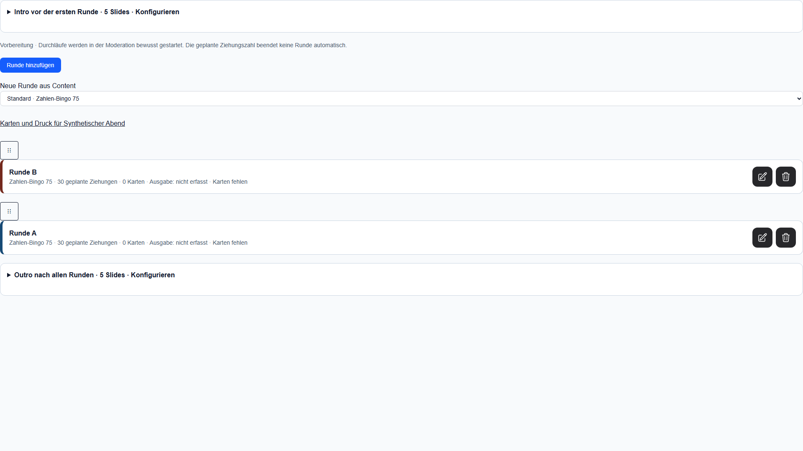
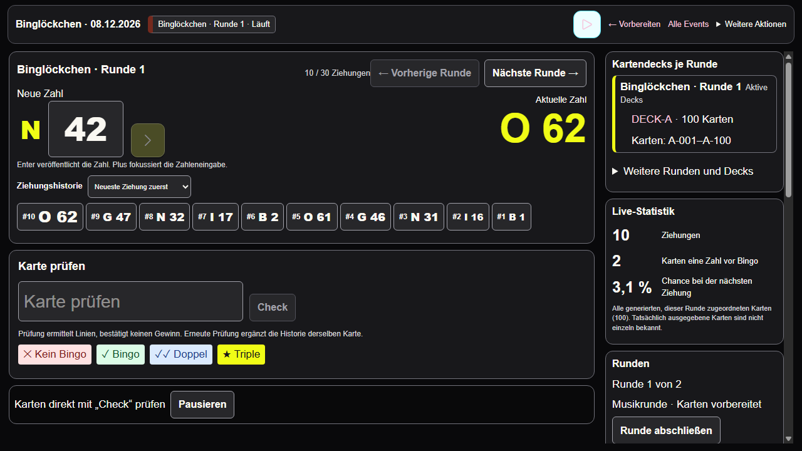
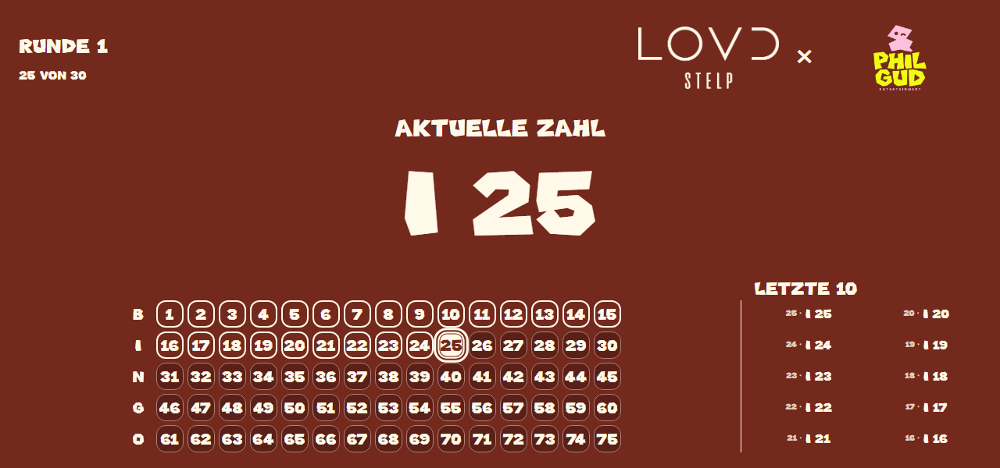
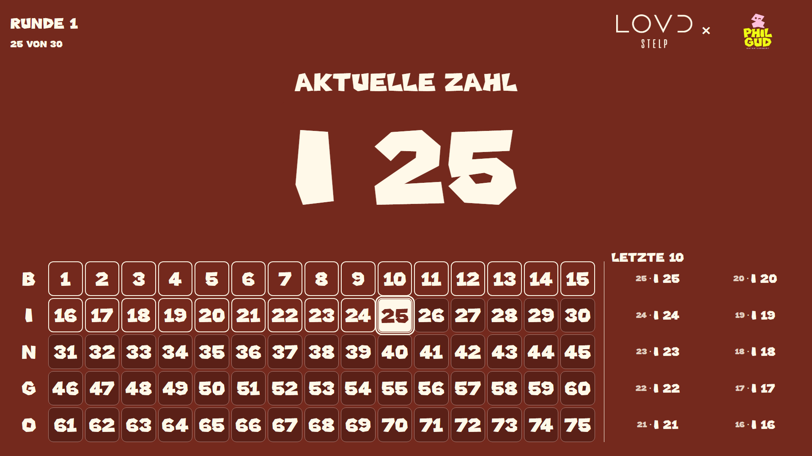

# Bingo: Intro, Rundenblock, Outro und rechte Ziehungsliste

Datum: 27.11.2026. Branch `codex/bingo-intro-outro-layout`, Basis
`a1bbbb62bd18c5d68ffecae31012ee1577606228` (PR189/190 bereits veröffentlicht).
Eigenständiger Folgeauftrag; kein Deployment, kein Production-Zugriff und kein
produktives Backup. Die CI-/Releasevereinfachung ist ausdrücklich nicht enthalten.

## Geprüftes Verhalten

| Bereich | Umsetzung und Nachweis |
| --- | --- |
| Intro → alle Runden → Outro | Zwei kompakte, zunächst geschlossene Konfiguratoren vor/nach dem gesamten Rundenblock. Einzelne Slideauswahl zeigt nur die passenden Felder; Aktivierung ist sichtbar. Browser prüft DOM-Reihenfolge und unabhängiges Speichern. |
| Unabhängige Persistenz | Vorhandenes JSON-Modell mit optionalem `config.outro`; kein Schemaeingriff. Alte Wurzel-Outro-Inhalte bleiben über einen lesenden Adapter verfügbar, alte Rundeneinfügungen bleiben gespeichert. Unit-Test prüft JSON-Roundtrip, fehlende Seiteneffekte und strikte Ablehnung verschachtelter Konfigurationen. |
| Tatsächliche Phasengrenze | Serverseitiges `OUTRO_NOT_READY` vor Eventstart und nach unvollständigem Rundenblock. Zwischenabschlüsse zeigen keine Rundeneinfügung mehr; Abschluss aller sechs Planrunden zeigt die konfigurierte Outro-Folie. Normale Outro-Folien sind dann ausdrücklich auswählbar; Verlosung bleibt bis Eventende gesperrt. Falsche Intro-Folie im Outro wird abgewiesen. |
| Runden | Bestehendes dnd-kit mit identischen Pointer-/Tastatursensoren wie zuvor; gleicher Quiz-Ziehgriff, mindestens 44 × 44 px. Gruppierte Bearbeiten-/Löschen-Icons verwenden gemeinsame `IconButton`-Komponente, Tooltip und zugänglichen Namen. Tastaturverschiebung und gespeicherte Planreihenfolge werden geprüft. |
| Sichere Löschung | Vorhandener Bestätigungsdialog und Serverbefehl, kein Aufweichen der Karten-/Ausgabe-/Historienbindung. Leere, ungebundene Runden können entfernt werden. Bereits gestartete oder gebundene Runden bleiben gesperrt; siehe Grenze unten. |
| Schnelle Moderation | Großes Zahlenfeld und Kartenfeld bleiben. Echtes Browser-Enter veröffentlicht genau einmal, leert/fokussiert wieder; Plus/NumpadAdd fokussiert und greift nach Unmount nicht. Veröffentlichen ist ein Weiter-Icon mit Tooltip und zugänglichem Namen, Präsentation der bestehende Quiz-Play-Link. |
| Platzverteilung | Linke Arbeitsfläche priorisiert, Sidebar 300 px statt breiter Statistikspalte. Historie mit kompaktem Umbruch ohne eigene Scrollfläche/Stiftglyphen, kompakte Sortierauswahl. Kartenlabel visuell entfernt, zugänglicher Name erhalten. |
| Rundenwechsel und Karten | Vor/Zurück verwendet weiterhin den eingefrorenen Eventplan. Warnung benennt unvollständige Runde/Ziel, Abbrechen erhält Zustand, Fortsetzen erfindet/löscht keine Ziehungen. Aktive Decks und echte gespeicherte Codebereiche wechseln gemeinsam. |
| Kopf und Zahl | Zähler ausschließlich links unter Titel im Format „25 von 30“. Laufstatus nur zugänglich, kein doppelter sichtbarer Zähler. Originale transparente Logos mit dünnem ×. Überschrift zentriert, Box 90 % der unskalierten Zahl; Animation und skalierte Vorschau verfälschen die Messung nicht. |
| Rechte Historie | „Letzte 10“ neben dem Raster, dezente Trennlinie, absteigende Positionen, zwei Spalten mit je fünf Zeilen. Beide Spalten auf denselben Rasterzeilen; 0/3/10/25 Ziehungen geprüft. Alte Fußhistorie und allgemeiner Moderatorprüfhinweis entfernt; konkrete Gewinnrückmeldung bleibt. |
| Gestaltung und Datenerhalt | Alle zehn Rundenfarben, abgestufte ungezogene Zellen, Kontur für gezogen und invertierte aktuelle Zahl bleiben. Originalfonts und Logos unverändert. Bestehende Karten, Ergebnisse, Ruf-/Prüfentscheidungen und Rechte bleiben geschützt. |

## Ausgeführte Prüfungen

- Erweiterte lokale Browser-Abnahme: bestanden. Echte produktive Komponenten,
  installiertes globales App-/Tailwind-Stylesheet und Modul-CSS; ausschließlich
  synthetische Actions/HTTP-Daten. Moderation bei 1280×720, 1366×768, 1920×1080;
  Präsentationsgeometrie bei 1280×600, 1280×720, 1366×768, 1920×1080.
  Zeilenzentren innerhalb 1 px, Überschriftbreite innerhalb 1 Prozentpunkt von
  90 %, neueste zehn Positionen exakt absteigend, kein horizontaler/vertikaler
  Überlauf der Raster-/Historienelemente. Schmale 390-px-Ansicht zeigt die bestehende
  Vollbild-/Fenstergrößenhilfe statt unleserlich zusammenzudrücken.
- Allgemeiner Board-Browsertest: bestanden, einschließlich leeres/vollständiges
  Board, beide Designs, Medien-/Textinhalt, Originalfont-Kaltladen, Resize,
  skalierte Vorschau und unveränderte Polling-/Revisionsinvarianten.
- Quiz-Lifecycle, Regression, NavigationTransition, PresentationWindowSync und
  gemeinsamer Preisrenderer: **39/39 bestanden**.
- Vollständige Bingo-/Vorbereitungsregression seriell: **98/98 bestanden**
  (rund 319 Sekunden, einschließlich Druck-/PDF-, Medien- und Browserprüfungen).
- Vollständiger PostgreSQL-Gesamtharness: **bestanden** (rund 153 Sekunden),
  einschließlich neuer Phasengrenzen, sechs vollständiger Runden und Verlosungssperre.
  Ausschließlich eigener lokaler Cluster `127.0.0.1:56574` und wegwerfbare
  `bingo_ap2_qa_*`-Datenbanken. Bestehende Dump-/Restore-Tests betreffen nur
  synthetische Daten; kein Production-Backup wurde erzeugt oder angefordert.
  Testcluster nach der Prüfung wieder gestoppt.
- `npx tsc --noEmit`: **bestanden**, auch nach dem abschließenden Layoutfeinschliff.
- ESLint geänderter TypeScript-Dateien mit `--max-warnings 0`: **bestanden**.
- `npm run build`: bestanden, Next.js-Kompilation, TypeScript und 61 statische Seiten.

## Screenshots

Alle Aufnahmen zeigen lokale synthetische Fixtures, keine produktiven Karten.

## Grenzen und Freigabe

- Technische lokale Abnahme; fachliche Sichtprüfung durch den Nutzer bleibt offen.
  Kein Preview-/Production-Deployment, kein Merge und keine neue Backup-Anforderung.
- Runden mit Karten, Ausgabeangaben oder Laufhistorie sind weiterhin nicht löschbar.
  „Jede Runde löschen“ ist mit dem verbindlichen Datenerhalt nicht gleichzeitig
  erfüllbar. Der kleinste sichere Folgeschritt wäre eine separat spezifizierte
  Archivierungs-/Ausblendefunktion statt physischer Löschung; nicht implementiert.
- Der Browserharness verwendet echte UI/CSS/Fonts, aber synthetische Servergrenzen.
  Kein vollständiger angemeldeter HTTP-End-to-End-Nachweis, kein realer Beamer-
  oder akustischer Gerätetest. Browser-Autoplay bleibt den bestehenden Regeln unterworfen.
- Alte `insertions` werden nicht automatisch zu einem Outro zusammengeführt;
  unterschiedliche frühere Inhalte lassen sich nicht verlustfrei automatisch vereinen.
  Sie bleiben lesbar; neue Konfiguration erfolgt in den beiden klaren Abschnitten.
- Alte Codeversionen ohne `config.outro` verstehen neu gespeicherte Konfigurationen
  nicht. Ein Code-Rollback benötigt einen vorab geprüften kompatiblen Reader;
  keine automatische Rückmigration oder Datenreparatur.
- Die vorhandene PostgreSQL-Harnesswarnung zum parallelen `client.query()` ist
  ein bestehender Testharnessbefund, keine neue fachliche Laufzeitänderung.
