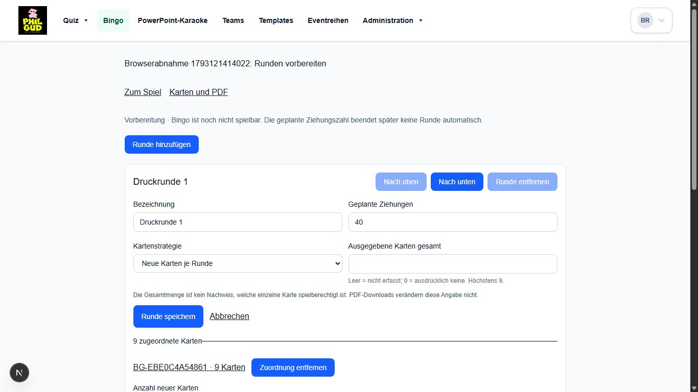
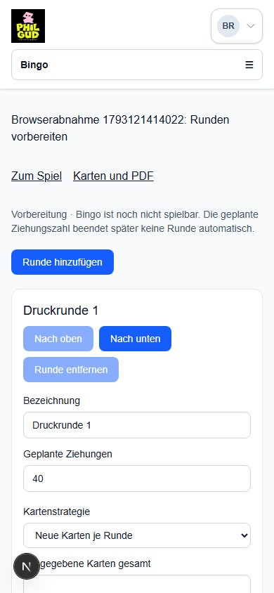
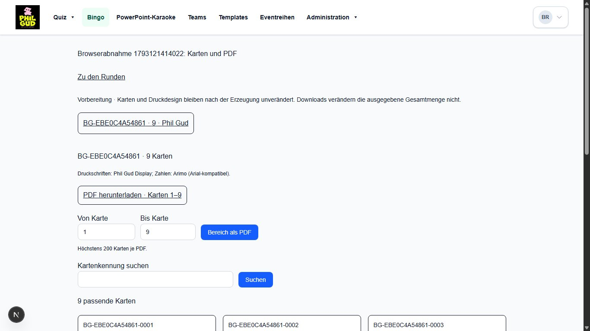
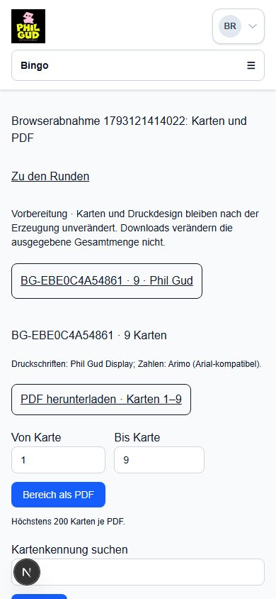

# Bingo AP2 – isolierte Abnahme

Arbeitsstand: Implementierung lokal geprüft; abschließende Head-CI und gehostete
Preview werden vor der Übergabe hier ergänzt. Kein Merge, kein Production-Release.

## Umfang und Architektur

Die vorhandene Spiel-ID bleibt erhalten. Sechs additive Tabellen speichern Runden,
explizite Serienzuordnungen, vollständige unveränderliche Karten, Druckdesign samt
Schrift-/Logobytes, Versionskonflikte und die Ausgabehistorie. Der AP1-Regelkern,
Quizlaufzeit, Teams und gemeinsame Designauswahl bleiben unverändert.
Details: [Living Specification](../../architecture/bingo-preparation.md).

Kleinere Entscheidungen: 25 Runden/Serien und 50 Karten je Listenseite; 500 Karten
je Erzeugungsauftrag; höchstens 200 Karten pro PDF mit ausdrücklich beschrifteten
Paketen. Für Druckschriften werden vorhandene Originaldateien versioniert
eingebettet. Variable Originalschriften erhalten sichtbare Vektorkonturen aus
derselben Schrift und einen eingebetteten durchsuchbaren Textanteil; dies verhindert
die in der echten Rasterprüfung gefundenen fehlenden Glyphen. Keine zusätzliche
Schriftverarbeitungsabhängigkeit wurde installiert.

## Tatsächlich durchgeführte Prüfungen

- Typecheck und ESLint sämtlicher geänderter Anwendungs-/Testdateien: erfolgreich.
- Vollständiger lokaler `npm test` und `npm run build`: erfolgreich. Ein lokaler
  CRLF-Effekt bei einem unveränderten historischen Freigabeplan wurde durch
  bytegenaues Lesen aus Git beseitigt; Test und historische Datei bleiben unverändert.
- AP1: bestehende 17 Regelkerntests bleiben enthalten; kein Kerncode geändert.
- Neue Policy-/PDF-Tests: manipulierte IDs/Felder, Integergrenzen, null/0,
  Kartenvalidierung, komplette Bereichspakete, echte PDFs beider Marken,
  Originalschrift-Vektoren und eingebetteter Text, 200 Karten/50 Seiten,
  Wiederexport, abgewiesene fremde Asset-URLs und nicht unterstützte Zeichen.
- Echter PostgreSQL-Test: Migration auf leerem und repräsentativ befülltem
  isoliertem AP1-Schema; vorhandene Quizdaten und Rollen unverändert. Alle sechs
  neuen Tabellen sind im bestehenden Backup-Katalog enthalten; Druckdesign und
  Prüfsummen werden durch die Integritätsprüfung validiert. Keine Sicherung oder
  Wiederherstellung gestartet.
- Reale Repository-Aufrufe: verweigerte Editor-/fremde Reihen-/Verwaltungszugriffe,
  Produktdeaktivierung auch für Admin, Rechteentzug, Archivgrenzen, fremde IDs,
  vollständiger Rollback bei erzwungenem Fehler während der Karteninsertion,
  parallele identische Erzeugung (genau eine Serie), geänderte Wiederholungsdaten,
  Versionskonflikte, gesperrter Reihenwechsel, Karten-/Serien-Unveränderlichkeit,
  Strategiekonflikte, null/0-Ausgabehistorie, Wiederverwendung und Reihung.
- 500 unterschiedliche gespeicherte Karten: vollständig und ohne Überschneidung
  über 1–200, 201–400 und 401–500 gelesen; 201 Karten in einem Export abgewiesen.
- Tatsächlicher Chromium-Browser gegen Next.js und die eigene Review-Datenbank:
  frischer Passwortlogin; Spiel/Runden anlegen, bearbeiten und vollständig neu
  laden; Karten doppelt anklicken (eine Erzeugung); vorhandene Serie zuordnen;
  Ausgabe speichern und neu laden; stale Formular in zweitem Tab behält Eingaben;
  Kartenkennung suchen; tatsächlicher PDF-Download; Editor-Direktlink abgewiesen,
  sein bisheriger Stammdaten-Lesezugriff bleibt erhalten; Quizverwaltung erreichbar.
- Der native Abbruchdialog wurde **automatisiert** abgebrochen: Seite und geänderte
  Eingabe blieben erhalten. Dies ist keine behauptete menschliche Abnahme.
- Laptop 1366×768 und Mobilviewport 390×844: Runden- und Kartenansichten geprüft,
  kein horizontaler Seitenüberlauf. Screenshots unten.
- PDF-Struktur und Text: beide Markenbeispiele und der echte Browserdownload
  jeweils 9 Karten/3 A4-Seiten, zwei eingebettete Schriften, ein eingebettetes Logo;
  jede Kennung und Zelle gegen die jeweilige Kartengrundlage verglichen, beim
  Browserdownload direkt gegen die gespeicherten PostgreSQL-Karten. Textfelder
  innerhalb der Seitenränder. Beide Marken tatsächlich gerastert und visuell geprüft.

Wiederholbar: `npm run test:bingo-preparation`; PostgreSQL über
`BINGO_PREPARATION_TEST_DATABASE_URL` und
`scripts/testing/bingo-preparation.integration.test.ts` (legt ausschließlich eine
neue eigene Testdatenbank auf einem explizit erlaubten Nicht-Production-Host an).
`npm run test:bingo-preparation:browser` ist auf die isolierte AP2-Preview oder
Loopback beschränkt und benötigt die privaten synthetischen Testkonten.

## Migration und Betriebsgrenzen

Review-Datenbank: `bingo_preparation_review_20261027`, nur synthetische Daten.
Dedizierter Laufzeitbenutzer ohne Rechte zum Lesen der bestehenden Development-
Datenbank; der entsprechende Negativtest besteht. Keine Production-Verbindung.
Die neue Migration wurde ausgeführt. Ältere Migrationen wurden in dieser neu
erstellten Datenbank anhand des AP1-Schemabaselines registriert, **nicht** als
vollständige historische SQL-Kette nachgespielt. Historische Bootstrap-Probleme
werden weder als AP2-Fehler noch als behoben ausgewiesen.

Ein echter Drucker-/Papiertest und unterschiedliche PDF-Viewer sind nicht vollständig
abgedeckt. Nicht unterstützte Schriftzeichen/-gewichte oder zu lange Druckzeilen
führen zu einer ausdrücklichen Exportfehlermeldung, niemals zu stiller Kürzung oder
einer anderen Schrift. Der PDF-Fehler verändert weder Karten noch Ausgabeangaben.

Bingo bleibt Vorbereitung. Nachfolgende AP3/AP4 müssen Livebetrieb/Start, Ziehungszustand, öffentliche
Präsentation und Ruf-/Gewinnworkflows samt dauerhafter Runtime-Integration ergänzen;
AP2 bietet dafür keine vorgetäuschten Schaltflächen oder Publikumslinks an.

## Bilder und synthetische Druckbeispiele

[Phil-Gud-Beispiel](examples/bingo-phil-gud.pdf) ·
[LOVD-Beispiel](examples/bingo-lovd-ungegoogelt.pdf)

Kontodaten werden ausschließlich privat in der Übergabe bereitgestellt, nicht in
diesem Bericht, im PR, in Screenshots oder im Repository.
