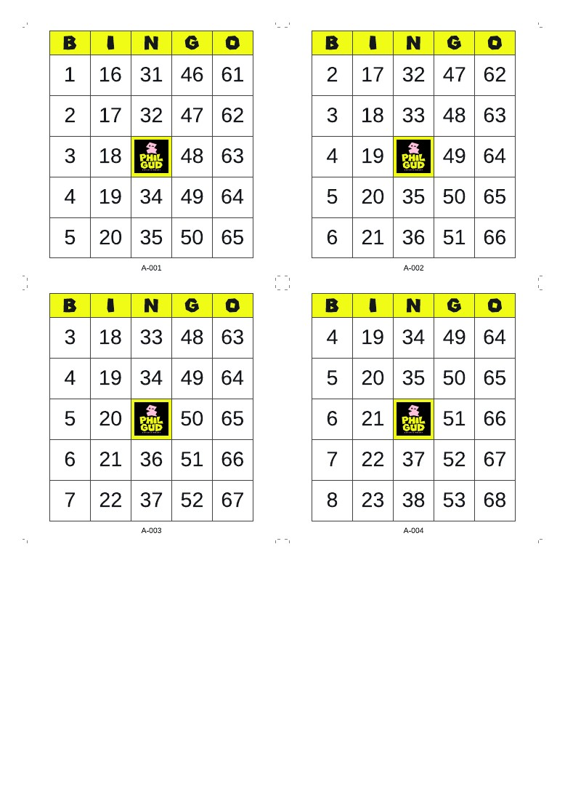
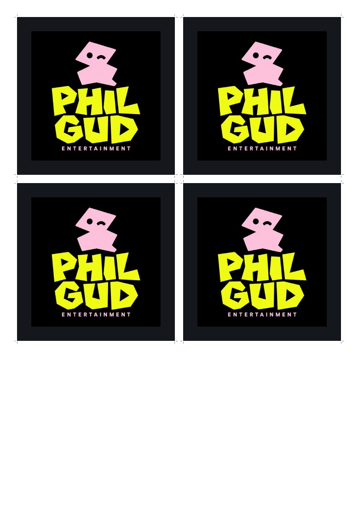
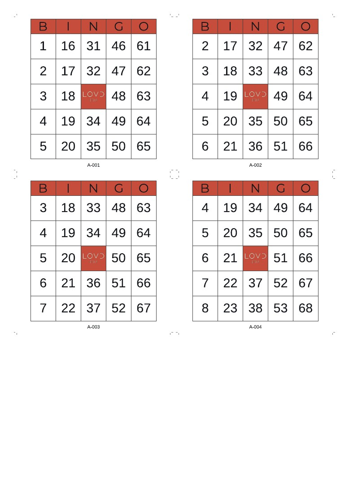
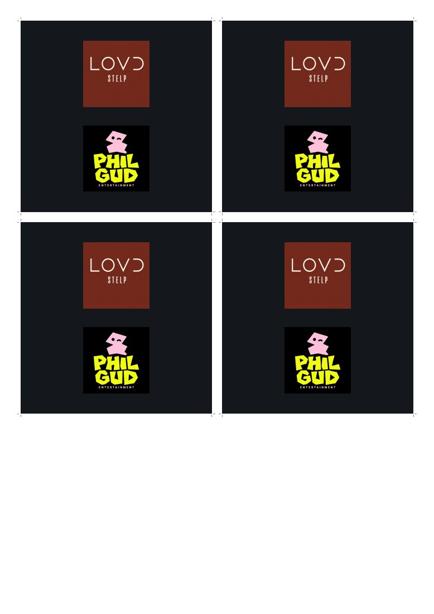
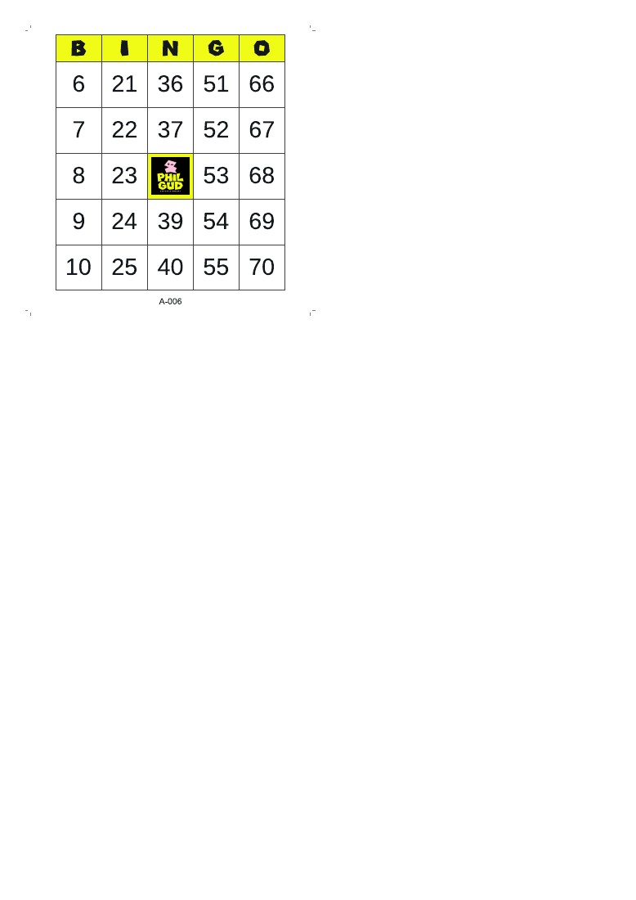
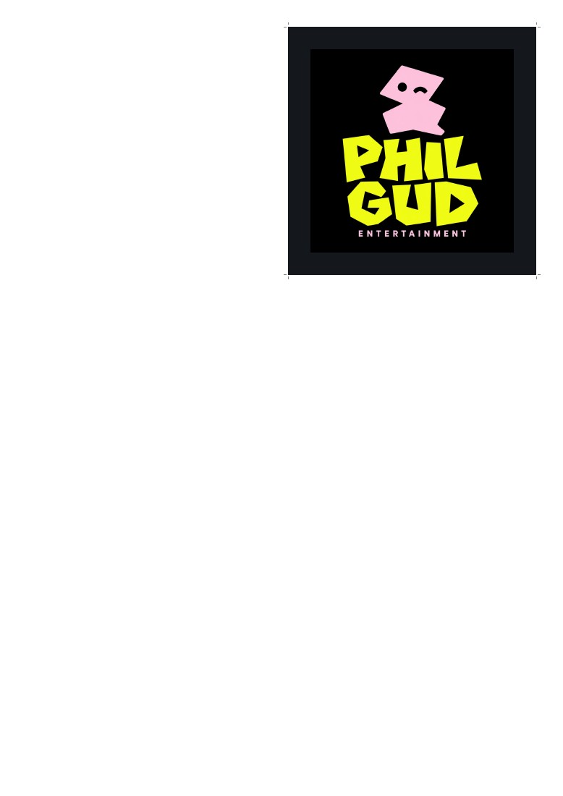
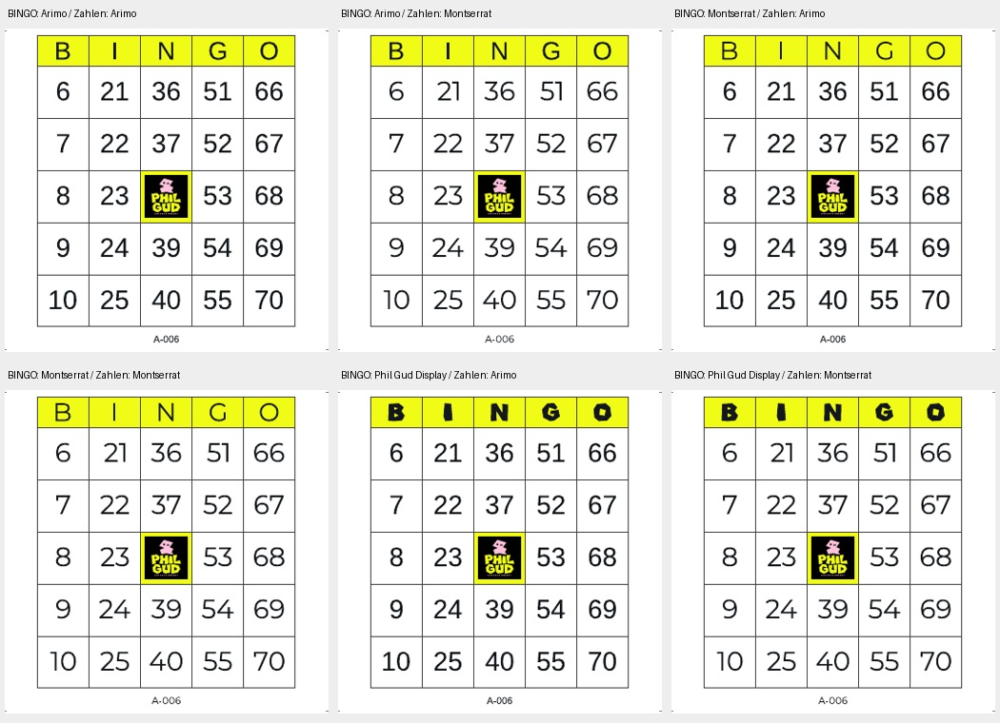
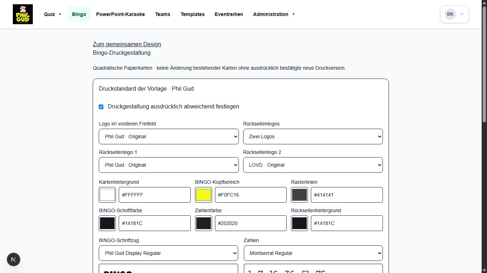
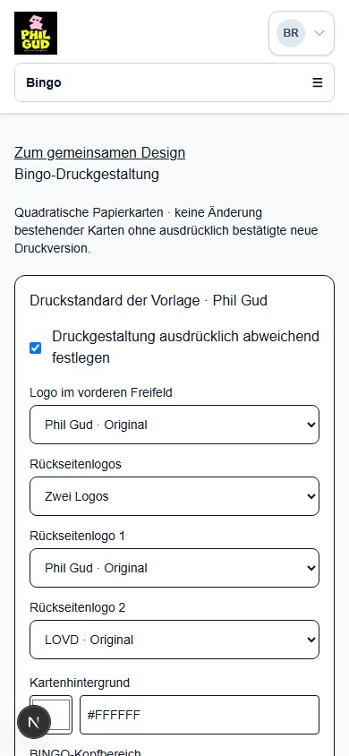

# Bingo AP2 – Abnahme der quadratischen Druckkarten

Dieser Bericht ersetzt die Drucklayout-Abnahme des ursprünglichen AP2-Stands.
Finaler Head, exakte CI-Läufe und tatsächlich ausgelieferter Preview-SHA werden
im [PR #143](https://github.com/justphilgud/pubquiz-web/pull/143) nachgewiesen.
Kein Merge, keine Production-Migration und kein Production-Deployment.

## Direkt zur isolierten Abnahme

- [Phil Gud – Druckeinstellungen](https://pubquiz-web-git-codex-bingo-preparation-just-phil-gud.vercel.app/bingo/25000000-0000-4000-8000-000000000001/design/druck)
- [LOVD – Druckeinstellungen](https://pubquiz-web-git-codex-bingo-preparation-just-phil-gud.vercel.app/bingo/25000000-0000-4000-8000-000000000002/design/druck)
- [Reihenstandard Phil Gud](https://pubquiz-web-git-codex-bingo-preparation-just-phil-gud.vercel.app/admin/eventreihen/10/design/druck)
- [Phil Gud – bestehende Serie bewusst neu gestalten](https://pubquiz-web-git-codex-bingo-preparation-just-phil-gud.vercel.app/bingo/25000000-0000-4000-8000-000000000001/karten/4755c451-14cc-45d3-bfcb-9ac8256e42be/druckgestaltung)
- [LOVD – bestehende Serie bewusst neu gestalten](https://pubquiz-web-git-codex-bingo-preparation-just-phil-gud.vercel.app/bingo/25000000-0000-4000-8000-000000000002/karten/535fa35d-74c4-4bae-a87a-d6f3f774f45f/druckgestaltung)

Der bestehende Vercel-Zugangsschutz bleibt erhalten. App-Testzugang ausschließlich
privat; alle Daten sind synthetisch und in der bisherigen eigenen Review-Datenbank.

## Gestaltung in sechs Schritten

1. Die Druckeinstellungen einer der beiden Marken öffnen. Ohne ausdrückliche
   Abweichung gilt der Reihen-/Vorlagenstandard. �Druckgestaltung ausdrücklich
   abweichend festlegen“ aktiviert die Bearbeitung.
2. �Logo im vorderen Freifeld“, �Rückseitenlogos“ und gegebenenfalls beide
   �Rückseitenlogo“-Felder wählen. Sechs Farben und �BINGO-Schriftzug“/�Zahlen“
   unabhängig einstellen. Unlesbare Kombinationen werden gemeldet, nicht ersetzt.
3. �Druckvorschau aktualisieren“ anklicken. Zwischen �Vorderseite“ und �Rückseite“
   wechseln oder �Vorschau-PDF öffnen“. Das ist die tatsächliche PDF-Zeichnung.
   Danach �Druckeinstellungen speichern“; vollständiger Reload erhält die Auswahl.
   �Vererbten Standard wiederherstellen“ wird erst durch Speichern verbindlich.
4. Den obigen Link �bestehende Serie bewusst neu gestalten“ öffnen und
   �Druckvorschau aktualisieren“ anklicken. Nach Ansicht der echten ersten Karte
   �Diese Gestaltung bewusst als neue Druckversion dieser Serie speichern“ anhaken
   und �Neue Druckversion bestätigen“. Zahlen, Karten und Ausgabe bleiben gleich.
5. In �Karten und PDF“ die �Druckdesign-Version“ ausdrücklich wählen und
   �Druckversion anzeigen“ anklicken. Die ursprüngliche Version bleibt verfügbar.
   Kurze Kennungen wie `A-001` und bisherige `BG-…`-Kennungen sind suchbar.
6. �Vorderseiten-PDF“ oder �Duplex-PDF“ mit dem gewünschten Kartenbereich laden.
   Duplex: A4 Hochformat, tatsächliche Größe/100 %, an langer Kante wenden.
   Zunächst einen Testbogen drucken; kein zusätzliches Spiegeln/Anpassen aktivieren.

## Erreichbare Dateien und Bilder

- [Phil Gud – acht Karten mit Rückseiten](examples/bingo-phil-gud-duplex.pdf)
- [LOVD – acht Karten mit Rückseiten](examples/bingo-lovd-ungegoogelt-duplex.pdf)
- [Teilbereich 2–6 – fünf Karten, unvollständiger letzter Bogen](examples/bingo-phil-gud-partial.pdf)
- [Maschinenlesbare PDF-/Rasterprüfergebnisse](print-verification.json)

Alle drei PDFs haben vier A4-Seiten, abwechselnd Vorder-/Rückseite. Bei fünf Karten
bleiben auf dem letzten Rückseitenbogen drei Plätze frei; der belegte Platz ist
für lange-Kante-Duplex gegenüber der Vorderseite horizontal gespiegelt.

| Marke | Vorderseite | Rückseite |
| --- | --- | --- |
| Phil Gud |  |  |
| LOVD |  |  |
| Unvollständiger Bogen |  |  |

## Architektur, Migration und tatsächlich ausgeführte Prüfungen

Vertrag und Entscheidungen: [Living Specification](../../architecture/bingo-print-design.md).
Vorlage und Branding bleiben die bestehende Architektur. Ganze Druckabweichungen
werden nullable vererbt; die neue Snapshot-Layoutversion V2 ersetzt keine alte
Serienversion. Neue unveränderliche Versionszeilen enthalten Actor und Zeitpunkt.
Kurzkennungen gelten innerhalb eines Spiels und werden nie durch Kürzen erzeugt.

Zwei zusätzliche Migrationen ergänzen Druckblöcke, Versions-/Kennungstabellen und
atomare Präfixzuteilung. Bereits ausgeführte SQL-Dateien bleiben unverändert.
Die bestehende eigene Review-Datenbank wurde additiv erweitert: Signaturen aller
bisherigen Karten, Serien-Snapshots, Runden, Zuordnungen, Ausgaben, Quizdaten und
Reihenrollen blieben identisch. Historische Migrationen der Review-Datenbank sind
aus einem AP1-Schemabaseline registriert; kein vollständiger historischer Replay
und keine Reparatur historischer Bootstrap-Probleme werden behauptet.

Ausgeführt:

- Strenge Unit-/Policy-Tests, die bisherigen V1-PDF-Assertions bleiben erhalten.
  Neue echte PDFs für 1, 3, 4, 5 und 8 Karten, Teilbereiche und beide Marken;
  korrespondierende Rückseitenpositionen und genau ein vorderes Logo.
- Alle sechs angebotenen Schriftkombinationen und Zahlen 1–75: Originalfonts,
  Regular 400, tatsächliche Konturen, vier Kartenpositionen und Folgeblätter.
- PDF- und Rasterprüfung aller zehn erzeugten Testdateien: 40 Seiten,
  unveränderte Zahlen, quadratische Flächen, korrekte Leer-/Spiegelpositionen,
  vollständige Logos ohne Verzerrung, echte eingebettete Fontprogramme und sichtbare
  Ziffernränder innerhalb jeder Zelle. Kein reiner Textextraktionsnachweis.
- Maximalmenge je Marke: 200 Karten, 100 Duplexseiten; lokal etwa 1–2,2 Sekunden
  und 1,1–2,0 MB. Grenze 200 Karten bleibt erhalten; über 20 MB expliziter Fehler
  statt abgeschnittener Datei. Server-/Druckerleistung ist damit nicht garantiert.
- Reale PostgreSQL-Integration: leere Erweiterung mit Rollback sowie befüllte
  isolierte Umgebung; aktuelle Rollen/Produkte, Fremd-IDs, Vererbung und Override,
  Wiederherstellung, CAS, Vorschau-/Bestätigungsbindung, unveränderliche Originale,
  historische Exporte, stabile Kurzkennungen und ihre Suchbarkeit. Bestehende
  Quiz- und Rollen-Preservierungstests bleiben enthalten.
- Echter lokaler Chromium-/Next.js-Ablauf: Originalschriftmuster, Vorder-/Rückseiten-
  PDF-Vorschau, Kontrastfehler ohne Farbänderung, Speichern/Reload, nativer
  Navigationsabbruch, stale Formular, ausdrücklich bestätigte Neugestaltung,
  alte/neue Druckversion, beide Kennungen, tatsächlicher Duplexdownload,
  Standardwiederherstellung sowie Editor-/Fremdzugriffsgrenzen. 1366×768 und
  390×844 ohne horizontalen Überlauf. Dies ist keine menschliche Abnahme.

Die vollständige Repository-CI, der finale Build und die gehosteten Nachweise
werden am tatsächlich ausgelieferten Head im PR ergänzt; ältere grüne Läufe
gelten nicht automatisch als Nachweis dieses neuen Druckvertrags.

## Offene Prüfgrenzen und ursprünglicher PDF-Befund

Das gemeldete Zusammenrutschen von Zahlen im vorigen PDF ließ sich mit den
vorhandenen PDFs unter Poppler bisher nicht reproduzieren. Kein historischer
Ursachenfix wird behauptet. Das neue Layout wurde eigenständig an den sichtbaren
Konturen, Rasterpixeln und der problematischen rechten Position mit `36`/`51`
geprüft. Eine konkret nachgewiesene neue Abweichung war der zu dünne variable
Default-Schnitt: explizite Regular-400-Variation und passende Metriken korrigieren
diesen Befund. Die vollständigen Originaldateien werden weiter verwendet.

Kein physischer Duplex-/Druckertest und keine vollständige PDF-Viewer-/Gerätematrix.
Mathematische Zuordnung ersetzt keine Prüfung mechanischer Druckertoleranzen.
Bingo bleibt Vorbereitung; keine Liveziehung, kein AP3. Keine Production-Daten,
Rechte oder Sessions verändert; keine Backups/Restores gestartet.

## Ergänzende Releaseprüfung: vollständiger Sicherungspfad

Der vorherige Bericht prüfte Druckzeilen, aber nicht das vorgeschaltete Gate für
Funktionen und Trigger. Dieser konkrete Blocker wird durch eine feste Referenz
für exakt 9 Bingo-Funktionen und 15 Trigger geschlossen, gebunden an die drei
unveränderten Migrationsprüfsummen. Geänderte Körper, Signaturen, Sicherheits-
attribute, Bindungen, deaktivierte/fehlende/zusätzliche Objekte und falsche
Migrationsprüfsummen werden weiterhin abgewiesen. Historische Backups bleiben
zulässig; Wiederherstellungsvergleiche erfassen die zusätzliche Referenz.

Der echte PostgreSQL-Test `bingo-preparation.integration.test.ts` führte nach
Installation der explizit hashgeprüften historischen Bestandsfunktionen den
vollständigen READ-ONLY-`collectSnapshot` aus: alle acht befüllten Bingo-Tabellen,
Drucksnapshots und eingefrorene Assets, Zeileninventur/-hashes sowie vollständiger
wiederholter Integritätsvergleich erfolgreich. Manipulierte Trigger/Sicherheits-
attribute abgewiesen, nach Wiederherstellung erneut erfolgreich. Keine Fehler der
unvollständigen Modellbaseline ausgeblendet: deren fehlende Bestandsroutinen
werden ausdrücklich ergänzt. Kein vollständiger historischer SQL-Replay,
Production-Backup/-Restore oder Wochenlauf behauptet. Release-/Preflightnachweise
werden am finalen Head im PR geführt; bisheriger Gestaltungsstand unverändert.
