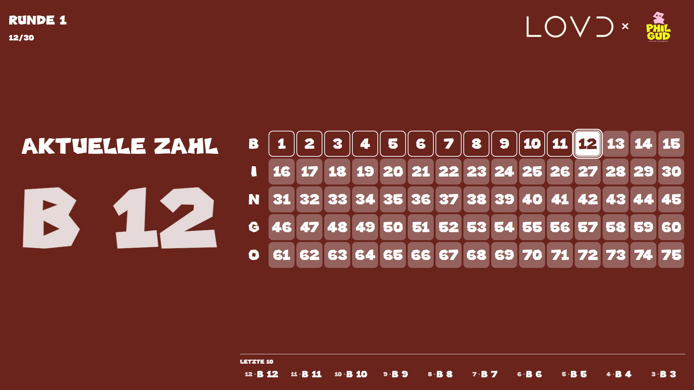
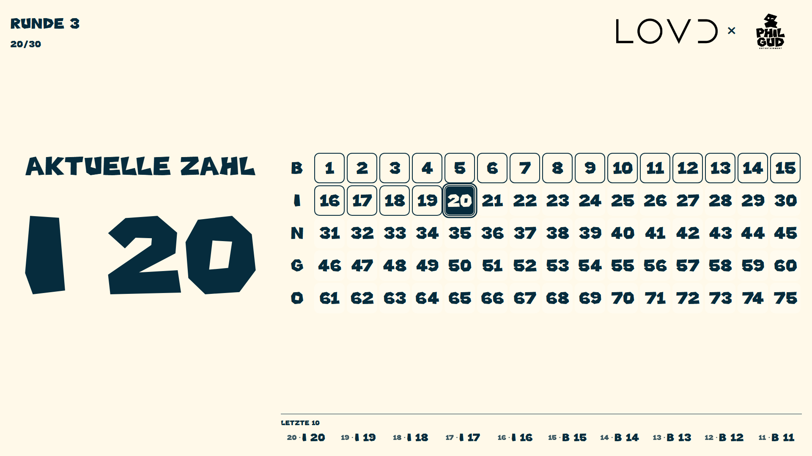
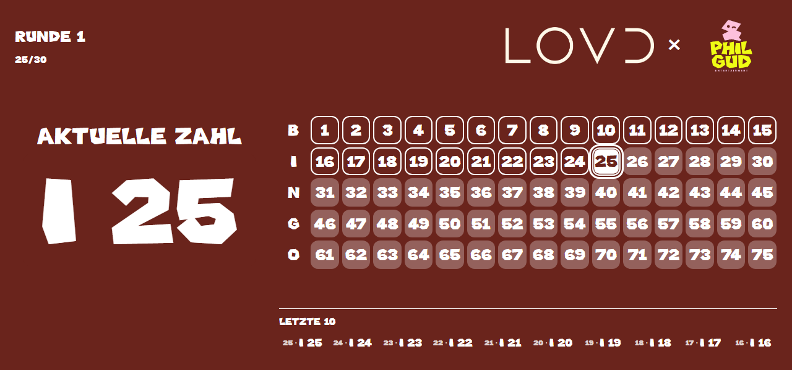

# Abnahme: Bingo-Zahlenpräsentation lesbarer

Basis: veröffentlichtes `main` `6b5156f666b5a5060aa6f7847eec8f94bedb08c8`.
Branch: `codex/bingo-presentation-readability`. Keine Merge-/Production-Freigabe.

## Ergebnis und Zuständigkeiten

`BingoBoard.tsx` zeigt bei numerischer Präsentation `12/30`, verwendet die bereits
vorhandene offizielle LOVD-Kleinformat-Wortmarke ohne STELP und liefert einen
numerischen Darstellungsmarker. `board.module.css` zentriert nur dort den linken
Bereich zur Tabelle und balanciert die unverzerrten Marken. `numberAppearance.ts`
berechnet die auf 28 % reduzierte Weißauflage samt kontrastsicherer Schrift.
Renderer, Daten, Fitter und Zustandslogik behalten ihre bestehenden Aufgaben.
Keine neue UI-Komponente oder Abhängigkeit, keine Schema-/Persistenzänderung.

Unverändert: Historienzeile, Ziehungen, BINGO-Zuordnung, Rundenzähler, Moderation,
Rundeneinrichtung, Content, Matching, Karten und sämtliche Druck-/Pflegeabläufe.
Keine Originalasset-Datei geändert. Der No-Delta-Releaseplan liegt gemäß Standard
im selben Feature-PR und pinnt die zuletzt verifizierte Production-Basis.

## Ausgeführte technische Prüfungen

| Prüfung | Ergebnis |
| --- | --- |
| TypeScript `npm run typecheck` | bestanden |
| ESLint aller geänderten TS-/TSX-Dateien, null Warnungen | bestanden |
| Farb-/Snapshot-/Darstellungstests | 4 Tests bestanden; alle sieben Farben und zusätzliche individuelle Farbfälle mindestens 4,5:1 Schriftkontrast |
| Tatsächlicher Abend-/Editor-/Präsentationsbrowser | bestanden; sieben Farben, zehn Runden und numerische Kachelkontraste im gerenderten DOM |
| Fortschritt | `12/30` und `20/30` geprüft |
| Logos | Originalwortmarke ohne STELP, `×` beibehalten, `contain`, unterschiedliche ausgewogene Breiten geprüft |
| Ausrichtung und LETZTE 10 | Zentren linker Zahlenfläche und Tabelle stimmen überein; 1280×600, 1280×720, 1366×768, 1920×1080; zehn Einträge einzeilig und absteigend, kein Überlauf |
| Bestehende Boardmatrix | 30 Fälle, zwei Marken × drei Größen × fünf Zustände; Resize, Schriftladen und Polling bestanden |
| Matching-/Medienregression | Aktivierung/Polling/Pause/Reload bestanden; keine numerische Gestaltung, altes Logo und Fortschrittswortlaut ausdrücklich bestätigt |
| Event-Run-Regressionen | 5 Tests bestanden, keine Kommandologik geändert |

Die Browsernachweise verwenden den echten Renderer mit synthetischen Fixtures,
lokalem HTTP und Headless Chrome. Keine Production-Datenbank oder echte Bewertung
wurde verwendet oder geändert. Finale PR-CI und Reviewstatus werden im PR ergänzt,
damit kein zusätzlicher reiner Berichtscommit eine weitere volle CI auslöst.

## Sichtprüfung

## Quellen und Grenzen

Die [offizielle Logoseite](https://www.branddoq.io/stelp/logo) nennt eine eigene
Kleinformat-Variante. Verwendet wird das bereits unveränderte Original im Projekt,
mit Downloadquelle und Prüfsumme in `public/branding/bingo-print/SOURCES.md`.
Kein Beschnitt erforderlich; die frühere Beschränkung gegen veränderte Logos
wird nicht verletzt. Nur die Präsentation wählt die andere offizielle Variante.

Im aktuellen Auftrag war kein zusätzlicher Referenz-Screenshot angehängt; die
vorhandene implementierte und zuvor auf Production geprüfte Ansicht dient als
Ausgangspunkt. Kein physischer Beamer-/Drucktest. Keine neue gehostete Preview,
kein Merge, kein Backup und kein Production-Deployment in diesem Auftrag.
Schreib- und Laufzustandsabläufe bleiben vollständig unverändert.

### Korrigierter CI-Befund

Der bestehende Test des PR196-Preview-Plans las den jeweils aktiven Releaseplan
und verlangte dadurch auch in späteren No-Delta-PRs noch die alte Delta-Planart.
Er liest nun Plan, Schema und Manifest gemeinsam aus dem unveränderlichen,
bereits veröffentlichten PR196-Commit. Alle bisherigen historischen Assertions
bleiben bestehen. Keine Änderung am Produktionsvalidator oder Deploymentworkflow.
Die gezielte Plan-/Preview-Regressionssuite wurde erneut bestanden.
