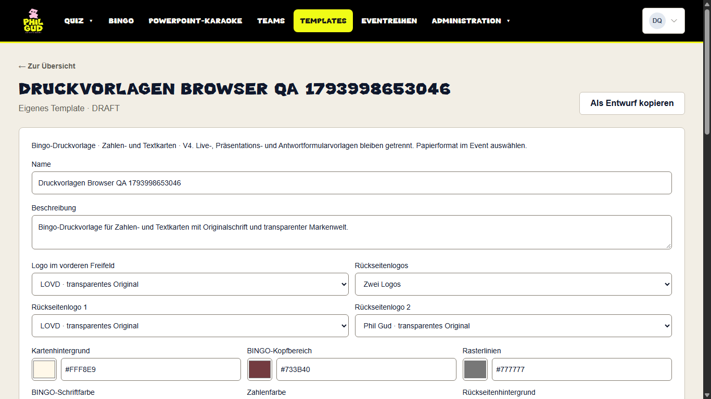
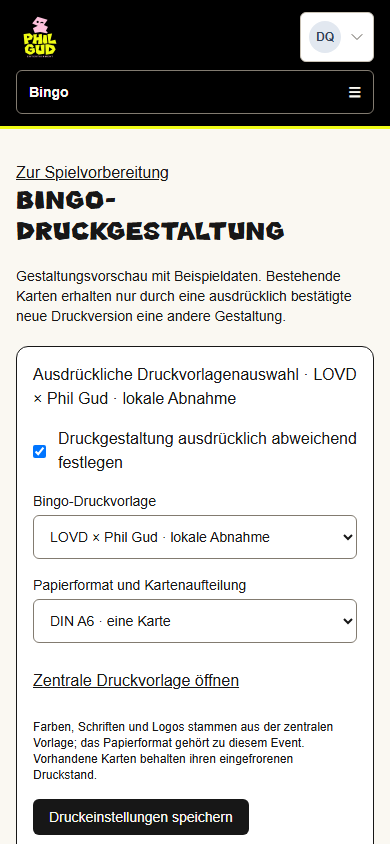
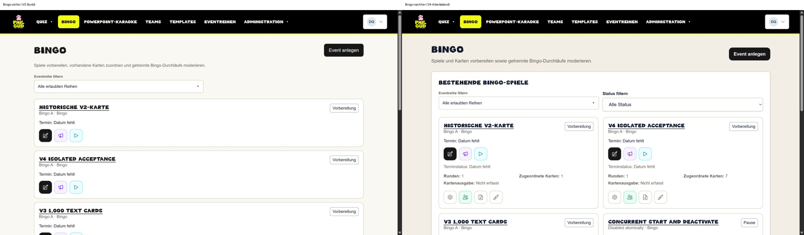
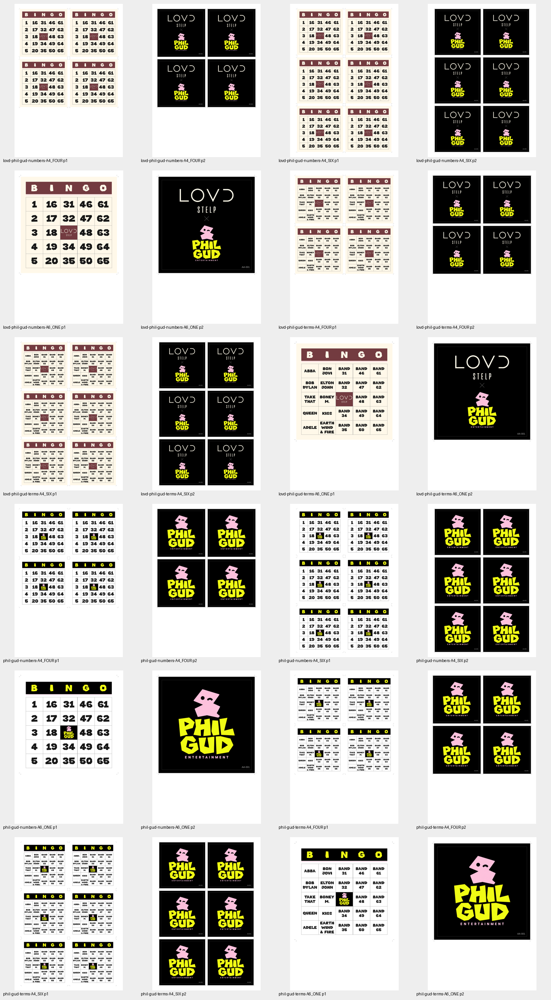

# Bingo-Druckvorlagen V4: isolierte lokale Abnahme

Stand 6. November 2026 · Branch `codex/bingo-print-templates-ui`.
Basis `192f27848f723559e3e18a0b9fdbbeb169a10ed3`; der davor separat geprüfte
Transfer-Fix ist Commit `1ff5854d`. Kein Merge, Production-Deployment oder Zugriff
auf produktive Daten. Vertrag: [Druckvorlagen V4](../architecture/bingo-print-templates-v4.md).

## Umsetzung und bewusste Entscheidungen

- Originale transparente Logos aus den zwei bereitgestellten PDFs, keine neue
  Interpretation der Marken. Zwei eigenständige Systemvorlagen unter `/templates`:
  Phil Gud und LOVD × Phil Gud, jeweils Zahlen/Text. Schrift-/Farb-/Logoauswahl,
  Kopie/Entwurf/Aktivierung/Archivierung verwenden die vorhandene Vorlagenverwaltung.
- Globale Pflege nur Admin. Frisch berechtigter Bingo-Manager liest System/aktive
  Druckvorlagen und wählt für eigene Events; keine globale Schreibfreigabe.
  Editoren können die eigene Druckauswahl lesen, aber nicht speichern; globale
  Druckvorlagen sind für sie gesperrt. Vorlagen sind in Live-/Antwort-/Shared-
  Designauswahl ausdrücklich ausgeschlossen.
- Event wählt zentrale Vorlage und Papierformat, Null erbt. Bisherige individuelle
  Druckstände bleiben ausdrücklich erhalten. Neue V4-Snapshots frieren Quelle,
  Einstellungen und echte Font-/Logobytes ein. Neue Gestaltung alter Karten
  erfordert Vorschau und ausdrückliche bestätigte zusätzliche Druckversion.
- Der Auftrag hat Vorrang vor abweichender Referenz: mindestens **10 pt** für
  Begriffe, A6-Kartenkante **93 mm**. Kein 9-pt-/95-mm-Import, keine globale
  18-Zeichen-Sperre. Maximal drei echte Wortzeilen und Glyphenmessung; zu breite
  Wörter werden vor Speicherung/Export abgewiesen, niemals gekürzt/gestaucht.
- Bingo übernimmt tatsächliche Quiz-Icons/Abstände/Filter/Raster. Die Quizübersicht
  bleibt pixel- und markupgleich. Keine neuen funktionslosen Duplizier-/Archiv-/
  Lösch-/Ergebnisaktionen. Echte Karten-/Runden-/Ausgabewerte, unbekannt ≠ Null.

## Tatsächlich geprüft

- Vollständiges `npm test` nach dem Transfer-Fix: PASS. `npm run typecheck`: PASS.
  ESLint aller 50 geänderten/neuen Design-Quelldateien: PASS ohne Warnungen.
  Der optimierte Build besteht; finale CI-/Head-Nachweise werden im PR ergänzt.
- 12 echte PDFs: beide Marken × Zahlen/Text × A4 vier/A4 sechs/A6 eine Karte.
  Unabhängige PDF-/Poppler-Prüfung: Seitenmaße, Originalschriften, Mindestgröße,
  vollständige Zeichen, tatsächliche gezeichnete Konturen innerhalb der Zellen,
  transparente proportionale Logos, genau ein Frontlogo, Rückseite ohne weißen
  Kennungsbalken, graue Kennung unten rechts, gespiegelte lange-Kante-Zuordnung
  einschließlich unvollständiger letzter Bögen: **12 PASS**. Keine alten Tests
  oder Mindestgrenzen abgeschwächt.
- Vollständiger PostgreSQL-Integrationscheck: echte leere Schema-Kopie und
  repräsentativ befüllte additive V4-Migration; V1/V2/V3/V4-Bestände, 1.000
  eindeutige Karten in atomaren Serien, falsche IDs/Zwecke/Entwürfe/Archive,
  Rollen/Produktgates, CAS, unveränderte Karten und alte Druckstände. Vollständiger
  isolierter Snapshot-/Dump-/Restore-/Integritätsvergleich alter/neuer Daten: PASS.
  Das ist kein Production-Backup und kein Wochenlaufnachweis.
- `bingo-print-templates.browser.mjs`: frische synthetische Adminanmeldung,
  Systemvorlage unabhängig kopiert, nativer Abbruchdialog tatsächlich abgebrochen
  (Seite + geänderte Eingabe bleiben), Schrift/Farbe explizit gespeichert und nach
  vollständigem Reload geprüft. Tatsächliche Textkarten-PDF als Canvas sichtbar.
  Tastatur-Tab fokussiert „Status“ mit sichtbarem Outline. Je **1366×768,
  1920×1080, 390×844** gemessen, kein horizontaler Überlauf; Screenshots.
- Ergänzende tatsächliche UI-Abnahme: Manager öffnet aktive Vorlage schreibgeschützt,
  globale Livevorlage gesperrt; fremde Reihen zusätzlich im Integrationstest
  abgewiesen. Eigene Vorlage/Papierformat
  ausgewählt, gespeichert, vollständig neu geladen. Editor: globale Vorlage 404,
  eigene Eventauswahl nur lesbar ohne Speicheraktion. Admin: unabhängiger Entwurf
  mit Arimo-Begriffsschrift und geänderter Rasterfarbe nach Reload erhalten.
- Vorlage → Event → Vorschau → ausdrücklich bestätigte neue Druckversion →
  erneutes Öffnen → echter Browserdownload: **7 unveränderte Karten**, Version 3,
  A6-Duplex mit **14 Seiten**, Rückseiten in Reihenfolge A-001 bis A-007.
  Versionen 1 und 2 bleiben wähl-/exportierbar. Validierter Listenfilter bleibt
  auch durch Druckeinstellungen/Neugestaltung/Rückweg erhalten.
- Unveränderte echte alte V3-Anwendung als UI-Baseline, keine Rekonstruktion:
  Quiz vor/nach bei 1366/1920/390 **null geänderte Pixel**; zusätzlich identisches
  vollständiges EventRow-Markup gegen die veröffentlichte Gitfassung. Neue Bingo-
  Übersicht mit denselben drei gemessenen Breiten. Vergleichsbilder erhalten.

## Migration und Betriebsgrenzen

`20261106210000_bingo_print_templates_v4` erweitert vier bestehende CHECKs, keine
neuen Tabellen/Spalten/Trigger, keine Datenmigration. Historische SQL-Dateien und
Prisma-Modellschema bleiben unverändert. Bestehende dynamische Inventur sichert
Vorlagen/JSON; der strikte V4-Parser und eingefrorene Binärintegrität werden im
bestehenden Inventurvertrag ergänzt. Nach V4-Schreibvorgängen wäre ein unbedachter
Rückfall auf alten Parser/Renderer nicht sicher. Keine Migration auf Production.

Die Original-Versalschrift besitzt gemeinsam genutzte Groß-/Kleinschreibungs-
Glyphen. Nur die unabhängige PDF-Textextraktion normalisiert Groß/Klein und
Zeilenleerraum; sichtbare Konturen, vollständige Zeichen und Mindestgrößen werden
separat strikt geprüft. Kein physischer Ausdruck, reale Druckerregistrierung,
Duplexgerät oder Beamertest behauptet.

## Gehostete Preview: konkreter Blocker

Neon verweigert im Nonprod-Projekt `polished-snow-55356911` Datenbankzugriffe wegen
überschrittenem Netzwerktransferkontingent (`53000`). Es wurde keine neue gehostete
Datenbank erstellt, migriert oder seeded. Keine Ausweichnutzung der gemeinsamen
Development-Datenbank oder von Production; kein Tarif-/Limitwechsel, kein erneuter
Lasttest. Der separate [Transfer-Fix](bingo-polling-transfer-2026-11-06.md) senkt
künftigen Verbrauch, stellt bereits verbrauchtes Kontingent aber nicht wieder her.

Die separate menschliche Vertrauensfreigabe für exakt `codex/bingo-print-templates-ui`
ist dokumentiert: vorhandene 15 Preview-Branches erhalten, genau ein Name ergänzt;
exakte Environment-Branch-Policy ID 65785211. Bestehende Medien-/Secret-/CI-Guards
bleiben erhalten, fremde Nonprod-Medien wurden nicht genutzt oder bereinigt.
Der generische gemeinsame DB-Migrationsjob ist für diesen Branch explizit gesperrt;
Vercel-Git-Autodeploy bleibt deaktiviert. Production-Workflow unverändert.

**PR bleibt Draft**, bis eine eigene isolierte gehostete Datenbank wieder möglich
ist, erfolgreiche Head-CI/Preview-Guards vorliegen und READY, Alias, Runtime-SHA
sowie die gehosteten Browserwege tatsächlich geprüft sind. Lokale Erfolge ersetzen
diesen Nachweis nicht. Nächster Schritt nach verfügbarem Kontingent: eigene
synthetische Branch-Datenbank identifizieren, geprüfte Migration/Seeds, isolierter
Previewprozess, vollständige gehostete Abnahme. Keine weitere fachliche Zwischen-
entscheidung ist für die bereits implementierten Details nötig.

## Ansichten

