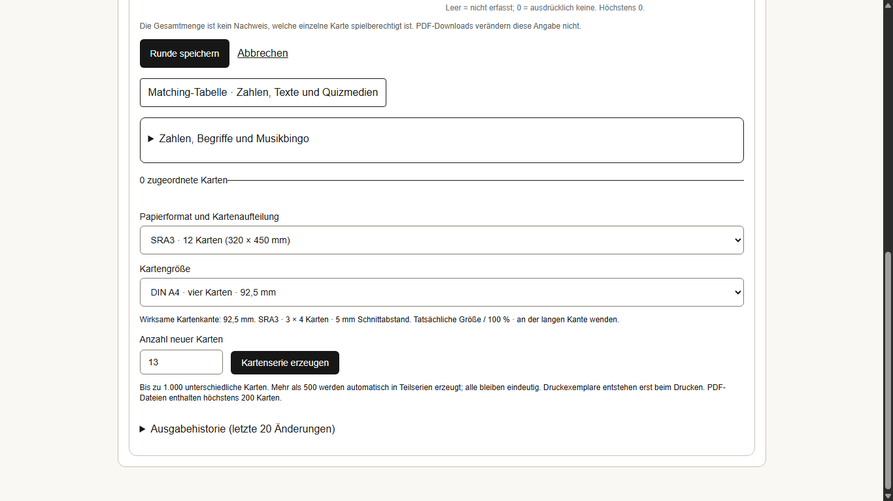
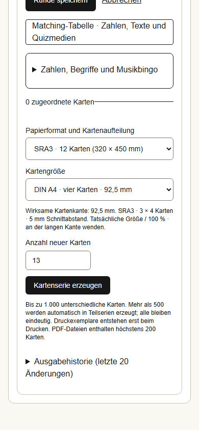
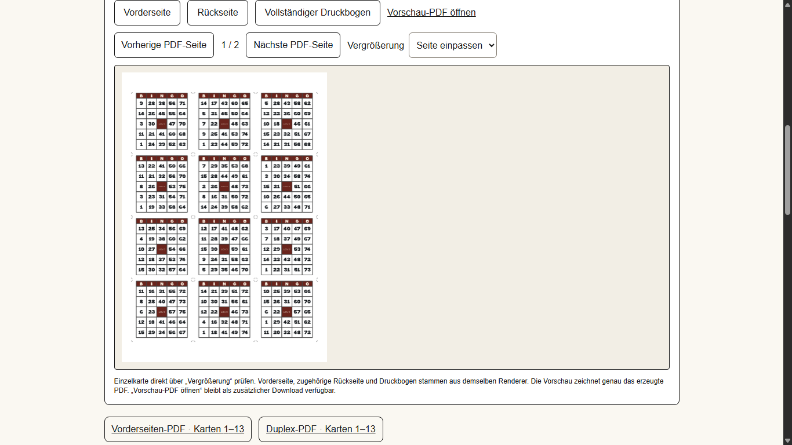
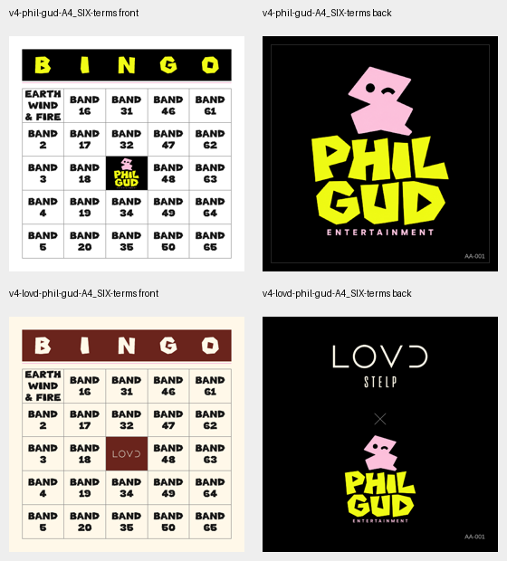

# Abnahmevorbereitung: Bingokarten auf SRA3

Stand: 20.11.2026 · Branch `codex/bingo-sra3`, Basis `450ff29b174e4b118a31f5364f8e7f0531d60704`. Umsetzung und technische Abnahme lokal mit ausschließlich synthetischen Daten. Fachliche Freigabe und physischer Probedruck stehen aus. Kein Merge und kein Production-Deployment.

**Aktueller LOVD-Gestaltungsnachweis:** [PR174-Nachtrag mit neuem 13-Karten-Muster und A-012 in 600 dpi](bingo-lovd-pr174-2026-11-20.md). Die verlinkten Standard-Musterdateien enthalten die korrigierte LOVD-Ausführung. Der Nachtrag dokumentiert separat den unveränderten Wiederexport der alten Version.

## Klickpfad

Bingo → Event anlegen/öffnen → Runde „Bearbeiten“ → „Papierformat und Kartenaufteilung“ → **SRA3 · 12 Karten (320 × 450 mm)** → sichtbare Kartengröße prüfen/auswählen → Anzahl **13** → „Kartenserie erzeugen“ → Serienlink „Karten und PDF“ → nach Neuladen **Duplex-PDF · Karten 1–13**.

Direkte SRA3-Auswahl übernimmt die wirksame Standardkarte mit 92,5 mm. Bei geerbtem A4-sechs bleiben 89 mm erhalten. Für bestehende Serien: Druckeinstellungen ausdrücklich auf SRA3 speichern → Karten und PDF → „Bestehende Karten neu gestalten“ → Vorschau aktualisieren → zusätzliche Druckversion bewusst bestätigen. Alte Version im Versionsselektor weiterhin abrufbar.

## Tatsächliche PDF-Messung

| Profil | Bisherige Kante | SRA3-Kante | Bogen | Raster / Schnittabstand | Außenrand horizontal / vertikal |
| --- | ---: | ---: | --- | --- | --- |
| A4-vier | 92,5 mm | 92,5 mm | 320 × 450 mm | 3 × 4 / 5 mm | 16,25 / 32,5 mm |
| A4-sechs | 89,0 mm | 89,0 mm | 320 × 450 mm | 3 × 4 / 5 mm | 21,5 / 39,5 mm |
| A6-eins | 93,0 mm | 93,0 mm | 320 × 450 mm | 3 × 4 / 5 mm | 15,5 / 31,5 mm |

Maße an tatsächlichen PDF-Seiten und gezeichneten Kartenrechtecken gemessen, nicht ausschließlich aus Konfigurationswerten übernommen. Druckhinweis nennt SRA3, tatsächliche Größe/100 % und lange Kante.

## Prüfungen

| Prüfung | Tatsächliches Ergebnis |
| --- | --- |
| Normaler Browserweg | Neue synthetische Serie mit 13 Karten über Bingo-Vorbereitung; direkte SRA3-Auswahl mit 92,5 mm; nach Neuladen unverändert. Tatsächliche Duplex- und Vorderseitendownloads erfolgreich. |
| Seitenfolge | Duplex vier Seiten: Vorderseite 1–12, Rückseite 1–12, Vorderseite 13, Rückseite 13. Nur Vorderseiten zwei Seiten. |
| Tatsächliche Identitäten | Für alle 13 Browserkarten sämtliche numerischen Vorderseitenzellen aus dem PDF mit gespeicherten synthetischen Zellen verglichen; jeweils eigene Rückseiten-Kurzkennung an der gespiegelt korrespondierenden Position. Keine Spiegelung der Schrift. |
| Vollständiges Raster | Alle zwölf Plätze, 1/12/13 Karten, freie Plätze und zusätzlicher Teilbereich 5–17 an tatsächlichen PDFs geprüft. Horizontale Spiegelung lässt die Kartenschnittkanten digital deckungsgleich werden. |
| Vorschau | Gespeicherte Canvasvorschau und vollständiger Druckbogen geöffnet. Text und Kartenpositionen des Vorschau-PDF stimmen mit dem ersten tatsächlichen Downloadbogen überein. |
| Designvergleich | 36 Kombinationen: V3/V4 × Phil Gud/LOVD × drei Profile × Zahlen/Text/Mischung. 72 ausgeschnittene Vorder-/Rückseiten bei 144 dpi verglichen. V3-LOVD zusätzlich mit individuellen Montserrat-/Arimo-Schriften und abweichender Zahlenfarbe. Langer Begriff „Earth Wind & Fire“ enthalten. |
| Typografie | Tatsächliche PDF-Zeichen, Schriftgrößen und lokale Textpositionen stimmen innerhalb 0,001 pt überein. 89-mm-Profil behält V3-Grenze 36 Zeichen; 37 Zeichen ausdrücklich sowohl auf bisherigem Papier als auch auf SRA3 abgewiesen. |
| Rastervergleich | Keine behauptete Bitidentität der PNGs: translationsbedingtes Antialiasing an Konturen ist vorhanden. Größte mittlere Abweichung 0,839 von 255 Kanalstufen; maximal 0,680 % der Pixel weichen um mehr als 20 Stufen ab. Diese Abweichungen betreffen Rasterkanten; PDF-Maße und Textgeometrie gesondert strikt geprüft. |
| Persistenz/Bestand | Echte isolierte PostgreSQL-Erzeugung mit geerbtem 89-mm-Profil, Reload, identische Wiederholung und Ablehnung geänderter Wiederholung. Zusätzliche SRA3-Druckversion aus vorhandener Serie; alte Snapshots und sämtliche Kartenidentitäten unverändert. |
| Regression | 38 Druck-/Vorbereitungstests und 37 Bingo-/Runtime-Regressionen grün; vollständige isolierte PostgreSQL-Suite einschließlich Rollen, Konflikten, historischer Versionen, Snapshot-/Restoreprüfung grün. |
| Oberfläche | 1366×768 und 390×844 ohne horizontalen Überlauf. |
| TypeScript / ESLint / Build | Typecheck, ESLint für geänderte/neue TS-/JS-Dateien und Next-Build grün. |

[Maschinenlesbare PDF-Messung](assets/bingo-sra3/pdf-verification.json).

## Muster und Bilder

Der folgende Duplexdownload stammt aus dem tatsächlich durchlaufenen Browser-Erzeugungsweg, mit 13 unterschiedlichen synthetischen Karten und dauerhaften Kurzkennungen:

- [13-Karten-Duplexmuster](assets/bingo-sra3/bingo-sra3-13-duplex.pdf)
- [Dieselben 13 Karten: nur Vorderseiten](assets/bingo-sra3/bingo-sra3-13-front.pdf)

## Architektur und Grenzen

Gemeinsame Auswahlkomponente; Profil-/Geometrielogik außerhalb der UI. Vorhandene Generatoren, Renderer und immutable Snapshots weiterverwendet. Alte JSON-Werte bleiben unverändert; keine Datenbankmigration erforderlich. Geänderte Dateien: gemeinsame Format-/Profilprüfung, Druckauswahlparser, Erzeugungs-/Lesepfad, Formularauswahl, vorhandene V3/V4-Renderer und Vorschau-/Downloadgeometrie; gezielte Tests und Spezifikation [Bingo auf SRA3](../architecture/bingo-sra3.md).

Kein physischer Probedruck durchgeführt. Papierzuführung, Druckertreiber-Skalierung und mechanische Duplexregistrierung müssen am vorgesehenen Drucker mit 100 %/langer Kante geprüft werden. Lokaler Browserstand, keine gehostete Preview eingerichtet. Bestehende `pg`-Parallel-query-DeprecationWarning auch in der isolierten Gesamtsuite; keine Änderung der Datenbanktreiber in diesem Auftrag. Keine neuen Anwendungsabhängigkeiten, keine Production-Daten verwendet oder geändert.
