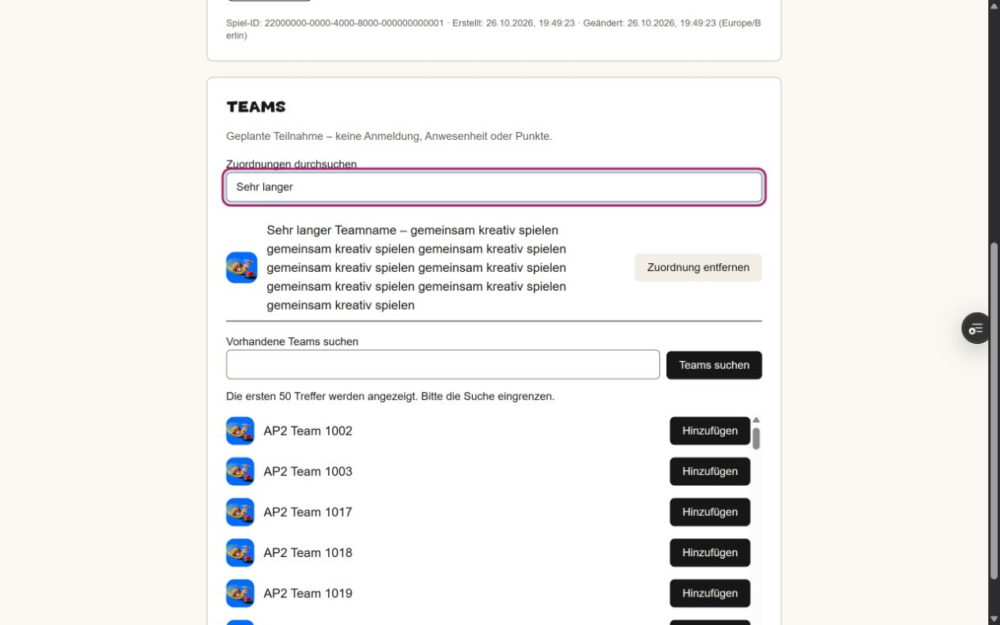
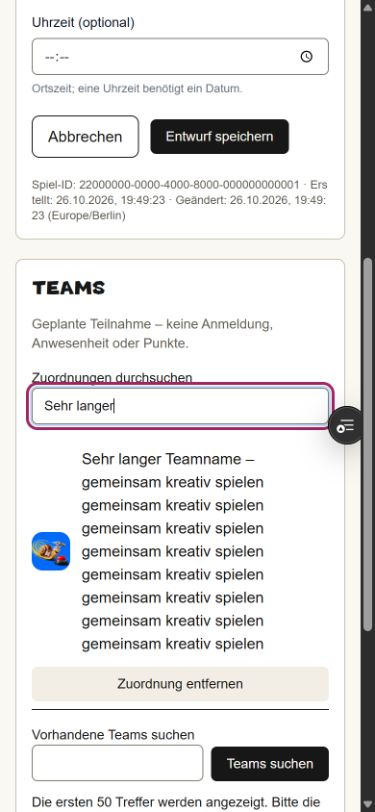
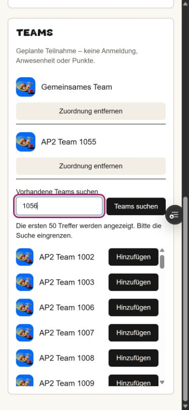
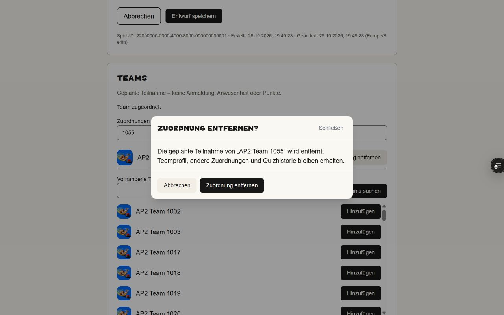

# AP2 – gemeinsame Teamidentitäten, getrennte geplante Teilnahme

## Nachgewiesener Stand

Funktionaler Head `91e8d7f7e03a0ef9fd139d36f581eeb250841dd6`, 26.10.2026. [Architektur, Zuständigkeiten, Rechte-Matrix und Persistenzvertrag](../../architecture/game-team-assignments.md). Der abschließende Dokumentationscommit ändert ausschließlich diesen Bericht und Screenshots. Aktuelle finale Head-/CI-/Deploymentnachweise und der unveränderte Anwendungsdateibaum werden im PR festgehalten. Kein Merge und keine Productionmigration oder -bereitstellung.

[Push-CI 40383882546](https://github.com/justphilgud/pubquiz-web/actions/runs/40383882546) und [PR-CI 40383888971](https://github.com/justphilgud/pubquiz-web/actions/runs/40383888971) vollständig erfolgreich: Prisma, striktes TypeScript, Tests, Changed-file ESLint, Build, echte PostgreSQL-/Server-Action-Tests. [Isolierte Preview 40384597588](https://github.com/justphilgud/pubquiz-web/actions/runs/40384597588) erfolgreich. READY-Deployment `dpl_ALk2gvyGTSGPKZHZ8kBsie8Grae5` und stabile Branch-Aliaszuordnung unabhängig per Vercel-API auf exakt diesen Head geprüft.

## Migration und Betrieb

Neue additive Migration `20261026180000_game_team_assignments`: nur vier Spalten, stabile UUID, PK, UNIQUE(game_id,team_id), Teamindex und zwei RESTRICT-FKs. Echte Tests wenden sie auf einem leeren und repräsentativ mit Quiz, Spielentwurf und Teamprofil befüllten Main-Ausgangsschema an. Vorhandene Zeilen bleiben identisch. Die bekannte alte Bootstrapgrenze bleibt bestehen: die historische vollständige Leerkette ist wegen BOM/doppelter Spalte nicht erfolgreich replaybar. Für die neu angelegte isolierte Preview wurde ausschließlich dort das unveränderte Main-Schema baseliniert; keine bestehende Historie oder Productionbaseline umgeschrieben.

Eigene Reviewdatenbank `game_teams_review_20261026` am bestätigten Development-Host. 63/63 Migrationen angewandt, keine offene Fehlmigration. Nur synthetische Daten: fünf Benutzer, 65 Teams, fünf Entwürfe, zuletzt 15 geplante Verbindungen. Separater Runtimezugang; Lesezugriff auf die reguläre Development-Datenbank nachweislich gesperrt. Die Testzugangsdaten stehen ausschließlich im Chat, nicht hier.

Die echte Backup-COLUMN_SQL-/CATALOG_SQL-Inventur sowie auditColumns/inspectRow erfassen Tabelle, alle vier Spalten und ihre Constraints ohne Ausnahme. Datenbank-UNIQUE wurde mit tatsächlicher doppelter INSERT-Anfrage geprüft. Keine manuellen Backups oder Restores. Gemeinsame Templates/Renderer und tatsächlicher Beitritt/Spielbetrieb sind nicht enthalten.

## Automatische Fachabnahme

Reale PostgreSQL- und Server-Action-Tests prüfen identische Teams in Bingo/Karaoke, getrenntes Entfernen, vier parallele idempotente Add-Anfragen, fremde/manipulierte IDs, fehlende Sitzung, reine Verwaltungsrechte, Bingo-Editor-/Karaokegrenze, Produkte und Rechteentzug, aktive/archivierte Teams/Reihen, alte Stammdatenversion und angezeigte Reihen-ID. Ein tatsächliches Rennen zwischen Add und Reihenwechsel lässt nur eine Operation erfolgreich werden. Mitgliedschaften schreiben keine Stammdatenversion. Teamprofile, Quiz-Teamzeilen und Zugangssessions bleiben erhalten.

Chromium rendert echtes Stammdatenformular und echten Team-Bereich; nur Framework/Persistenz sind dort Adapter. Nachgewiesen: dirty Stammdaten sperren Zuordnungsaktionen, Zuordnungsaktionen rufen keinen Stammdatensave auf, Fehlermeldung/Navigation erhalten Eingaben, Entfernen erfordert Modalbestätigung und Abbrechen schreibt nichts. Diese Adaptertests ersetzen nicht die folgende gehostete Browserabnahme.

## Tatsächlich gehostet im Browser geprüft

- Frischer Passwortlogin als Admin auf unveränderlichem Deployment und stabiler Alias; auf dem finalen funktionalen Head erneut vollständig ab-/angemeldet.
- Dasselbe Team `AP2 Team 1055` Bingo und Karaoke zugeordnet und beide nach vollständigem Reload wiedergefunden. Bingo-Verbindung ausdrücklich entfernt; Karaoke-Verbindung bleibt nach Reload erhalten.
- Entfernen erst abgebrochen und später bestätigt; auf finalem Head außerdem Escape getestet. Keine unbeabsichtigte globale Teamlöschung.
- Großer Zuordnungsbestand (13 bereits vorhandene Bingo-Verbindungen), Suchbegrenzung und serverseitige Namenssuche. Lokale Zuordnungssuche blendet nur aus; vollständiger Reload erhält die Verbindungen.
- Ungespeicherten Titel geändert: Suchen/Hinzufügen/Entfernen gesperrt; Stammdaten weder mitgespeichert noch verworfen. Reihenwechsel bei bestehenden Verbindungen tatsächlich mit verständlicher Servermeldung abgewiesen.
- Neuen Bingo-Entwurf ohne Teams angelegt, separat bearbeitet/gespeichert, vollständig neu geladen: weiterhin keine Teams erforderlich.
- Separater frischer Managerlogin: fremdes Team aus anderer Quizhistorie wird nicht gefunden. Separater Bingo-/Karaoke-only-Login: Hinweis auf fehlenden bestehenden auswählbaren Teambestand, keine globale Suche. Diese Rollenprüfungen erfolgten bereits auf `141252bb`; zwischen diesem und `91e8d7f7` ändern sich ausschließlich mobile Knopfzeile und Test-/Dokumentationsbelege, keine Policy.
- Laptop 1280×800 und Mobilgröße 390×844 mit langem Namen und scrollbar größeren Listen geprüft. Tatsächlich gefundener mobiler Engpass korrigiert: Knopf eigene Zeile, Name 242 px statt schmaler Restspalte; kein horizontaler Überlauf. Nachprüfung auf stabilem Alias mit finalem funktionalem Head.
- Bestehende Quizliste/-detail und globale Teamverwaltung lesend geöffnet. Aggregierte vollständige Zeilenfingerabdrücke für sieben bestehende Tabellen vor/nach Browseraktionen identisch: Teamprofile, Quizze, Quiz-Teamzuordnungen, Zugangssessions, Benutzer, Reihenrollen und Produkte. Kein Quizstart, keine Antworten und keine Produktionsdaten berührt. Keine Browser-Konsolenfehler im finalen Smoke.

## Fachliche Testanleitung

1. Mit dem im Chat bereitgestellten synthetischen Zugang auf der Preview anmelden. **Bingo** → **AP2 · Bingo-Teamplanung** öffnen.
2. Unter **Vorhandene Teams suchen** beispielsweise `1056` eingeben, **Teams suchen**, beim Treffer **Hinzufügen**. Die Verbindung wird unmittelbar gespeichert; **Entwurf speichern** ist dafür nicht nötig.
3. Vollständig neu laden: die Verbindung steht unter **Teams**. Bei größerem Bestand hilft **Zuordnungen durchsuchen**; die Suche löscht nichts.
4. Unter **PowerPoint-Karaoke** → **AP2 · Karaoke-Teamplanung** dasselbe Team genauso hinzufügen und neu laden.
5. In Bingo **Zuordnung entfernen** zunächst mit **Abbrechen** schließen: Verbindung bleibt. Anschließend erneut öffnen und **Zuordnung entfernen** bestätigen: nur die Bingo-Verbindung verschwindet, Karaoke bleibt erhalten.
6. Einen Titel ändern, ohne zu speichern: Zuordnungsaktionen sind gesperrt. Erst Stammdaten ausdrücklich mit **Entwurf speichern** sichern oder den Wechsel über **Abbrechen** bewusst ausführen. Ein Reihenwechsel bleibt bei vorhandenen Verbindungen gesperrt.

Teams bleiben optional und die Spiele nicht spielbar. Keine öffentliche Anmeldung, Team-Sitzung, Punkte, Kamera oder Offline-Synchronisation hinzugefügt. Native Navigationsdialoge werden hier nicht als neue menschliche Abnahme behauptet; der bestehende Guard wird wiederverwendet und automatisch mit kontrollierter Bestätigung geprüft. Physischer Geräte-/Beamertest ist nicht enthalten.

## Screenshots der gehosteten Preview

