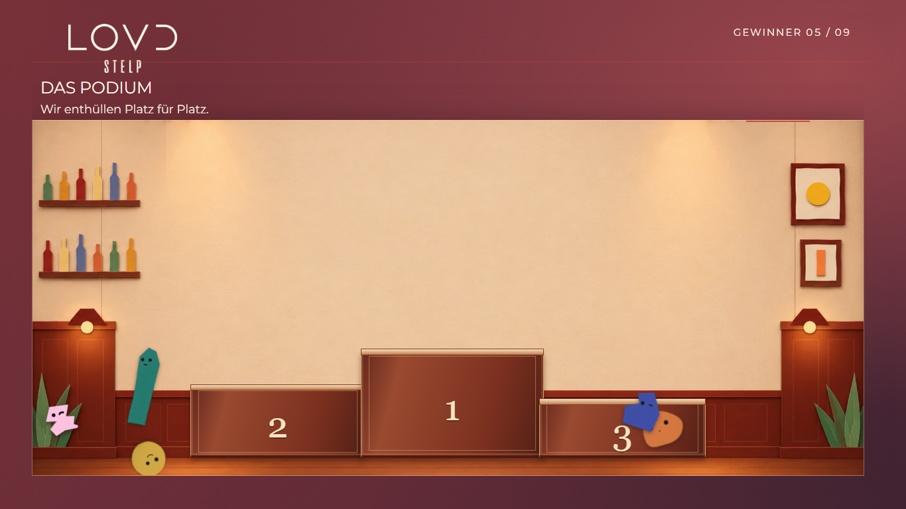
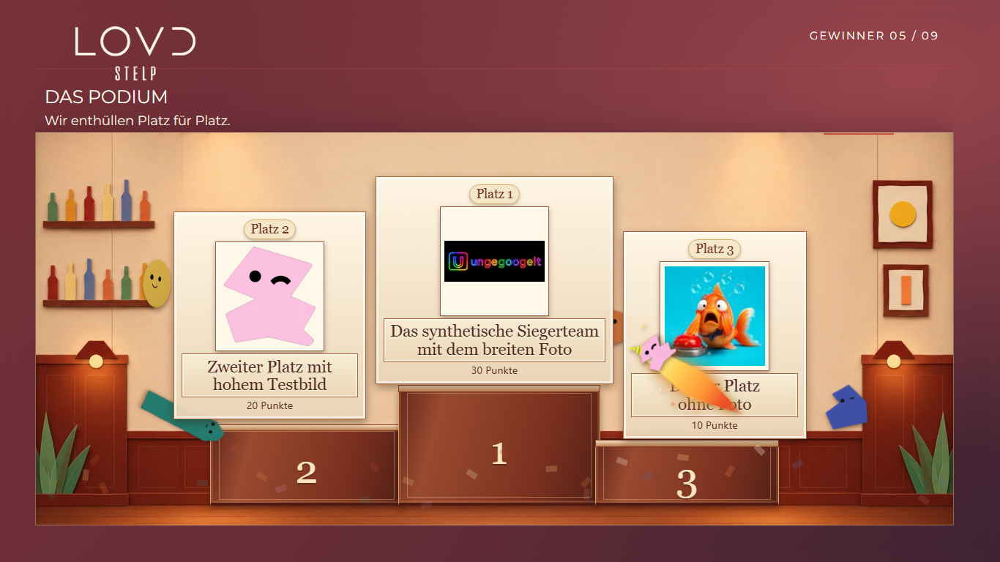
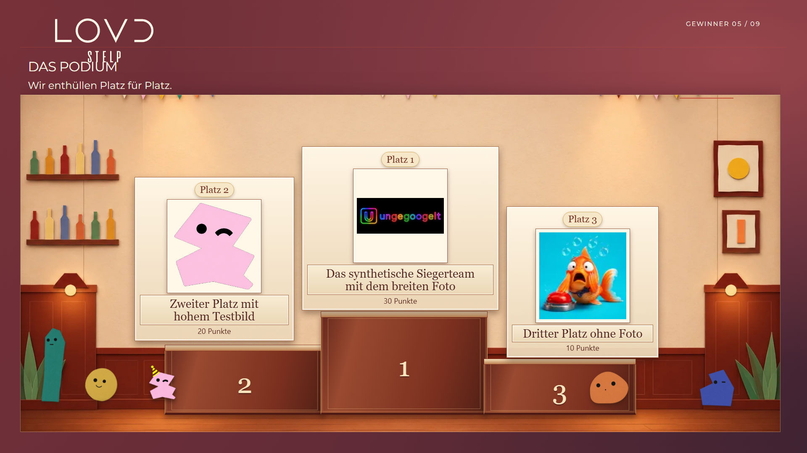
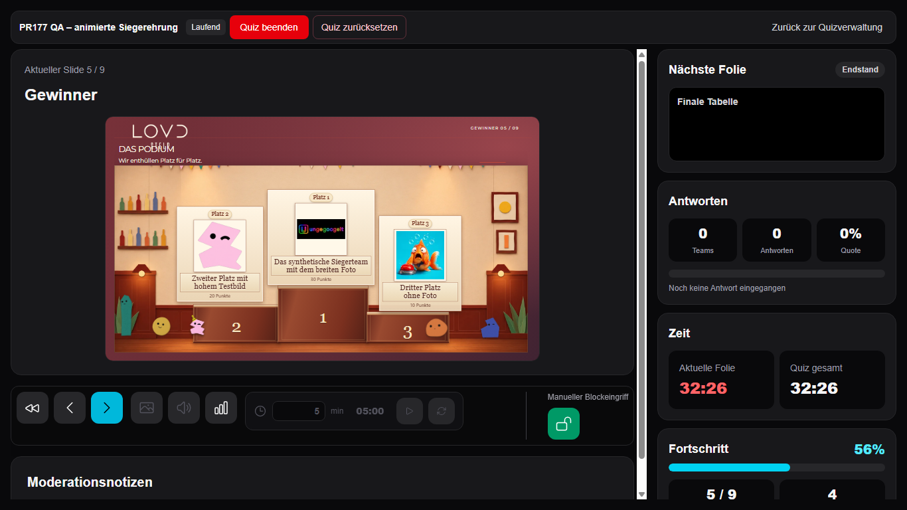
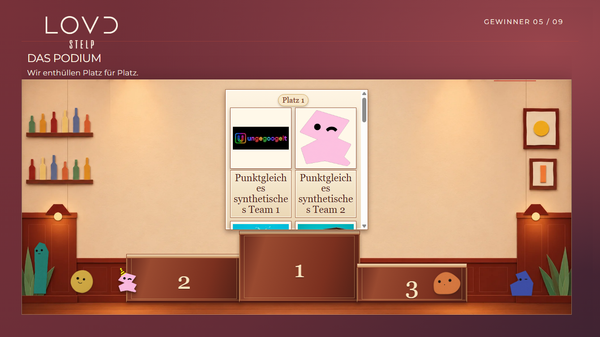

# Animierte Siegerehrung – technische Preview-Abnahme

Stand: 22. November 2026. [PR #177](https://github.com/justphilgud/pubquiz-web/pull/177) ist offen. Kein Merge, kein Production-Deployment und kein Backup in diesem Auftrag. **Technische Preview-Abnahme bestanden; fachliche Sichtung/Freigabe durch den Auftraggeber offen.**

## Preview und geprüfter Stand

- [Präsentation der Siegerehrung](https://pubquiz-i72ycikjp-just-phil-gud.vercel.app/quiz/16/praesentation)
- [Zugehörige Moderation](https://pubquiz-i72ycikjp-just-phil-gud.vercel.app/quiz/16/moderation): mit „Weiter“ die vorhandenen Ranggruppen enthüllen.
- [Gleichstandsfall mit zwölf Teams](https://pubquiz-i72ycikjp-just-phil-gud.vercel.app/quiz/17/praesentation)
- Geprüfter Anwendungscode: `9d699d373ef356616a94e573385cd30bdd3e5626`. Der nachfolgende Abschlusscommit ergänzt ausschließlich diesen Bericht und seine Screenshots/Messbelege; die Preview-Anwendung bleibt identisch.
- Geschützte Vercel-Preview, branchbezogene synthetische Review-Datenbank und AUTH_SECRET; vorhandener Automation-Bypass nur im isolierten Testbrowser per Header verwendet, weder veröffentlicht noch Schutz deaktiviert.
- Eigene synthetische Quizze 16/17, kein produktiver Datenbestand. Nach Prüfung beide Fixtures wieder auf Zähler 0 gestellt; eigene Testbrowser geschlossen. Keine echten Bewertungen oder Punkte bearbeitet.

## Verhalten und bewusste Entscheidungen

| Zustand / Moderationsschritt | Ergebnis |
| --- | --- |
| Öffnen mit Zähler 0 | Drei leere Podeststufen; fünf Figuren tanzen. Platz 1 steht in der Mitte, Platz 2 links, Platz 3 rechts. |
| Erster Reveal | Figuren sammeln sich; nach 2,2 Sekunden erscheint die erste vorhandene Ranggruppe. Im normalen Dreierfall Platz 3. |
| Nächster Reveal | Platz 2 und verstärktes, endliches Konfetti; bereits enthüllte Karten bleiben stehen. |
| Gewinner-Reveal | Platz 1 mittig, Gudi mit Partyhut und Raketenschweif, Konfetti und eigene Figurenbewegungen. Finale endet nach spätestens 7,8 Sekunden im dezenten Jubelbild. |
| Danach | Weiter zur nächsten regulären Folie, keine zusätzliche erfundene Tabellenphase im Podium. |
| Erneutes Öffnen eines enthüllten Stands | Gespeicherte Karten sofort sichtbar, kein erneutes Raketenfinale. |
| Reduzierte Bewegung | Sofortige Endposition ohne Sammelpause, Konfetti, Raketenschweif oder Pseudo-Elementanimationen. |
| Gleichstand | Gemeinsame tatsächliche Ranggruppe; fehlende Ränge werden nicht als Teamgruppen erfunden. Große Gruppen bleiben vollständig in einer fokussierbaren Scrollfläche erreichbar. |

Quadratisch ist die Bildfläche. Breite/hohe Fotos bleiben vollständig mit contain sichtbar, statt Gesichter beliebig anzuschneiden. Ohne Foto erscheint der bestehende Team-Avatar. Titel und Beschreibung der konfigurierten Gewinnerfolie bleiben erhalten. Die bestehende Designmanifest-Ausnahme für diese bewusst spielerische Siegerehrung ist dokumentiert; reduzierte Bewegung und Bildschutz bleiben verbindlich.

## Architektur, Persistenz und Invarianten

PresentationSlideRenderer bleibt der gemeinsame Einstieg für Präsentation und Moderationsvorschau. PodiumCeremony liest ausschließlich Scores/Snapshot und Revealzähler und orchestriert lokale Zustände. PodiumCelebrationCrowd stellt Figuren, Gudi und Konfetti dar. CSS begrenzt Bewegung und Bildflächen auf die Bühne. Es gibt keine neue Präsentationsengine, keine neuen Moderationsklicks, DB-Felder, Migrationen oder Abhängigkeiten.

Rangfolge, gültige Stichentscheide, gemeinsame Ranggruppen, Punktestand und eingefrorener podium_snapshot bleiben unverändert maßgeblich. Animationen und lokale Timer schreiben keine Daten, navigieren nicht und blockieren keine Player-Quittung. Schnelle neue Reveals ersetzen alte Timer; Unmount räumt lokale Timer/Animationen auf. FINAL_STANDINGS bleibt eine separate Folie. AP5-Analyse und Bewertungslogik unberührt.

## Ausgeführte Prüfungen

| Prüfung | Ergebnis |
| --- | --- |
| Lokale Unit-/Renderer-/Snapshot-/Ranking-/Navigationsregressionen | 70 erfolgreich; Renderer nach Erhalt von Titel/Beschreibung nochmals erfolgreich. |
| Echter Zwei-Fenster-Browsertest | Erfolgreich: Quittung ohne Fokus/Animationsframes, Phasen, schnelle 0→1→3-Folge, erneutes Öffnen, Fotoformate, zwölf Gleichstände, reduzierte Bewegung einschließlich Pseudo-Elementen und sichtbare Gudi-Ebenen. |
| TypeScript und ESLint aller geänderten TS-Dateien | Erfolgreich; diff-check sauber. |
| [Push-CI 45059964868](https://github.com/justphilgud/pubquiz-web/actions/runs/45059964868) | Alle drei Jobs erfolgreich, einschließlich Tests, Typecheck, Changed-file ESLint und regulärem Produktionsbuild. |
| [PR-CI 45059970245, Versuch 2](https://github.com/justphilgud/pubquiz-web/actions/runs/45059970245/attempts/2) | Alle drei Jobs erfolgreich. Versuch 1 scheiterte am Chrome-Start des GitHub-Runners, vor den Browserassertionen. Einmal unverändert neu gestartet; keine Assertions/Timeouts gelockert. |
| Gehosteter Next-/DB-Durchlauf | Erfolgreich: 3→2→1, Gudi/Konfetti, Platz 1 zwischen2/3, quadratische geladene Fotos/Avatar, Moderationsvorschau, Ende der Effekte und Reload ohne Wiederholung. |
| Gehosteter Gleichstands-/Reduced-Motion-Durchlauf | Zwölf Teamidentitäten ausschließlich auf Rang1, begrenzte fokussierbare Scrollfläche, aktive Reduced-Motion-Präferenz und null laufende Animationen, Schweif ausgeblendet; danach nächste reguläre Endstandfolie. |
| Geometrie | 1280×720 und 1920×1080: alle drei Karten innerhalb der Bühne, Bildrahmen quadratisch. Screenshots zusätzlich 1366×768 und verkleinerte Moderationsvorschau. |
| Production-Abgrenzung | Aliasse ausschließlich lesend weiter auf e75c47cb bestätigt; kein Merge/Production-Deployment, keine Änderung produktiver Nutzdaten. |

Bei der gehosteten Prüfung gefundene Ebenenfehler sind behoben: ruhende Figuren verschwanden hinter dem Podest und Gudi teilweise hinter den Karten. Eine erste Reduced-Motion-Messung verlor ihre Testemulation beim Verbindungswechsel; die finale Prüfung hält Emulation, Nutzeraktion, Messung und Screenshot in derselben Testsitzung und belegt matchMedia=true sowie null laufende Animationen. Navigation wurde erst nach bestätigtem/entsperrtem Moderationsstand fortgesetzt; ein früher Testklick während der Quittungsphase wurde nicht als neue Navigation gezählt.

## Screenshots und Messbelege

Alle Bilder stammen aus der genannten gehosteten Preview mit synthetischen Daten. [Strukturierte Messwerte](assets/podium-ceremony/measurements.json).

## Bekannte Grenzen und offene Abnahme

- Fachliche Sichtung der Choreografie durch den Auftraggeber steht aus. Technische Abnahme ist keine Merge-/Production-Freigabe.
- Physischer Beamer, Veranstaltungston/-netz sowie Safari/iOS wurden nicht neu geprüft. Keine Performance-/Last-/SLA-Zusage; alte P0-Restgrenzen aus PR #175 bleiben unverändert.
- Große Gleichstände und extrem lange Teamnamen benötigen die dokumentierte Scrollfläche; beliebig viele Karten passen nicht gleichzeitig lesbar auf eine endliche Bühne. Ein Foto kann weiterhin durch den bestehenden Avatar ersetzt werden, wenn keines hinterlegt ist.
- Bewegungsphasen laufen lokal. Später geöffnete Fenster zeigen den gespeicherten Rangstand ohne Wiederholung der Enthüllung; es gibt keine framegenaue, geräteübergreifende Choreografiesynchronisierung. Die fachlichen Rang-/Navigationsdaten bleiben serverseitig synchron.
