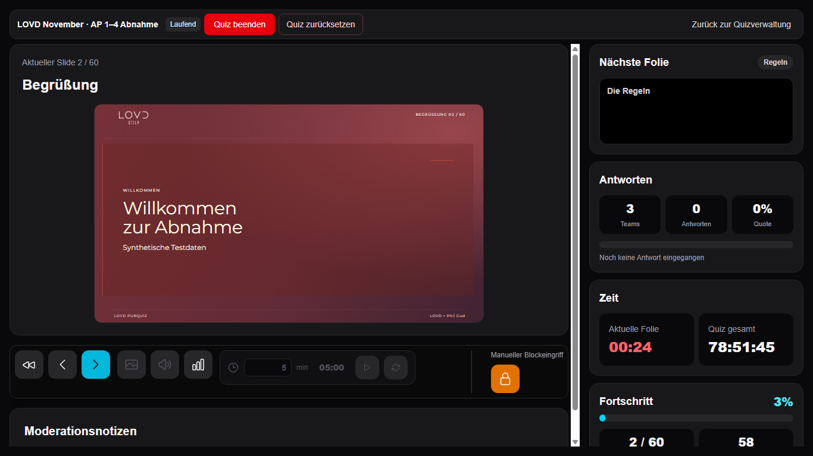
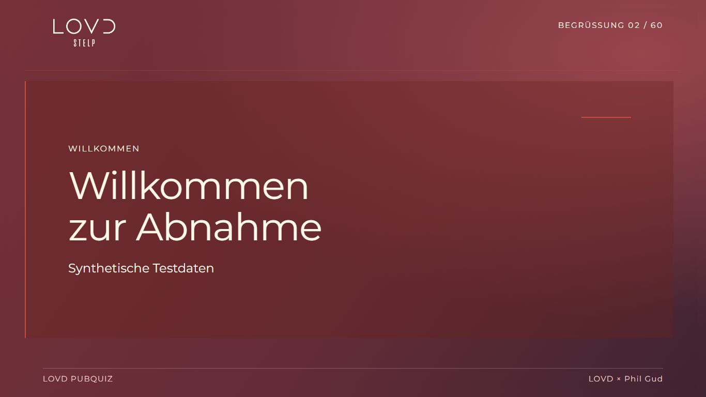

# PR175: reale P0-Latenzdiagnose

## Verifizierte Basis

PR175 offen, Branch `codex/quiz-moderation-corrections`, Ausgangshead
`b878a7050dd21bc109ebd82e4cb26eb450e9d337`. Aktuelle Prüfungen der Basis erfolgreich.
Production-Runtime am 22.11.2026 über das lesende Monitoring bestätigt:
`31f99fe4f01596880dcec8ba614108fa5e1cd440`. Kein Production-Eingriff.
Ausgangspreview: `dpl_GvbNQ7Hy5PZQ9TQi5rYqGZf1hG1d`, ausschließlich synthetische
Review-Datenbank. Die vorhandene Anfrage-/Rückmeldesperre ist noch unverändert.

## Gesicherte Vorher-Belege

Die ursprünglichen fünf `moderator-slide-mutation`-Logereignisse sind zugänglich:
Handlerlaufzeit 133,9–273,3 ms. Ohne gemeinsame Korrelations-ID lässt sich der
ursprüngliche 1→2-Eintrag nicht ausschließlich aus der Reihenfolge beweisen.
Die alten Browserwerte 14.361,9 + 12.906,7 ms werden daher nicht nachträglich als
Datenbanklatenz interpretiert.

Erneute echte Next-/Datenbank-Reproduktion mit genau zwei Testtabs, Fokus in der
Moderation und `document.hasFocus() === false` / `visibilityState === hidden` im
Player. Der erste 1→2-Lauf nach Seitenöffnung benötigte **42.315 ms** bis zur
erneuten Bedienbarkeit. Die spätere Playerübernahme wurde ebenfalls beobachtet.
Ein weiterer Lauf überschritt das zusätzliche Player-Beobachtungsfenster; die
Serie wurde deshalb noch nicht als zehn vollständig gemessene Warmläufe gewertet.
Kein Alert; die Sperre löste sich später. Kein behaupteter Erfolg.

Browsertrace und Vercel-Logs sind für eine konkrete Snapshot-Anfrage verbunden:

- Vercel-ID `fra1::fra1::bckfm-1795354610980-07caf0f6daed`.
- Korrelations-ID des Browsers `5661a724-e9be-416a-a636-ce892250854f`.
- Normales HTTP, `/api/quiz/live-snapshot`, HTTP/2, Status 200, rund 29.479,7 ms
  Gesamtnetzwerkzeit und 29.477,8 ms bis zu den Antwortheadern.
- Exakt derselbe Vercel-Request meldet **548,1 ms** Handlerzeit, darin Auth 20,2 ms,
  Snapshot 524,1 ms, Serialization 0,009 ms, 23 Queries / 266,1 ms Querysumme.
- Rund 28,9 Sekunden liegen somit außerhalb dieses gemessenen Handlers. Da ein
  normaler HTTP-Endpunkt betroffen ist, ist eine reine clientseitige Server-Action-
  Serialisierung keine hinreichende Erklärung.

Die installierte Next.js-Dokumentation bestätigt zwar, dass lesende Server Actions
serialisiert werden (`backend-for-frontend.md`, „Server Actions are queued“ und
`07-mutating-data.md`). Der Player verwendet zwei davon pro Pollingrunde. Das ist
ein untersuchter Einflussfaktor, aber aktuell keine vollständig belegte Ursache.
Client- und Plattform-Wanduhren unterscheiden sich zudem um etwa 5,3 Sekunden;
Differenzen zwischen ihnen werden nicht ohne Kalibrierung als Laufzeit verwendet.

## Befristete zusätzliche Preview-Diagnostik

`navigationTrace.ts` und `navigationTrace.server.ts` verbinden die zufällige
`x-qa-correlation` mit Start-/Endzeit von Proxy einschließlich Authentifizierung,
Navigationsaktion, Status-/Snapshot-Serveractions und HTTP-Snapshot.
Die vorhandenen numerischen Prisma-/Navigationsphasen bleiben erhalten.
Der isolierte Browser zeichnet HTTP-Send/Response, tatsächliche React-Übernahme,
Broadcast-Versand/-Empfang, Bedienbarkeit und Plattform-Request-ID auf.

Nur Preview, nur zulässige zufällige Kennungen; automatisches Ende 24.11.2026,
00:00 UTC. Keine Quiz-/Teamnamen, Antworten, Medien, Positionsschlüssel, Cookies,
Secrets oder SQL-Parameter. Kein geändertes Timeout, keine neue Quittung und keine
Änderung der Navigations-, Lifecycle-, Rechte- oder Sperrlogik. Produktionslogging
bleibt deaktiviert. Die Diagnose ist **noch keine Latenzkorrektur**.

## Neue Preview und vollständige Messung

Getesteter Codehead: `fd3317fd3eee40249c824db3376be872b26c2b8f`.
Deployment: `dpl_7BJyG4rjuYsH7CPWo6DXMeH69p6h`.
[Gemeinsame geschützte Preview](https://pubquiz-7s7nnkgkr-just-phil-gud.vercel.app).
Die nachfolgenden Dokumentationsänderungen ändern diesen getesteten Code nicht.

Erste Serie: zwei Tabs in einem separaten, ausschließlich für diesen Test
angelegten Chrome-Profil. Erstwechsel 2.002 ms; zehn Warmläufe, Median
**1.501,5 ms**, P95 (Nearest Rank) **2.020 ms**.

Zusätzliche verbindliche Zwei-Fenster-Serie: zwei getrennte Browserfenster
mit echter Preview, Next und synthetischer Datenbank. Playerfenster minimiert,
`document.hasFocus() === false`, `visibilityState === hidden`. Kein erzwungener
Fokuswert. Nach dem Erstwechsel sind Player-Animationsframes angehalten.
Zwischen Lauf 5 und 6 wurde der Player aktiviert und anschließend zur Moderation
zurückgewechselt. Alle zehn gemessenen Warmläufe blieben unfokussiert.

Alle Werte in ms ab dem Moderationsklick; „Server“ ist die Dauer der Navigation
innerhalb der Anwendung, „HTTP“ die vollständige Browseranfrage. Die
DOM-Beobachtung zeigt die tatsächlich übernommene Foliennummer, keine erfundene
Quittung. Senden/Empfang erfassen den echten BroadcastChannel.

| Lauf | Server | HTTP | Player-DOM | ACK gesendet | ACK empfangen | Wieder bedienbar |
| --- | ---: | ---: | ---: | ---: | ---: | ---: |
| Erstwechsel | 150 | 282,0 | 934 | 935 | 936 | 995 |
| 1 | 141 | 320,6 | 2.017 | 2.019 | 2.019 | 2.071 |
| 2 | 151 | 282,7 | 2.133 | 2.134 | 2.134 | 2.177 |
| 3 | 135 | 223,4 | 1.880 | 1.882 | 1.882 | 1.945 |
| 4 | 114 | 200,2 | 1.921 | 1.922 | 1.922 | 2.008 |
| 5 | 136 | 225,4 | 1.914 | 1.915 | 1.915 | 1.935 |
| 6 | 159 | 257,8 | 2.017 | 2.018 | 2.018 | 2.068 |
| 7 | 159 | 246,7 | 1.926 | 1.927 | 1.927 | 1.987 |
| 8 | 144 | 242,7 | 987 | 988 | 988 | 997 |
| 9 | 142 | 248,4 | 1.931 | 1.932 | 1.932 | 1.984 |
| 10 | 136 | 724,8 | 1.965 | 1.966 | 1.966 | 2.005 |

Median **1.996 ms**, P95 **2.177 ms**: Zielwerte in dieser Stichprobe erreicht.
Die Bedienbarkeit wird alle 50 ms beobachtet; der gemeldete Zeitpunkt ist eine
obere Beobachtungsgrenze einschließlich CDP-Aufwand. Der Median liegt nahe am
Zielwert; zehn Stichproben sind keine Langzeitgarantie.

Jeder Dreifachklick löste genau **eine** serverseitige Navigation aus; alle
Fenster erreichten Folie 2, keine übersprungene Folie, kein Alert und keine
Dauersperre. Zurücksetzen erfolgte ausschließlich als normale Navigation auf
Folie 1, ohne Lifecycle-Reset oder Änderung von Bewertungen. CAS,
Lifecycle-Revision, Quiz-Lock und synchrones Doppelklick-Gate blieben unverändert.

Die Servertraces derselben Serie ergeben: Proxy einschließlich Auth 1–32 ms,
Status-Poll 19–25 ms, Snapshot-Serveraction 23–36 ms und HTTP-Snapshot 35–120 ms.
Die Zielnavigation verwendet jeweils 73 erfasste Queries mit summierten
Querydauern von 160,4–215,5 ms. Die Summe darf wegen paralleler Abfragen größer
als die Handler-Wandzeit sein. Der verbleibende normale Warteanteil ist mit
Polling und Netzwerk vereinbar; die tatsächliche Playerübernahme liegt vor ACK.
Zufällige gemeinsame Kennungen, getrennte Phasen und Request-IDs sind in den
[numerischen Messbelegen](evidence/pr175-p0-two-windows.json) enthalten;
[erste Tabserie](evidence/pr175-p0-tabs.json).

Visuelle Kontrolle derselben synthetischen Preview nach der Tabserie:

### Erststart / Kaltstartgrenze

Die erste Navigation nach neuer Seitenöffnung ist jeweils separat ausgewiesen;
initiale Dokument-/Pollinganfragen wurden vor den Warmläufen aufgezeichnet.
Ein **vom Provider bestätigter Function-Kaltstart** ist daraus nicht belegbar.
Die beiden Erstwechsel sind deshalb ausdrücklich keine verifizierten
Provider-Kaltstartmessungen. Ein solcher Kaltstart wurde nicht durch Eingriffe in
Production oder künstliche Änderungen an der Datenbank erzwungen.

## Befund, Grenzen und nächste Maßnahme

Die alte Verzögerung ist für eine konkrete HTTP-Anfrage als überwiegend
**außerhalb des gemessenen Snapshot-Handlers** belegt: 29.479,7 gegenüber
548,1 ms. Ob im alten Deployment Proxy, Plattform-Warteschlange, Transport oder
eine Kombination verantwortlich war, ist anhand der verfügbaren alten Logs
nicht abschließend zu trennen. Die neue Preview zeigt diesen langen Anteil
nicht mehr. Das zusätzliche Tracing und ein neues Deployment sind **kein
nachgewiesener funktionaler Codefix**. Es wurden keine Timeouts verlängert,
Sperren gelockert oder Polling-/Bewertungsregeln geändert.

**P0 bleibt offen und PR175 nicht releasebereit**, trotz erreichter warmer
Zielzeiten auf der neuen Preview. Erforderlich ist die Aufklärung der alten
Request-Lücke anhand der Plattformdaten (Vercel-Request
`bckfm-1795354610980-07caf0f6daed`, altes Deployment oben) bzw. eine ausdrückliche
fachliche Akzeptanz der dokumentierten Restgrenzen mit zusätzlicher wiederholter
Preview-Beobachtung. Ohne belegte Codeursache erfolgt keine spekulative Korrektur.
Die eigene Diagnose-Browserinstanz wurde nach beiden Serien geschlossen.

## Prüfungen und Architektur

Die bestehende Navigation, Autorisierung, Pollingverantwortung und Quittierung
bleiben in ihren vorhandenen Komponenten. Neu ist ausschließlich ein zentraler,
befristeter Diagnosehelfer für numerische Phasen. Einstiegspunkte delegieren die
Korrelationsprüfung und Datenminimierung an diesen Helfer.

Betroffene Produktdateien: `proxy.ts`, `app/lib/navigationTrace.ts`,
`app/lib/navigationTrace.server.ts`, `app/api/quiz/live-snapshot/route.ts`,
`app/quiz/actions.ts`, `app/quiz/[quizId]/praesentation/statusActions.ts`.
Testgrenzen wurden in `participantQuestionPayload.test.ts` und
`sponsorNavigation.test.ts` um explizite No-op-Diagnosemocks ergänzt, ohne
Assertions zu lockern. `navigationTrace.test.ts` prüft Preview-/Ablaufgrenze,
ungültige IDs und die numerische Allowlist; Einbindung im vorhandenen Testskript.

Lokale Prüfungen: TypeScript, Changed-file ESLint und Build erfolgreich.
51 fokussierte Diagnose-/Sicherheitsprüfungen, 91 Feature-/Runtime-Regressionen,
45 tatsächliche Sponsor-/Payload-/Diagnoseprüfungen und 23 Countdown-/Recovery-
Prüfungen erfolgreich (überlappende Suiten, keine addierte Testgesamtzahl).
Der erste Diagnose-CI-Lauf fand einen fehlenden VM-Testmock; dieser wurde
korrigiert. Für den getesteten Head `fd3317fd` sind **alle sechs CI-Checks grün**:
[Push-CI](https://github.com/justphilgud/pubquiz-web/actions/runs/45033618707),
[PR-CI](https://github.com/justphilgud/pubquiz-web/actions/runs/45033624593).
Bekannte vollständige Repository-Lint-Schulden bleiben gesondert informativ;
Changed-file ESLint ist erfolgreich.

Kein Merge, Backup, Snapshot, Production-Preflight, Production-Migration oder
Production-Deployment. Siegerehrungsanimation und Bingo-Linienfarbe unberührt.
