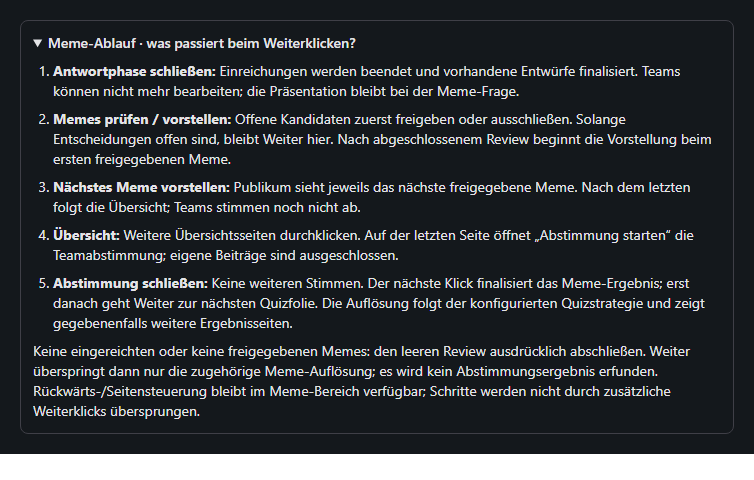
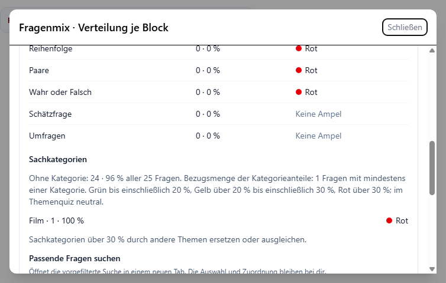
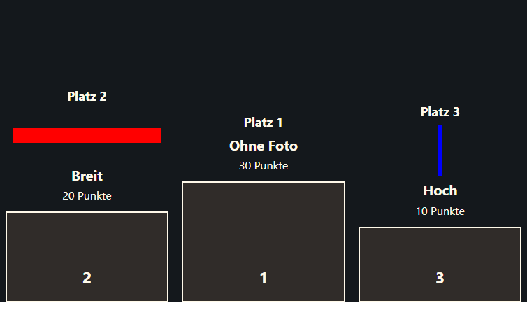

# Quiz-Korrekturen: Abnahme und Ist-Analyse

**P0-Releaseblocker:** Die spätere echte Preview zeigte erhebliche Verzögerungen.
Die [gesonderte korrelierte Latenzdiagnose](pr175-p0-latency-2026-11-22.md) ergänzt
die folgenden lokalen Nachweise; PR175 ist bis zu ihrer bestandenen Abnahme nicht
releasebereit. Kein Merge oder Production-Eingriff im Diagnoseauftrag.

Basis: aktuelles `origin/main` vom 22.11.2026, `31f99fe4f01596880dcec8ba614108fa5e1cd440`.
Separater Branch `codex/quiz-moderation-corrections`. Kein Merge, kein Production-
Deployment, keine produktiven Quiz-, Antwort- oder Bewertungsänderungen.

## P0: Ursache und Korrektur

Der Server persistierte den Folienwechsel bereits erfolgreich. Die Moderation
übernahm diesen Stand, wartete anschließend aber auf einen BroadcastChannel-Beleg
des Players. Der Player veröffentlichte seine neue Position erst nach zwei
`requestAnimationFrame`-Callbacks und endlichen Podiumsanimationen. Hintergrundtabs
können diese Frames aussetzen. Der 15-Sekunden-Timeout wurde deshalb fälschlich als
fehlgeschlagener Wechsel dargestellt. `unconfirmedPosition` sperrte danach die
Toolbar; weitere Navigation wiederholte nur die identische Anzeigeprüfung. Fokus
konnte die ausstehenden Frames freigeben und damit scheinbar den Fehler beheben.

Der Player quittiert jetzt den tatsächlich von React übernommenen Zielzustand,
ohne Fokus-/Frame-/Animationsvoraussetzung. Das ist ein Anwendungsbeleg, kein
Beweis sichtbarer Beamerpixel. Der Server bleibt die einzige Navigationsquelle.
Ein fehlender Beleg erzeugt nach dem begrenzten Warten einen getrennten Hinweis
„Wechsel gespeichert“, keine falsche Aktionsfehlermeldung und keine Dauersperre.
Eine verspätete passende Quittung löscht den Hinweis. „Anzeige erneut prüfen“
schreibt keine Navigation; echte Fehler bieten zusätzlich einen rein lesenden
Serverabgleich. Ausgangsschlüsselprüfung, Quiz-Lock, Lifecycle-/Blockregeln und
synchroner Doppelklickschutz bleiben erhalten. Kein zweiter Navigationsbefehl.

**Regression:** Echter Chrome mit zwei getrennten Same-Origin-Fenstern und den
produktiven React-Hooks/BroadcastChannels. Die Moderation bleibt fokussiert,
`document.hasFocus()` im Player ist falsch und sein rAF wird vollständig ausgesetzt.
Frage → Lösung → nächster Block → Podium 0/1 → Quizabschluss werden bestätigt, ohne
einen Frame anzufordern. Deterministische Tests decken verspätete/fehlende Belege,
genau einen Schreibbefehl, Wiederprüfung, echten Fehler und Freigabe des Gates ab.
Der ausführbare Test der tatsächlichen Moderationskomponente deckt schnelle
Mehrfachklicks, Weiter nach fehlendem Beleg, Fehler und Zurück ab.

Grenze: Der Browsertest simuliert den Server-Zustandswechsel, nicht ein neu
angelegtes vollständiges Next-/DB-Quiz. Andere Geräte/Profile liefern weiterhin
keine lokale BroadcastChannel-Quittung. Alte bereits geöffnete Oberflächen müssen
für das neue Protokoll neu geladen werden. Browser-/OS-Komplettsuspendierung und
physische Beamerprüfung sind nicht nachgewiesen.

## Meme und Fragennummern

Die Moderation erklärt unmittelbar an der Hauptsteuerung den bestehenden Ablauf:
Antwortphase schließen → Kandidaten prüfen → einzelne freigegebene Memes vorstellen
→ Übersicht(en) → Abstimmung öffnen → schließen → Ergebnis finalisieren → nächste
Quizfolie. Der ausdrücklich abgeschlossene leere Review überspringt nur die eigene
Auflösung. Die Auflösung folgt weiter der Quizstrategie. Die Hauptaktion benennt
nun insbesondere den Wechsel vom letzten Meme zur Übersicht und vom fertigen
Ergebnis zur nächsten Quizfolie konkret. Keine Änderung an Voting oder Punkten.

Der gemeinsame Header zeigte die Decknummer schon auf Fragefolien; auf Auflösungen
verwendete er dagegen nur das generische Label. Frühe Spezialtemplate-Rückgaben
innerhalb des Inhalts erhielten dort keinen zusätzlichen Nummerntext. Der Header
verwendet nun auf Frage und Auflösung `frageIndexImBlock`; auch die kleine
Moderationsvorschau zeigt diese Nummer. Alle vorhandenen Frage-Inhaltsnummern
bleiben erhalten. Intro/Trenner/Erklärung werden nicht nummeriert.
Meme, Übersetzung und Paare erhalten zudem eine gemeinsame Nummernzeile in der
Inhaltsfläche selbst: Ihre frühen Spezialzweige hatten die Nummernzeile des
Standardfrage-Inhalts nicht übernommen. Die Regression verlangt deshalb explizit
`data-question-sequence` innerhalb der Komposition und prüft nicht nur den Header.
Renderer-Regression: Meme, Übersetzt-vorgelesen und Paare in sechs Designwelten,
Frage/Auflösung und Moderationsvorschau, Nummernfolge 17 → 1 → 8 → 17; bestehende
Decktests prüfen die Neuordnung und den Neustart bei Blockwechsel.

## Kategorie-Ampel: gezählt wird Folgendes

Der Ausgangsstand verwendete alle Fragen eines Blocks als Nenner, auch ohne
Kategorie. Mehrfachkategorien zählten je Kategorie einmal. Kategorien mit null
Fragen waren unsichtbar; die Detailansicht zeigte lediglich einen Leerhinweis.
Die bisherige Rechnung konnte eine einzelne zugeordnete Kategorie durch viele
unzugeordnete Fragen stark verdünnen. Template-Ampeln haben einen eigenen Nenner.

Die widersprüchlichen Grenzen im neuen Auftrag wurden **vor Umsetzung geklärt**:
Der Nutzer bestätigt weiterhin **Grün ≤20 %, Gelb >20–30 %, Rot >30 %**. Die alten
10-/20-%-Grenzen werden nicht wieder eingeführt.

| Größe | Zähler | Nenner / Verhalten |
| --- | --- | --- |
| Sachkategorie im abwechslungsreichen Quiz | Fragen mit dieser Kategorie, Duplikate je Frage nur einmal | Fragen des jeweiligen Blocks mit mindestens einer Kategorie; ungerundet ≤20 / >20–30 / >30 % |
| Ohne Kategorie | Fragen ohne Kategoriezuordnung | Alle Fragen desselben Blocks; separat, keine erfundene Kategorieampel |
| Themenquiz | Dieselben Kategorieanzahlen und Anteile | Neutral; kein Einfluss auf Status oder Kategorie-Ausgleichsempfehlungen |
| Keine Kategorien zugeordnet | 0 zugeordnete Fragen | Neutraler Hinweis; keine Kategorie-Prozentbewertung |
| Templates | Fragen je bestehender disjunkter Gruppe | Alle Blockfragen; Regeln unverändert |

Eine Frage mit mehreren Kategorien zählt nur einmal im Kategorie-Nenner, aber in
jeder ihrer Kategorien. Daher dürfen Anteile über 100 % summieren. Beispiel im
Screenshot: eine Filmfrage und 24 unzugeordnete Fragen → Film 100 % von 1; „Ohne
Kategorie“ 96 % von 25. Templatewarnungen bleiben unabhängig aktiv. Kategoriezeile,
Block-/Gesamtstatus und Empfehlung verwenden dieselbe Berechnung. Bei 25 vollständig
zugeordneten Fragen sind 5 grün, 6–7 gelb und ab 8 rot. Geprüft: 9,99 %, 10 %, 20 %,
knapp darüber, 30 %, knapp darüber, Überlappungen, leere Blöcke, ohne Kategorien und
Themenquiz. Kategorien mit null Fragen bleiben ausgeblendet; aktive Alternativen
dürfen als Empfehlung in der vorgefilterten Suche geöffnet werden.

## Manuelle Antwortprüfung: Ist-Analyse und bewusste Entscheidung

`getQuizAntworten` projiziert gespeicherte wirksame Submissions und Bewertung in
das bestehende Readmodel. `filterEvaluationAnswers` wendet Scope, Team, Modus und
Abgabefilter an; danach schneidet `filterManualReview` den manuellen Prüfbedarf.

| Filter | Tatsächliche Bedeutung |
| --- | --- |
| Nur offene Fragen | Effektiv offener Antwortmodus; kein Bewertungsstatus |
| Nur falsche Antworten | Gespielte Fälle, die **nicht automatisch CORRECT** sind; kann auch manuell richtige Fälle enthalten |
| Unbeantwortete ein-/ausblenden | Keine effektive Abgabe nach gestartetem Run; nicht mit PENDING/NOT_PLAYED gleichzusetzen |
| Bisher „Noch zu prüfen“ | Gespielt, beantwortet, Berechnung fertig, REVIEW_REQUIRED und Quelle nicht MANUAL |
| Eindeutig falsche geschlossene Antworten ausblenden | Nur berechnete AUTO/WRONG bei geschlossenem Modus; manuelle Entscheidungen bleiben sichtbar |

Die Checkbox hat damit einen eigenständigen Zweck und bleibt erhalten. Ihr neuer
Name **„Nur ungeklärte automatische Prüffälle“** sowie der Hilfetext erklären den
Unterschied. Die Filter sind Schnittmengen: In Kombination kann die Liste leer
werden. Keine Änderung an Filterprädikaten, Auswertung oder Punkten.

Automatische offene Erkennung bleibt der bestehende konservative exakte Vergleich
nach Normalisierung im Evaluator. `manualReviewHints` normalisiert für Hinweise
zusätzlich Unicode/Leerraum und ß/SS. Ein Zeichen Unterschied und eine passende
Antwort im anderen FaceMorph-Feld sind ausschließlich Prüfhinweise, keine neuen
automatischen Entscheidungen. Meme/Ordering bleiben aus der normalen Prüfliste
ausgeschlossen, in Matrix/eigener Wertung jedoch erhalten. Der historische
AP5-Analysebericht bleibt unverändert.

## Siegerehrung und Dauer in der Suchliste

Vorhandene Teamfotos aus dem eingefrorenen Podium-Snapshot werden prominent über
dem Namen angezeigt, vollständig mit `object-fit: contain`. Ohne Foto entsteht
kein Rahmen. Ranggruppen, Gleichstände, feste Stufen und Enthüllung 3–2–1 bleiben.
Echter Browser prüft extrem breite/hohe Fotos und ein Team ohne Foto.

Die Suchprojektion liefert für Übersetzt-vorgelesen dieselbe Schätzung wie der
Editor, getrennt für Fragetext und Übersetzung samt Geschwindigkeit. Sichtbare
Übersetzungs-/Musiktreffer laden nur Dateimetadaten und zeigen bekannte positive
endliche Dauer ausdrücklich als **Dateidauer**. Kein Autoplay, keine geschätzte
Dateilänge, keine leere Beschriftung für unbekannte Dauer. Texte und DB unverändert.
Echte WAV-Probe: Schätzwerte 0:04/0:08, gemessene Datei 0:02, klar getrennt.
Nicht verfügbare/geschützte/inkompatible Dateien können ohne Dauer bleiben.

## Prüfungen, Architektur und Grenzen

- 168 gezielte Unit-/Laufzeitregressionen erfolgreich, zusätzlich erweiterte
  Meme-Beschriftungsregression erfolgreich.
- Neuer Zwei-Fenster-/UI-Browsertest erfolgreich; vorhandene Such- und
  Ampel-/Editor-Browsertests erfolgreich (3 Browsertests insgesamt).
- TypeScript-Typecheck und ESLint aller geänderten TypeScript-Dateien erfolgreich.
- Next-Production-Build erfolgreich. CI-Nachweis wird im PR für den endgültigen
  Head verlinkt; lokale Ergebnisse ersetzen nicht dessen Checks.
- Keine Schema-/Datenmigration oder neue Abhängigkeit. Keine Production-Verbindung
  für die Tests, kein Backup und keine produktiven Datenänderungen.
- Keine gehostete Preview und keine vollständige neue Quiz-/DB-End-to-End-Abnahme
  in diesem Auftrag. Screenshots stammen ausdrücklich aus isolierten lokalen
  Browserfixtures mit echten UI-Komponenten, nicht aus Production.

Navigation bleibt in den bisherigen Actions und der Moderation; das Protokoll
bleibt im bestehenden Synchronisationshelfer. `MemeFlowGuide` übernimmt nur die
kompakte Ablaufdarstellung. Der vorhandene Header und die Vorschau behalten
Nummern-/Layoutverantwortung. `questionDuration` projiziert Dauerangaben rein aus
autorisierten Suchdaten; `QuestionDurationPreview` lädt ausschließlich sichtbare
Dateimetadaten. Ampel- und Antwortprüflogik bleiben fachlich getrennt.
