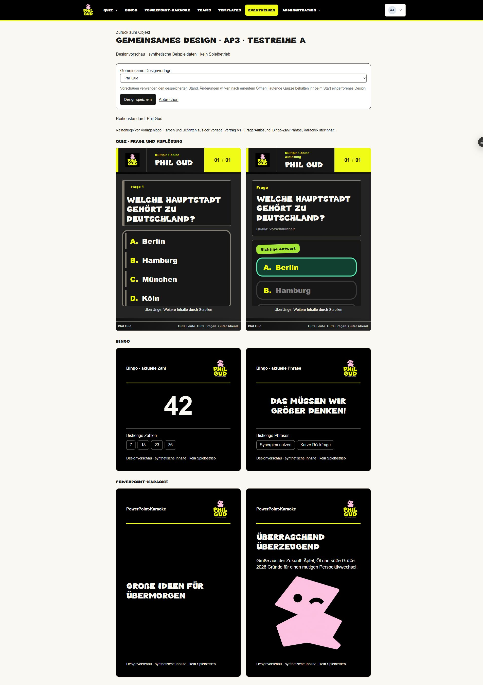
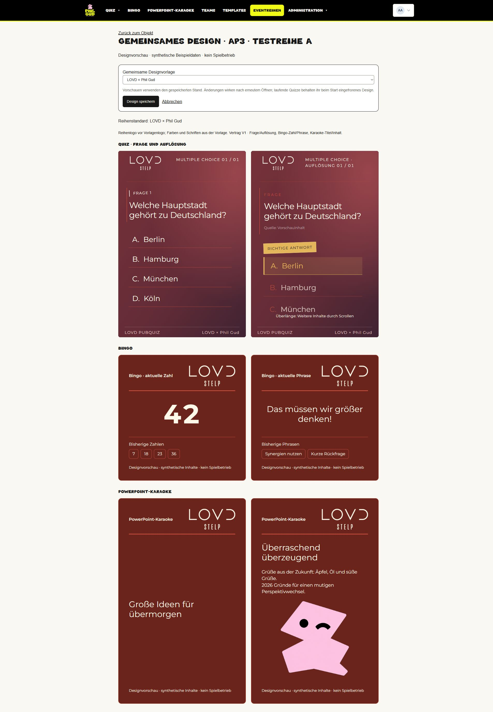

# AP3 – Prüfbericht und fachliche Preview

Stand der funktionalen Abnahme: 0578dddacb73f6d75184c217d2a7451d8b0b1940, 26.10.2026. Nachfolgende Dokumentationscommits ändern den geprüften Anwendungscode nicht. PR #136 bleibt ungemergt; keine Production-Aktion.

## Architektur und geänderte Bereiche

[Verbindliche Architektur, Prioritäten und Grenzen](../../architecture/shared-game-design.md).
Einzige Vorlagenverwaltung bleibt presentation_templates. SharedDesign V1 verwendet dieselben BrandTokens wie der vorhandene Quizrenderer. BingoDisplayRenderer und KaraokeSlideRenderer erhalten eigene typisierte Inhalte. Neue autorisierte Design-Unterseiten ergänzen bestehende Objekte; Stammdaten-, Team- und Runtimeverantwortung bleiben bestehen.

Geänderte Dateigruppen: app/rendering/sharedDesign (Vertrag, Auflösung, Auswahl, Formatlayouts, Tests), vier Designrouten und bestehende Objektlinks, quizTheme/resolveQuizTemplates/Quiz-Lifecycle und Quiz-Schreib-/Kopierweg, vorhandene Template-Verwendungs-/Archivierungssperre, Prisma-Schema plus generierte Typen und eine additive Migration, Backup-Acceptance-Policy, Tests/CI und eng begrenzte isolierte Preview-Konfiguration. Keine Abhängigkeit hinzugefügt.

Unterstützt: EDITORIAL/CORPORATE ohne Storybook; Phil Gud, LOVD und gültige aktive Ableitungen. Flächen: echte Quizfrage/-auflösung, Bingo-Zahl/Phrase mit Verlauf, Karaoke-Titel/Inhalt mit Bild. Keine neuen Teilnehmer-/Liveflächen. Reihenlogo überschreibt nur das Vorlagenlogo; übrige Gestaltung kommt aus der Vorlage. Explizite Spielauswahl vor Reihenstandard vor Phil Gud. Legacyquizze bleiben ohne ausdrückliches Opt-in unverändert. Antwortformular bleibt separat. Beim tatsächlichen Quizstart werden beide aufgelösten Konfigurationen eingefroren.

## Gehostete Vergleichsreihe

Nur synthetische Daten in shared_design_review_20261026, eigene beschränkte Runtimeidentität; Development-Stammdaten sind für diese Identität nicht lesbar. Zugangsdaten ausschließlich im Chat.

- [Reihenstandard und alle drei Formate](https://pubquiz-web-git-codex-shared-game-design-just-phil-gud.vercel.app/admin/eventreihen/10/design)
- [Quizfrage und Auflösung](https://pubquiz-web-git-codex-shared-game-design-just-phil-gud.vercel.app/quiz/11/design)
- [Bingo: Zahl und Phrase](https://pubquiz-web-git-codex-shared-game-design-just-phil-gud.vercel.app/bingo/33000000-0000-4000-8000-000000000001/design)
- [Karaoke: Titel und Inhalt](https://pubquiz-web-git-codex-shared-game-design-just-phil-gud.vercel.app/karaoke/33000000-0000-4000-8000-000000000002/design)

Vorbereitet: Reihe 10 mit Phil Gud, alle drei Beispiele mit Reihenvererbung; Quiz-Antwortformular unabhängig davon Minimal. Bingo hat 13 bestehende geplante Teamzuordnungen, Karaoke eine. Keine gehostete Quizsession gestartet/zurückgesetzt.

## Erprobte Testanleitung

1. Als synthetischer Admin anmelden und den Reihenstandard-Link öffnen. In „Gemeinsame Designvorlage“ „LOVD × Phil Gud“ auswählen und „Design speichern“ betätigen. Die sechs Vorschauflächen zeigen LOVD; nach vollständigem Neuladen bleibt die Auswahl erhalten.
2. Die drei einzelnen Vorschau-Links öffnen beziehungsweise neu laden. Sie zeigen „Reihenstandard: LOVD × Phil Gud“. In der Quizansicht bleibt „Antwortformularvorlage (getrennt)“ unabhängig auswählbar.
3. Im Bingo „Phil Gud“ wählen, „Design speichern“, vollständig neu laden. „Spielauswahl: Phil Gud“ und dessen Originalschrift/Markenwelt erscheinen, die anderen Spiele erben weiterhin LOVD.
4. Im Bingo „Reihenstandard verwenden“ wählen und speichern. Nach Reload erscheint wieder LOVD. Dies ist eine Referenz, keine Kopie.
5. In der Reihe wieder „Phil Gud“ speichern. Alle geerbten Vorschauen nach Reload vergleichen. „Zurück zum Objekt“ öffnet unverändert die jeweilige Verwaltung einschließlich bestehender Teamplanung.
6. Bei ungespeicherter Auswahl „Abbrechen“ verwenden und den Navigationswechsel abbrechen: Auswahl und Seite müssen erhalten bleiben. Dieser Teil wurde in echtem automatisiertem Chromium mit negativem Bestätigungsdialog geprüft; keine zusätzliche menschliche gehostete Abnahme behauptet.

## Tatsächliche Prüfungen

| Bereich | Nachweis |
| --- | --- |
| TypeScript, geänderte Dateien ESLint, Prisma, Tests, Build | Erfolgreiche Push-CI 40402600874 und PR-CI 40402610596 auf 0578ddda; vollständiger lokaler Testlauf und Build ebenfalls erfolgreich. Bestehende Gesamt-ESLint-Schulden bleiben separat informativ. |
| PostgreSQL | AP1/AP2/AP3 und bestehende Eventarten-Integration erfolgreich; leeres und repräsentativ befülltes Main-Ausgangsschema, additive Migration, Erhalt alter Quiz-/Spiel-/Teamdaten. Tatsächliche Policies, Actions und starteQuiz; Rechteentzug, deaktivierte Produkte auch für Admin, fremde/manipulierte IDs, Karaoke-Editor abgewiesen, CAS, Vorlagenvalidierung/Archivierung einschließlich Parallelfall. |
| Quizkompatibilität | Legacy- und Opt-in-Zweige regressionsgesichert; getrennte Antwortauswahl über alten Stammdaten-Schreibweg erhalten; tatsächlicher Start friert Präsentation und Antwortkonfiguration ein, spätere Reihen-/Vorlagenänderungen und wiederholter Start ändern den Snapshot nicht. Kein Start in der gehosteten Vergleichsreihe. |
| Chromium | Tatsächliche Auswahlkomponente: speichern, remount, getrennte Antwortauswahl, Read-only, Abbruch erhält Auswahl. Reale Renderer mit App-/Template-CSS und lokaler Originalschrift: 343 Pixel tatsächliche mobile Inhaltsbreite sowie 390/1280/1920, Kontrast, Umlaute/ß, Ziffern, lange Inhalte, fehlende Bilder und Grenzen. Keine native Beamer-/Geräteprüfung. |
| Gehosteter Browser | Frische Admin-/Manager-/Editoranmeldung; beide Marken in allen drei Formaten, Bingo-Override und Rückkehr, Quizauswahl mit separatem Minimal-Antwortformular, vollständige Reloads. Manager eigene Bingo-/Karaokeansichten erlaubt, fremde Reihe 404; Editor Bingo nur lesend, Karaoke-Direktlink 404. Finaler 0578-Stand zusätzlich mobile/ Laptop-/Großbildprüfung, unskalierte Quizvorschau, geladene Logos, sichtbarer Tastaturfokus, Rückkehr zu Stammdaten/13 Teamzuordnungen. |
| Datenintegrität | Lesender Vorher-/Nachhervergleich von zwölf geschützten Tabellen und stabilen Spielstammdaten: PASS. 64 abgeschlossene Migrationen, keine offenen/gerollbackten Einträge. |
| Backupvalidator | Optionales displayFamily nur aus vorhandener Schrift-Whitelist; unbekannte Felder bleiben Fehler. Neue Snapshotkonfiguration durch regulären Validator und enger Integritätsprüfung akzeptiert. Kein Backup/Restore ausgeführt; historisches PRIVATE_READBACK_FAILED weiterhin ungeklärt. |

Preview-Workflow 40403338000: SUCCESS; Deployment dpl_85TWXU5YJLpVPLEJY93K7ftbEM1o READY; unveränderlicher Link https://pubquiz-mfcr5z4oo-just-phil-gud.vercel.app/ . Commit und stabiler Alias wurden unabhängig über Deployment-Metadaten geprüft. Die abschließende Dokumentationsänderung enthält nur Bericht/Bilder; Anwendung, Schema, Tests und Workflow sind gegenüber dem ausgelieferten Funktionscommit unverändert.

Zusätzlicher nachgewiesener Previewfehler: Bei 343 Pixel Inhaltsbreite konnte die lesbare Quizfrage über ihre Rasterzelle ragen. Ausschließlich der AP3-Vorschaucontainer erhält inhaltsabhängige Mindesthöhen. Der ergänzte echte Chromium-Test reproduziert ohne Korrektur die Überlappung und besteht mit ihr; bestehende Live-/Templateansichten besitzen das erforderliche AP3-Attribut nicht. Ein zunächst ungeeigneter CSS-Modulimport wurde nach CI-Fehler durch die eng attributgebundene Regel im vorhandenen Stylesheet ersetzt. Vollständiger lokaler Projekttest danach erfolgreich.

## Migration und verbleibende Prüfgrenzen

Vier nullable Spalten, kein Backfill, keine Umdeutung alter Werte. Dynamischer bestehender Dump und Kataloginventur erfassen die Spalten. Isolierte Migrationstests verwenden die dokumentierte Main-Schemabaseline: ein vollständiger historischer Leerkette-Bootstrap wird ausdrücklich nicht behauptet. Die isolierte Baseline enthält bekannte lokale Zeilenendenvarianten; SQL-Inhalt mit Git normalisiert identisch, gespeicherte Checksummen auf exakte Erstellungsbytes/EOL-Varianten geprüft. Keine Migrationshistorie nachträglich umgeschrieben.

Bingo und Karaoke sind weiterhin nicht spielbar. Keine OCR, Ziehungen, Folienimporte, öffentlichen Links, Teambeitritte, Universalengine oder gemeinsame Teilnehmer-/Moderationsverträge. Die mobile Quizauflösung verwendet bei langen Inhalten den bereits vorgesehenen, gekennzeichneten Scrollbereich. Bestehende allgemeine Liveflächen werden nicht neugestaltet; die tatsächliche neue Quizbasis ist automatisiert über Resolver, Lifecycle und vorhandenen Renderer geprüft, nicht durch einen Production-Quizstart. Keine produktiven Daten, Rechte oder Sessions berührt. Offene historische Backupursache und echter Wochenlauf bleiben separate Betriebspunkte. Geöffnete Previewansichten nach Aktualisierung neu laden.

## Vergleichsbilder

Dieselbe jeweilige Designwelt über Quiz, Bingo und Karaoke, aufgenommen auf dem funktional geprüften 0578-Stand:

[Mobile Vollseitenaufnahme](images/mobile-phil-gud.jpg)
