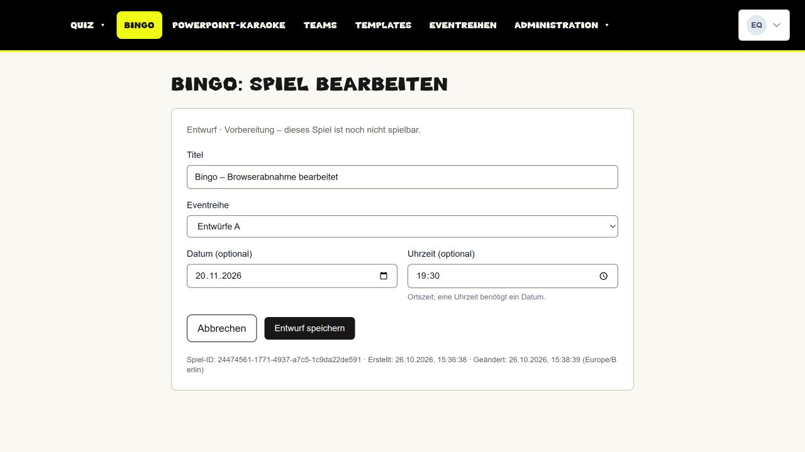
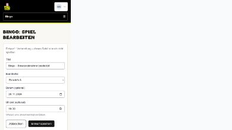
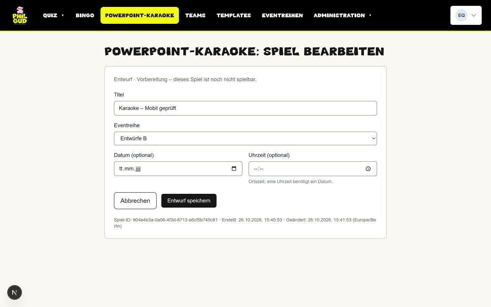
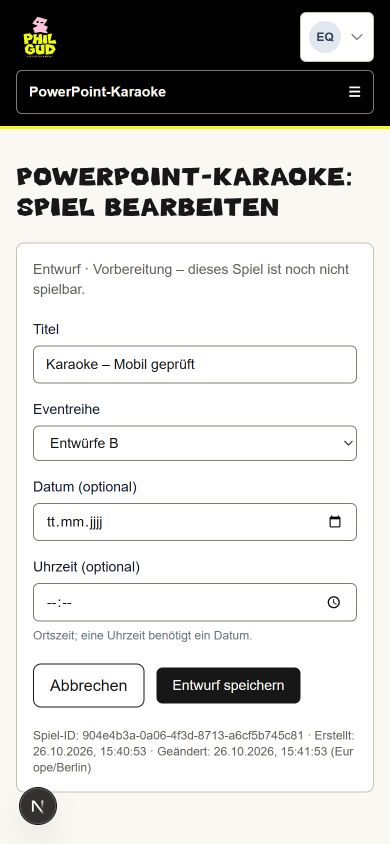

# Abnahme: eigenständige Spielentwürfe

## Umfang und Architektur

Nur Bingo-/PowerPoint-Karaoke-Entwürfe, ohne Spielbetrieb, Teams, Templates oder Quizlaufzeitänderungen. Architektur, konservative Rollenentscheidung und isolierte Baseline: [Architekturentscheidung](../../architecture/standalone-game-drafts.md).

## Tatsächlich ausgeführte lokale Prüfungen

- Prisma-Generierung, Typecheck, ESLint der geänderten Dateien, vollständiger `npm test` und Next-Build erfolgreich. Der unveränderliche historische Importplan musste lokal mit seinen Git-Originalbytes gelesen werden: Windows-CRLF verändert dessen geprüften Dateihash. Kein Importplan oder Prüfvertrag geändert.
- Echter PostgreSQL-Test: neue Migration auf leerem und repräsentativ befülltem Main-Schema; Quiz- und Rollenwerte bleiben erhalten. Anschließend tatsächliches Repository und tatsächliche Server Actions mit echter Datenbank; nur Authentifizierungsanbieter und Framework-Seiteneffekte sind Testadapter.
- Getestet: Bingo/Karaoke getrennt, UUID/Reload/Bearbeiten, Titel/Datum/Zeit, falsche Eventart und manipulierte IDs/Felder, fremde Reihe, Quell- und Zielrechte beim Reihenwechsel, globale Editor- und reine Verwaltungsrechte, Karaoke-Editor-Abweisung, Produktdeaktivierung auch für Admin, Rechteentzug, veralteter Versionsstand und DB-Constraints.
- Die echte bestehende Sicherungsinventur (`COLUMN_SQL`, `CATALOG_SQL`, `auditColumns`, `inspectRow`) erfasst alle neun neuen Spalten und sechs Constraints und akzeptiert die neuen Zeilen. Das ist eine Verträglichkeitsprüfung, kein ausgeführtes Backup oder Restore.
- Chromium-Komponententest der echten Form und des echten Navigationsguards für beide Eventarten: explizite Auswahl, Datum/Zeit, Speichern, erneutes Rendern aus gespeicherten Daten, abgelehnter Schreibvorgang ohne Eingabeverlust, abgebrochener Linkwechsel mit erhaltenen Eingaben und schreibgeschützte Ansicht. Hier ist `window.confirm` kontrolliert ersetzt; keine menschliche native Dialogprüfung wird behauptet.
- Vollständige lokale Anwendung mit eigener synthetischer Datenbank: Admin-Login; beide Entwürfe anlegen, bearbeiten, speichern und aus Liste/über Vollreload erneut öffnen; Bingo mit nativ per Tastatur eingegebenem Datum/Uhrzeit; Karaoke mit leeren optionalen Feldern. Auf 390 × 844 Karaoke bearbeitet, gespeichert und nach Vollreload erhalten. Beide Formulare ohne horizontalen Überlauf bei 390 Pixeln, Laptopansicht 1280 × 800.
- Suchbarer lokaler Reihenfilter: Auswahl B zeigt passenden Bingo-Leerzustand statt Spiel aus A; gefilterter Rückweg bleibt erhalten; Anlegen wählt auch dann keine Reihe automatisch. Native Pflichtfelder verhindern leeres Absenden. Abbrechen unveränderter Form speichert nichts.
- Getrennte Editor-Sitzung: Bingo sichtbar und ausdrücklich nur lesbar, keine Speicheraktion; Karaoke-Direktlink serverseitig abgewiesen (404). Die umfangreicheren Rechtefälle sind zusätzlich im PostgreSQL-/Action-Test abgedeckt.
- Bestehende synthetische Quizdetailseite lesend geöffnet: Hauptnavigation, Blockverwaltung und bestehende Live-Einstiege vorhanden. Kein Quizstart, Beitritt, Antwortversand oder Session-Reset.

## Screenshots der lokalen vollständigen Anwendung

Ausschließlich synthetische Daten, aktuelles Verwaltungsdesign; keine Mockup-Bilder.

## Prüfgrenzen und Betrieb

Keine Production-Prüfung, kein Merge und keine Produktionsmigration. Neue Entwürfe sind nicht spielbar. Teams, gemeinsame Renderer und Designs, Offlinebetrieb und Synchronisation sind nicht Teil dieses Pakets. Keine Sicherung und keine Wiederherstellung ausgeführt. Historische Backup-Readback-Ursache und Wochenlauf bleiben separate Betriebspunkte.

Die eigene isolierte Preview-Baseline ersetzt keinen Replay-Nachweis der historischen Migrationskette oder ihrer Datenmigrationen/Trigger. Die historischen Bootstrapfehler sind ausdrücklich dokumentiert; die neue Migration selbst ist auf leerem und befülltem Schema geprüft. Ein nativer Bestätigungsdialog der vollständigen Anwendung wurde in dieser Abnahme nicht manuell bestätigt; der Abbruchvertrag ist als echter Chromium-Komponententest mit kontrollierter Bestätigung automatisiert geprüft.

Gehosteter Head, CI-Läufe und Preview-Smoke werden im PR zum tatsächlich ausgelieferten Stand ergänzt.
