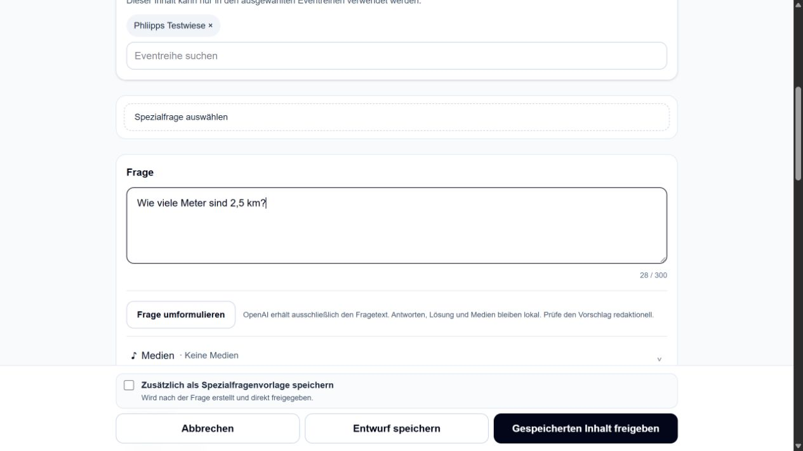

# Release 2: OpenAI-Formulierungshilfe – Production-Abnahme

Dieser Bericht ergänzt den [Preview-Bericht](../reports/openai-question-rewrite-release-20261016.md)
um den tatsächlichen Releaseabschluss. Release 1 ist unabhängig davon bereits
[auf Production abgenommen](pr116-production-release-20261016.md).

**Ergebnis: Release 2 erfolgreich veröffentlicht und auf Production geprüft.**
Beide Production-Aliase liefern denselben Commit `fecca33309089fa880a41c202587fa776d3914e1`.

## Versionskette

| Gegenstand | Nachweis |
| --- | --- |
| PR | [#121](https://github.com/justphilgud/pubquiz-web/pull/121), regulär gemergt |
| Auf Preview geprüfter Anwendungscode | `13c7aea0cc58be0997603d96cdeb4b1d2dae6764` |
| Letzter PR-Head | `296b21058969385fc465d007c41a34768ad8b33a`; danach ausschließlich Dokumentation und synthetische Nachweise ergänzt |
| Merge-Commit | `fecca33309089fa880a41c202587fa776d3914e1`; Dateiinhalt identisch zum PR-Head |
| Finale PR-CI | [Push](https://github.com/justphilgud/pubquiz-web/actions/runs/38945600805), [PR](https://github.com/justphilgud/pubquiz-web/actions/runs/38945610285): SUCCESS |
| Main-CI | [38946204795](https://github.com/justphilgud/pubquiz-web/actions/runs/38946204795): SUCCESS |
| Finales Preview | [Deploymentlauf](https://github.com/justphilgud/pubquiz-web/actions/runs/38944602066): SUCCESS; [Deployment](https://pubquiz-g9rnazzkl-just-phil-gud.vercel.app/) |
| Production | [Regulärer Lauf38946626911](https://github.com/justphilgud/pubquiz-web/actions/runs/38946626911): SUCCESS, einschließlich geschützter Abnahme, Datenbankidentität, Status und Smoke-Test |
| Deployment | `dpl_2y54wUzMqq9gwzxQrdMTB8r6PivP`, [unveränderliche Production-Adresse](https://pubquiz-4pxpdghrn-just-phil-gud.vercel.app/) |
| Kurzer Alias | [pubquiz-web.vercel.app](https://pubquiz-web.vercel.app/): tatsächliches angemeldetes Monitoring liefert den vollständigen Merge-Commit |
| Langer Alias | [pubquiz-web-just-phil-gud.vercel.app](https://pubquiz-web-just-phil-gud.vercel.app/): identisches Deployment und vollständiger Merge-Commit |

Beide Zuordnungen zusätzlich über reguläres Vercel-Inspect bestätigt. Keine
erneute Domainkorrektur erforderlich. Der reguläre Migrationsschritt meldete
„No pending migrations to apply“; vor und nach Deployment Schema aktuell.
Keine KI-Schemaänderung. Die nicht geheime Backup-Referenz `PRODUCTION_RELEASE_SHA`
wurde nach tatsächlich verifiziertem Release auf diesen Commit aktualisiert und
erneut gelesen; `BACKUP_RETENTION_VERIFIED` bleibt unverändert `false`.

## Architektur und Umfang

Der bestehende Editor behält Draft, Änderungsvergleich, Vorlagenkontext und
normales Speichern. Das neue Panel zeigt Original, bearbeitbaren Vorschlag,
Verlauf, tatsächliche Usage und konfigurierte Kostenschätzung. Ein unabhängiger
Controller verwaltet Tickets, Abbruch und Stale-Schutz einschließlich A→B→A.
Übernehmen ändert ausschließlich `questionText` im ungespeicherten Draft.

Serverseitige Route und Provider prüfen Featureflag, echte Sitzung, explizite
Editorial-Rolle, Origin, Längen, Timeout, striktes Responses-Schema und geschützte
Zahlen/Zitate. Übertragen wird nur der Fragetext plus notwendiger serverseitiger
Anweisung, niemals Lösungen, Medien oder Teilnehmerdaten. `store:false`.
Die exakte API-Route liefert ihre selbst authentifizierten JSON-Fehler; andere
Loginregeln bleiben erhalten. Keine Migration und keine neue Abhängigkeit.

Betroffene Bereiche: `app/api/question-rewrite`, neue `questionRewrite*`-/Diff-
Dateien unter `app/fragen/editor`, Panel und Tests, bestehender Editor/QuestionSection,
zwei serverseitige Editorseiten, Drafthelper, Template-Metadaten, de/en-Nachrichten,
exakte Proxy-Ausnahme, Environment-Lader, CI und Testscripts. Vollständige Dateiliste
im [PR-Diff](https://github.com/justphilgud/pubquiz-web/pull/121/files).

Die kleine Preview-Korrektur bindet ausschließlich den Hinweis „noch nicht
gespeichert“ an den bestehenden Änderungsstatus. Nach erfolgreichem Save
verschwindet der Hinweis; kein zweiter Speicherweg wurde eingeführt.

## Prüfungen

- Typecheck, striktes Changed-file ESLint, Next 16.2.5 Build und erforderliche CI.
- 39 gezielte KI-Tests, 30 zusätzliche Musik-/Vorlagen-/Environment-/CI-Tests.
  Vollständiges bestehendes `npm test` lokal: 1577 PASS, 0 FAIL, 2 lokale
  PostgreSQL-Skips; echte PostgreSQL-Jobs in der CI erfolgreich.
- Echte gebaute HTTP-Kette ohne Actor-Injektion: ohne Sitzung JSON 401,
  Flag aus JSON 404; Editor und ähnlich benannte Fremdroute bleiben loginpflichtig.
  Rollen, Providerfehler, Timeout, Refusal, Schema, Rate-Limit und Größen zusätzlich
  deterministisch getestet. Kein behaupteter Live-Rollentausch.
- Tatsächliches angemeldetes Preview: anfordern, vergleichen, Vorschlag bearbeiten,
  übernehmen, separat fehlende automatische Persistenz prüfen, normal speichern
  und neu laden. Antwort, Kategorie, Quelle, Notiz, Scope, Status und Zuordnungen
  bleiben erhalten. Erneute Anfrage, Verlauf, Verwerfen und A→B→A während sichtbarem
  Pendingzustand geprüft. Suchtext und Filter kehren unverändert zurück.
- Musik: QA-Interpret, QA-Titel und Antwortumfang nach KI-Übernahme unverändert.
  Statische FaceMorph-Definition ohne KI-Button. Die bestehende native Bestätigung
  eines bereits befüllten Templatewechsels blockierte die Browserautomation;
  frische Auswahl und automatisierte Kontextwechseltests sind getrennt belegt.
- Aktuelle offizielle Modell-/API-Dokumentation und tatsächlich erfolgreiche
  Responses bestätigen `gpt-5.6-luna`, Structured Outputs, `reasoning.effort:none`,
  `service_tier:default`, maximal 512 Outputtokens und `store:false` im Preview.

## Konfiguration und Budget

Alle fünf dokumentierten OpenAI-Variablen wurden nach gezielter direkter Freigabe
sensitive ausschließlich für den genehmigten Preview-Branch gesetzt. Nach
bestandener Preview erfolgte die im Gesamtauftrag ausdrücklich freigegebene,
bewusste Production-Konfiguration derselben fünf Variablen. Verwendet wurde der
vorhandene Projektschlüssel ausschließlich im Prozessspeicher und über stdin.
Keine neuen Credentials, keine Ausgabe von Keys, keine Übernahme fremder
Variablen, keine Änderung der zentralen Nonprod- oder Production-Medienkonfiguration.

Insgesamt 13 bewusst ausgelöste UI-Versuche: zehn erfolgreiche Preview-Responses,
eine erfolgreiche Production-Response, ein vom App-Cooldown vor dem Provider
abgewiesener Request und ein clientseitig abgebrochener Versuch ohne Usage.
Letzterer bleibt mit 0,01 USD konservativ reserviert. Dazu zwei lesende
Modell-Metadaten-GETs ohne Generierung. Keine unbegrenzten Retries.

| Umgebung | Eingabetokens | Ausgabetokens | Konfigurierte Schätzung USD |
| --- | ---: | ---: | ---: |
| Preview, 10 Erfolge | 2269 | 248 | 0,0007514 |
| Production, 1 Erfolg | 227 | 23 | 0,0000730 |
| Bestätigte Usage gesamt | 2496 | 271 | 0,0008244 |

Rechengrundlage: 0,20 USD/Mio. Eingabe und 1,20 USD/Mio. Ausgabe, ausdrücklich
konfigurierte Schätzung und keine Providerrechnung. Mit zusätzlicher 0,01-USD-
Reserve konservativ noch **0,9891756 USD** vom gesamten freigegebenen **1 USD**.
Das [vollständige Ledger](question-rewrite-production-assets/provider-budget.json)
enthält jeden einzelnen Versuch; keine Keys oder internen Provideranweisungen.

## Tatsächlicher Production-Ablauf

Eigene neue Frage **1409**, Quelle eindeutig „Codex PR121 Production QA 2026-10-16“,
ausschließlich bestehende Eventreihe **Phliipps Testwiese**; Anzeigename nicht
geändert. Status **Entwurf**, keine Quizzuordnung und keine Freigabe.

1. Ausgangsfrage vor Deployment normal als eigenen Entwurf gespeichert und erneut
   geöffnet: `Wie viele Meter entsprechen einer Entfernung von 2,5 km?`, Lösung
   `2500`, eigene Quelle und Kontrollnotiz. Noch kein KI-Button im alten Release.
2. Nach erfolgreichem Deployment echten Editor neu geladen: KI-Button sichtbar.
   Tatsächlicher Klick lieferte `Wie vielen Metern entsprechen 2,5 km?`,
   echte Usage 227+23=250 Tokens. Zahl/Einheit/Bedeutung erhalten, keine Lösung
   ergänzt. Angefordertes Modell und Parameter damit auch auf Production belegt.
3. Vorschlag bewusst redaktionell bearbeitet zu `Wie viele Meter sind 2,5 km?`
   und übernommen. Separat über den anderen Production-Alias geöffneter Editor
   zeigte weiterhin das gespeicherte Original: keine automatische Persistenz.
4. Erst normales **Entwurf speichern** aktualisierte Frage1409. Reload über den
   langen Alias bestätigt den neuen Text, Lösung2500, Quelle, Kontrollnotiz,
   Testreihenscope und Entwurfsstatus unverändert. Keine Kategorie angelegt oder
   zugeordnet. Hinweis „noch nicht gespeichert“ nach Save nicht mehr sichtbar.
5. Production-Suche q=1409 findet den gespeicherten Text. Öffnen trägt korrektes
   returnTo; Zurück liefert exakt `/content?q=1409` und Suchtext1409.

Nachweise:
[echter Live-Vorschlag](question-rewrite-production-assets/proposal.png),
[gespeicherter Inhalt](question-rewrite-production-assets/saved.png),
[Live-Button](question-rewrite-production-assets/live-button.png).

## Eigene QA-Daten und offene Grenzen

Preview-Frage 253: eigener synthetischer Entwurf in TEST-PR88-INHALTE-20261004,
keine Quizzuordnung. Weitere Preview-Fälle blieben ungespeichert. Production-Frage1409
bleibt ausschließlich unzugeordneter QA-Entwurf in der Testwiese; kein Quizlauf
gestartet. Echte Quizze30/31 und historische Bewertungen wurden nicht verändert.

Keine automatische Faktenprüfung behauptet; Vorschläge müssen redaktionell
geprüft werden. Rate-Limit ist pro Prozess, kein verteiltes Kostenkontingent.
Physischer Hörtest, Fairphone-/Android-Download und unabhängige Geräte-/Netztests
aus Release 1 bleiben offen. Keine Rücknahme oder Vermischung mit Release 2.

## Rückfall und temporäre Freigabe

Bei KI-Problemen `OPENAI_QUESTION_REWRITE_ENABLED=false` setzen und regulär
redeployen. Manuelles Bearbeiten/Speichern bleibt verfügbar; Meme-Archiv und
Archivmigration erhalten. Kein Datenbank-Rollback für die Formulierungshilfe.

Die temporäre GitHub-Trust-Freigabe und Policy63303195 wurden nach erfolgreicher
Abnahme entfernt und am16.10.2026 um18:25:59UTC erneut gelesen. Ausschließlich
die drei ursprünglichen Einträge/Policies bleiben:

- `preview/content-and-quiz-flow`, Policy62465427
- `codex/editorial-safe-import`, Policy62465429
- `codex/preview-media-configuration`, Policy62465430

[Strukturierter Cleanup-Nachweis](question-rewrite-production-assets/branch-cleanup.json).
Die autorisierten Vercel-Werte bleiben getrennt auf den Preview-Branch bzw.
Production begrenzt; keine Medienwerte oder anderen Branchvariablen verändert.

## Bedienung

Content → Frage bearbeiten → beim editierbaren Fragefeld **Frage umformulieren**.
Original/Vorschlag vergleichen, bei Bedarf Vorschlag bearbeiten; **Übernehmen**
überträgt ausschließlich den Fragetext in den Entwurf. Anschließend normal
speichern. Kein automatischer Aufruf beim Laden oder Tippen. Bei fest definiertem
Template-Fragetext, Read-only, fehlender Editorial-Rolle oder ausgeschaltetem Flag
wird die Aktion nicht angeboten.

