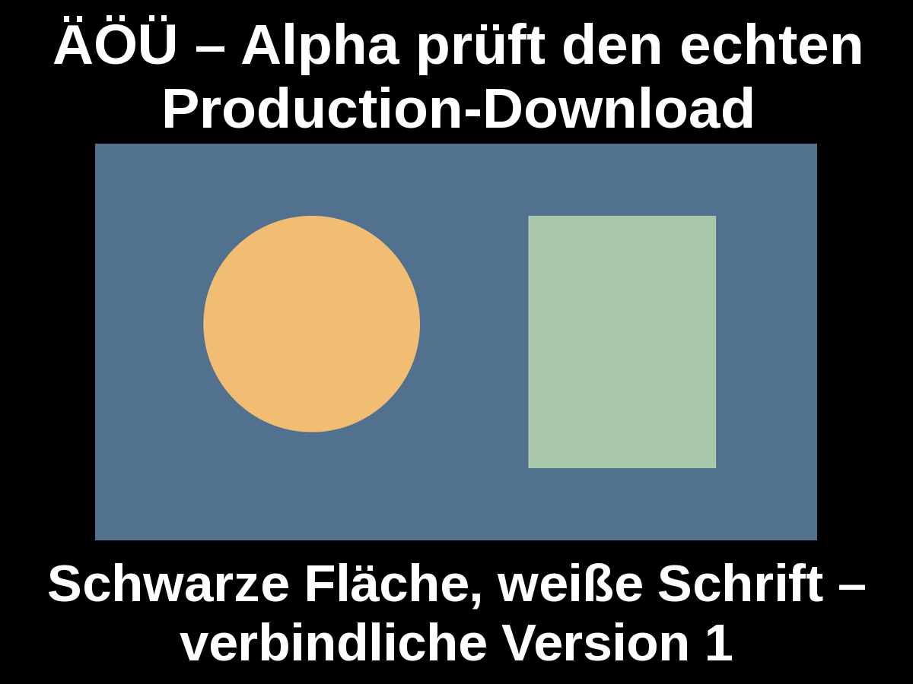
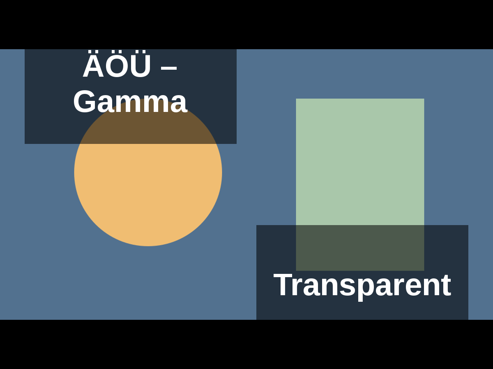
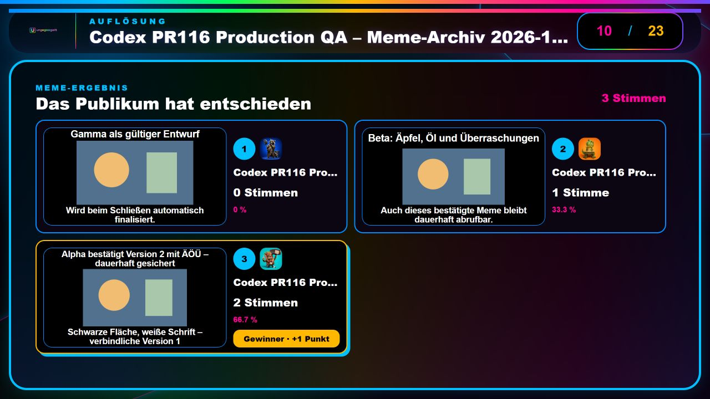
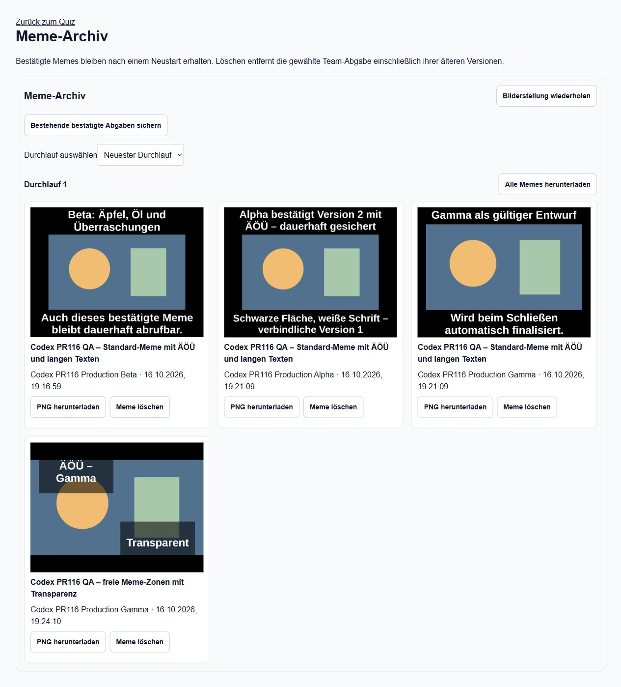
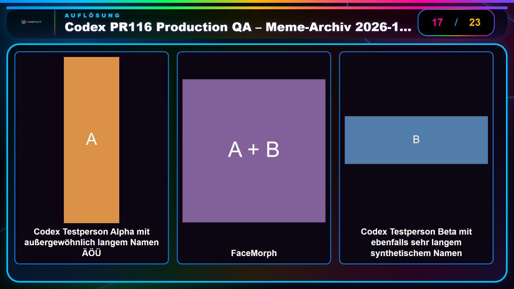
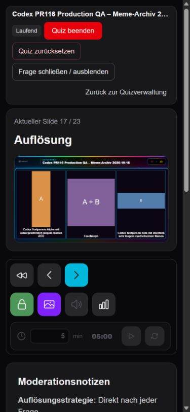

# PR116: Production-Abnahme am 16. Oktober 2026

**Release erfolgreich veröffentlicht und funktional kontrolliert.**
[PR116](https://github.com/justphilgud/pubquiz-web/pull/116) wurde regulär als
`b6d5388df4dd146a16b507219d50e02ea0bb1e1b` integriert und veröffentlicht.

| Nachweis | Ergebnis |
| --- | --- |
| Geprüfter Preview-Anwendungscode | `b1bed48c69cc6683435bb7eb4f3c3f0421306e49` |
| Finaler PR-Head | `23c0b130e1cd6772fb8e1d98498a09f432d0ec08`, CI grün |
| Unterschied seit `41f3c2a8` | Genau zwei CI-Kommentarzeilen für Mergekonflikt; kein ausgeführter Code/SQL geändert |
| Main-CI | [38937361867 SUCCESS](https://github.com/justphilgud/pubquiz-web/actions/runs/38937361867) |
| Geschützte Migration/Deployment/Smoke | [38937798819 SUCCESS](https://github.com/justphilgud/pubquiz-web/actions/runs/38937798819) |
| Tatsächliches Deployment | [pubquiz-njm4dfa38](https://pubquiz-njm4dfa38-just-phil-gud.vercel.app/) |
| Kurzer Alias | [pubquiz-web.vercel.app](https://pubquiz-web.vercel.app/), vollständige veröffentlichte SHA im angemeldeten Monitoring bestätigt |
| Langer Alias | [pubquiz-web-just-phil-gud.vercel.app](https://pubquiz-web-just-phil-gud.vercel.app/), identische vollständige SHA im Monitoring bestätigt |
| Migration | `20261016120000_meme_archive` angewendet; danach `Database schema is up to date!` |

Der Merge-Commit wurde gegen den finalen PR-Head abgeglichen: `app`, `components`,
`lib`, `prisma`, `assets` und Next-Konfiguration identisch. Die bereits vollständige
[Preview-Abnahme](../reports/meme-archive-and-slides-20261016.md) wurde gezielt
wiederverwendet. Tests am finalen Head und am Main-Commit erneut erfolgreich.

## Bedienung und Architektur

- Teams: Antwortformular → **Meine Memes** → **Mein Meme herunterladen**. Maßgeblich
  bleibt die letzte bestätigte Abgabe; ein unbestätigter Entwurf ersetzt sie nicht.
- Veranstalter: Quizverwaltung → **Meme-Archiv** → Durchlauf auswählen. Einzel-PNG
  oder **Alle Memes herunterladen** (ZIP). Ein Quizreset löscht dieses Archiv nicht.
- **Meme löschen** benötigt die sichtbare Bestätigung und entfernt alle Versionen
  der gewählten Team-/Fragen-Abgabe dieses Durchlaufs. Andere Memes bleiben erhalten.
- **Bestehende bestätigte Abgaben sichern** ist eine separate Aktion. Sie wurde
  auf keinem historischen realen Quiz ausgeführt. Kein automatischer Backfill.
- TTS: Präsentationsfenster aktivieren, dann Lautsprechersymbol der Moderation für
  Start/Pause/Fortsetzen. Der entfernte Hinweis auf der öffentlichen Folie kehrt nicht zurück.
- FaceMorph: In der Auflösung links Original A, mittig Morph, rechts Original B;
  Namen bei den Originalen. Fragephase und Bildvergrößerung verraten keine Lösung.

Submission, Voting, Bewertung und Lifecycle behalten ihre bestehenden Aufgaben.
Die Archivschicht sichert bestätigte Medien-/Text-/Layout-Snapshots, rendert PNGs,
verwaltet wiederholbare Arbeit und geschützte Exporte. Zwei additive Tabellen,
atomarer Capture-Trigger und Resetbarriere; keine Runtime-Löschkaskade ins Archiv.
Eine separate Advisory-Sperre hält langsame PNG-/Netzarbeit außerhalb des Quizlocks.
Öffentliche Blobs enthalten nur AES-GCM-verschlüsselte PNGs, Schlüssel bleiben
serverseitig. Keine neue Abhängigkeit, keine Meme-Schwierigkeit oder Neubewertung.

Maßgebliche [Dateiliste](https://github.com/justphilgud/pubquiz-web/pull/116/files):
`app/quiz/memeArchive/*`, Archivroute/-seite/-Panel, Prisma-Schema/Migration,
Submission-/Reset-/Quizlöschintegration, Meme-CSS, FaceMorph-Renderer/-Adapter,
gezielte Tests, Fontasset/Tracing und Living Specifications.

## Production-Vorbereitung und Sicherung

- Separate freigegebene Operations-PRs [117](https://github.com/justphilgud/pubquiz-web/pull/117),
  [118](https://github.com/justphilgud/pubquiz-web/pull/118),
  [120](https://github.com/justphilgud/pubquiz-web/pull/120) regulär integriert.
  Ops-only Appjobs übersprungen; der aufgrund des CI-Image-Fixes angebotene
  Appjob117 wurde vor jedem Migrations-/Deployschritt am Reviewer-Gate abgebrochen.
- [Finaler lesender Preflight38936712881 PASS](https://github.com/justphilgud/pubquiz-web/actions/runs/38936712881):
  tatsächlich veröffentlichte Basis `baedd479615d33a7eb7b5e15f18f36450061dc5b`,
  Alias/Projekt/READY geprüft, Reader `READ ONLY`, kein Drift, allein genehmigte
  Archivmigration ausstehend. Exakter SQL-SHA256
  `99a4b9d18e55d2294383a31cf35fb30973e6a30f9750c3c5da752f102818f641`.
- Isoliertes PostgreSQL17-Delta PASS: Bestandszeilen/alte Spalten unverändert,
  kein Backfill, Capture/Resetbarriere/Archiverhalt und Rollbackkompatibilität geprüft.
  Der historische Neuinstallationsfehler `HISTORICAL_BASELINE_OVERLAP` bei
  `20260713130000_add_question_draft_fields` bleibt ausdrücklich offen.
- Vollständige geschützte [Vorab-Sicherung38930389548 SUCCESS](https://github.com/justphilgud/pubquiz-web/actions/runs/38930389548),
  Backup-ID `production/acceptance/run-38930389548-1`, Source-Snapshot16:15:43UTC,
  Sicherung fertig16:53:36UTC, Gesamtjob fertig16:56:11UTC. Alle782 geplanten
  Objekte und Manifest privat zurückgelesen/integritätsgeprüft. Manifest-SHA256:
  `3ea0b3b3e38c78e1a0608cbbcdc33a9326b1d82b0071b5880ad0bdb9b814b72e`.
  Source-Identität und Evidence-Flags gesondert verglichen. Kein Restore.
- Die erste Gesamtausführung38918685948 scheiterte am Retention-Inventarlimit;
  sie wird nicht als insgesamt erfolgreicher Restore-Nachweis ausgegeben.
  PR118 erhöhte nach separater direkter Freigabe32000 auf64000 Objekte innerhalb
  unveränderter64 Seiten. [Lesender Retention-Test38929820890 PASS](https://github.com/justphilgud/pubquiz-web/actions/runs/38929820890):
  71Stände,62behalten,9hypothetische Löschkandidaten,0fremde Pfade,0gelöscht.
  Retention bleibt deaktiviert. Der neue vollständige Backupjob bestand auch Retention.
- PR119 ohne Merge geschlossen: Original45-Minuten-Limit reichte aus.
- Backup-/Restore-Vertrag erlaubt ausschließlich die drei exakt geprüften
  Archivfunktionen und den exakten Trigger, einschließlich vollständiger privater
  Sicherung verschlüsselter PNGs und Schlüssel. Reale PostgreSQL17-Dump-/Restore-
  und Entschlüsselungsprüfung erfolgreich; unbekannte Routinen bleiben gesperrt.
- Nach bestätigter Veröffentlichung nicht geheime Operations-Variable
  `PRODUCTION_RELEASE_SHA` auf die tatsächlich veröffentlichte SHA aktualisiert.

## Tatsächliche funktionale Production-Abnahme

Ausschließlich eigenes **Quiz34 „Codex PR116 Production QA – Meme-Archiv 2026-10-16“**,
Testwiese, Block113; neue Fragen1405/1406/1408/1407, Zuordnungen271/272/274/273.
Eigene geometrische Bilder, eigener synthetischer TTS-Text, keine echten Personen,
Songtexte, historischen Antworten oder realen Quizzuordnungen. Nur eigene QA-Fragen
für diese Testzuordnung freigegeben; keine redaktionellen Import-/Bestandsfragen verändert.

Alpha auf kurzem Alias, Beta auf langem Alias, Gamma auf der tatsächlichen neuen
Deployment-Adresse. Drei unabhängig rehydrierende Teamidentitäten, gleicher Browser.
Keine Session-Tokens/Team-Zugangswörter in Bericht oder Nachweisdateien.

| Prüffall | Tatsächlich beobachtetes Ergebnis |
| --- | --- |
| PNG und Darstellung | Echtes Team-PNG visuell geöffnet: schwarze Flächen, weiße Schrift, ÄÖÜ und lange Texte lesbar. Präsentation und Ergebnis ebenso. |
| Draft/Reload | PNG vor/nach unbestätigtem Entwurf und Reload exakt SHA256-identisch: `78592ef544b1b233c752133fe2c0615acc2808cdf3984781f5cf8c5784572651`. |
| Neue Version/automatischer Abschluss | AlphaV2 ersetzt aktuelle Anzeige; gültiger Gamma-Entwurf beim Schließen automatisch finalisiert und archiviert. |
| Drei Teams bis Ergebnis | Eigene Wahl gesperrt. Alpha→Beta, Beta/Gamma→Alpha. Ergebnis2/1/0Stimmen; Alpha66,7%/+1Punkt. |
| Freie Zonen | Kurze Captions bestätigt, tatsächlicher PNG-Download mit sichtbarem Hintergrund/Alpha und weißem Text visuell geprüft. Zu langer Text verständlich abgewiesen. Alpha/Beta→Gamma; Ergebnis2Stimmen/100%/+1. |
| ZIP | Mit unabhängigem .NET-ZIP-Leser geöffnet: exakt3PNG-Dateien, alle SHA256 identisch mit Einzel-Downloads; [Manifest](pr116-production-assets/zip-check.json). |
| Teamzugriff | Gamma-UI listet ausschließlich eigene Memes. Fremder direkter URL-Versuch bereits vom Browser blockiert; kein behaupteter HTTP403-Nachweis. Fremde Team-ID und Rechtepfade durch automatisierte Route-/PostgreSQL-Tests geprüft. |
| Reset | Eigener Durchlauf zurückgesetzt:0Teams/0Antworten, Vorbereitung/Slide1; alte Sessions ungültig, alle4Archiveinträge erhalten. AlphaV2 nach Reset byteidentisch: `24b3d13f79214e01b55b4b14615b8375885945c6324ce6f247dee8f05637fefa`. |
| Löschdialog | Abbrechen erhält4Einträge. Bewusste Bestätigung ausschließlich für Alpha entfernt alle Versionen;3andere Memes erhalten, kein Wiedererscheinen alter Alpha-Version. |
| Export nach Reset/Löschung | Genau BetaStandard, GammaStandard, GammafreieZonen, SHA-identisch zu ihren Einzeldateien; [Manifest](pr116-production-assets/retained-zip-check.json). |
| TTS | Öffentliche Folie ohne alten Hinweis. Moderation Start→„Text wird vorgelesen“, Pause→„Vorlesen pausiert“, Fortsetzen→„Text wird vorgelesen“. Anschließend pausiert. Kein Hörnachweis behauptet. |
| FaceMorph | Frage und Vergrößerung nur Morph, keine Namen/Originale. AuflösungA240×720 / Morph480² / B960×320 vollständig geladen, lange Namen. |
| Schmale Moderation | Tatsächlicher390×844Viewport: Dokument-/Scrollbreite375px, alle3Spalten innerhalb; rechte Bildkante338,1px. Temporäre Viewport-Overrides zurückgesetzt. |

**QA-Endzustand:** Eigener Lauf zurückgesetzt, keine aktiven Teams/Antworten;
Quiz34 anschließend wiederherstellbar archiviert. Archiv weiterhin erreichbar,
3eigene Test-Memes bewusst als Nachweis erhalten. Eigene QA-Fragen bleiben nur im
Testbereich. Reale Quizze30/31 nicht gestartet, fortgeschaltet, zurückgesetzt,
gelöscht oder verändert. Keine historischen Meme-Erfassung oder Bewertungsänderung.

## Prüfgrenzen und Rückfallweg

Typecheck, Changed-file ESLint, Build, normale Tests und echte PostgreSQL-Gates am
finalen Head und Main erfolgreich. Die informative repositoryweite ESLint-Schuld
ist kein Nachweis vollständiger Lintfreiheit; geänderte Dateien strikt geprüft.

Physischer Fairphone-/Android-Download, voneinander unabhängige Geräte-/Netze und
tatsächlicher Hörtest bleiben offen. Keine künstlichen Blob-/Netzausfälle in Production.
Kein Production-Restore durchgeführt; Restorekompatibilität isoliert getestet.

Temporäre PR116-Preview-Freigabe und Policy entfernt und erneut geprüft: erhalten
bleiben ausschließlich `preview/content-and-quiz-flow`, `codex/editorial-safe-import`
und `codex/preview-media-configuration`. Keine anderen Einträge entfernt.

App-Rollback erhält additive Tabellen, Dateien und Schlüssel. Kein automatisches
DROP/Restore. Der alte Appcode kennt die neue Resetbarriere nicht: keine Meme-Resets
oder vollständigen Quizlöschungen, bis die archivfähige App wieder läuft. Bereits
vor der Migration bestehende Abgaben werden nicht automatisch übernommen; fehlende
Sicherung kann einen späteren Reset bewusst blockieren. Historische Übernahme nur
als separat beurteilte Aktion. Memes erhalten weiterhin keinen Schwierigkeitsgrad.

## Bildnachweise

