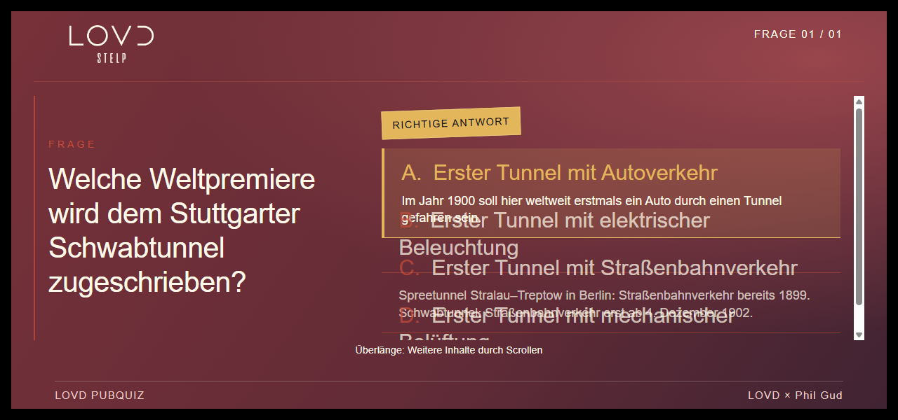
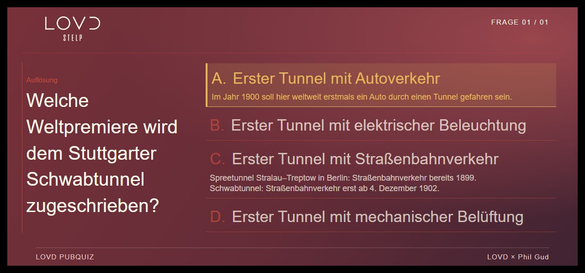
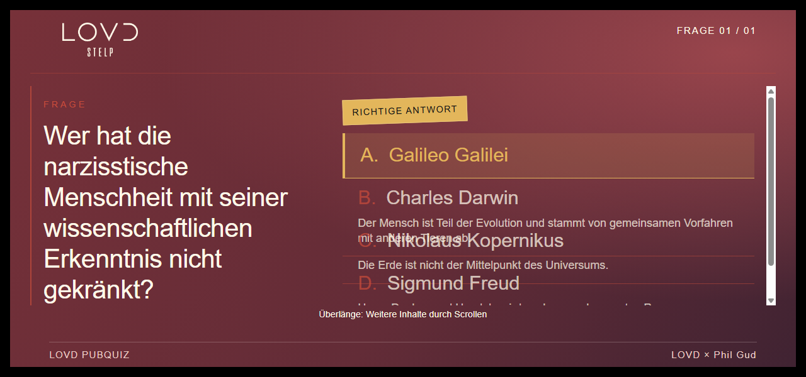
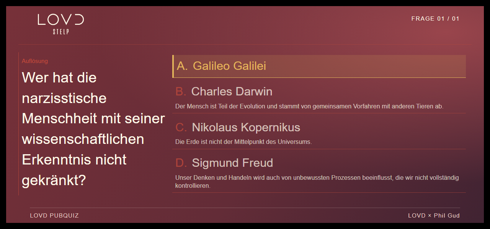
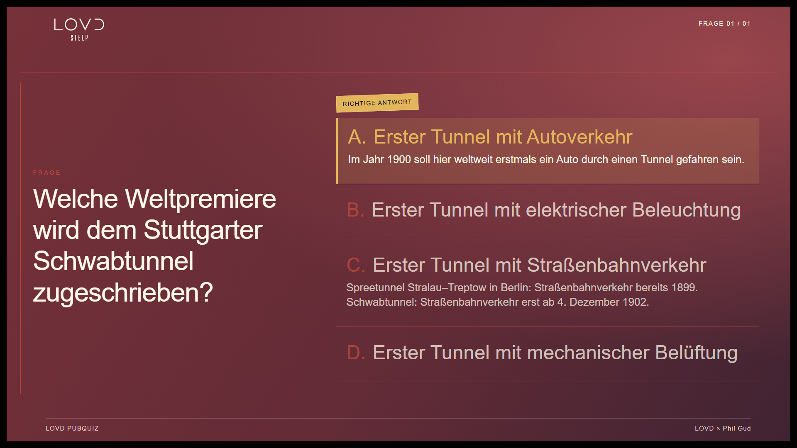
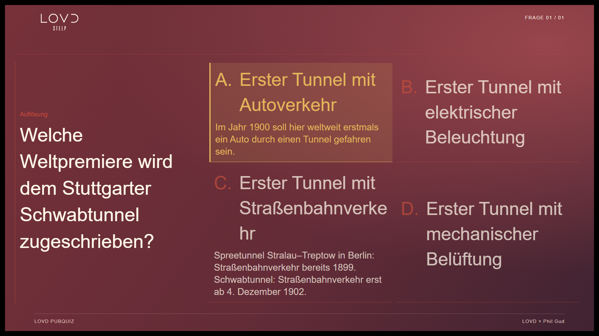
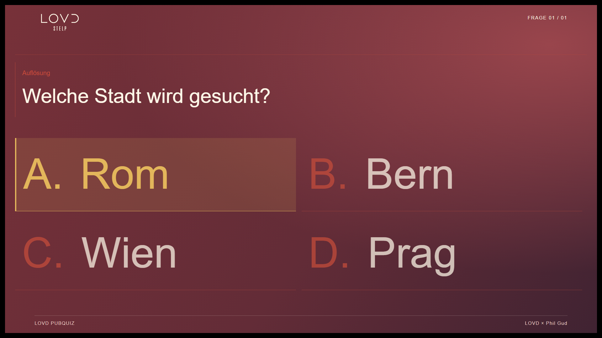

# Klassische Auswahlfolien – Browserabnahme 27.10.2026

## Befund und Architektur

Basis: main `97359425435f7790448f2b11e3604517f628d421`. Vollständige Texte von Frage #1393 (Schwabtunnel) und #1413 (narzisstische Kränkung) wurden im Production-Frageneditor ausschließlich gelesen. Folienpositionen wurden nicht als IDs interpretiert; kein Quiz wurde gesteuert oder gespeichert.

Der unveränderte Main-Renderer reproduziert bei 1280×600 überlappende Antwort-/Erläuterungszeilen und abgeschnittene Texte in beiden Fällen; auch 1280×720 und 1366×768 benötigen Scrollen. Ursachen: höhenbegrenztes Lösungsgrid mit unzureichenden intrinsischen Zeilenhöhen, breitenabhängige Typografie ohne Messung der vollständigen Erläuterungen und ausdrücklich vorhandener Scrollfallback. Storybook reservierte zusätzlich eine halbe Seite für dekorative Fotos. Die reine Containerhöhe erkennt die Textüberschneidung nicht.

`ClassicalChoiceSlide` hält Antwort und Erläuterung als natürliche gemeinsame Grid-Zeile zusammen. `fitChoiceContent` misst den vom vorhandenen Stage tatsächlich zugewiesenen Bereich nach Header/Footer, erprobt obere bzw. seitliche Frage mit Liste/2×2-Raster und bestimmt mit beschränkter binärer Suche eine gemeinsame Antwort- und Erläuterungsgröße. Frage und Bild besitzen eigene Größenverhältnisse; Bilder erhalten eine Mindestfläche. Kurze Inhalte wachsen bis höchstens 144 px Antwortschrift (zusätzlich an Breite/Höhe gebunden); Erläuterungen mindestens 14 px, Antworten mindestens 18 px. Diese Grenzen sind keine Garantie für beliebig viel Inhalt.

Der Produktionsrenderer delegiert ausschließlich klassische geschlossene Fragen ohne strukturierte Template-Daten (legacy/standard/multiple_choice) und ohne Nicht-Bild-Medien. Antwortreihenfolge und Medienrendering bleiben beim vorhandenen Renderer. Audio-, Pixel-, Meme-, Spezialformate und Quizlaufzeit werden nicht umgebaut. Bestehende Layout-, Storybook- und Fehlende-Bild-Vertragsmerkmale bleiben erhalten. Keine Schema-/Datenmigration, Templatezuweisung oder neue Abhängigkeit. Gemeinsame Designs aus PR #136 bleiben erhalten.

Messungen erfolgen beim Inhaltswechsel, ResizeObserver auf der extern bemessenen Box, Größen-/Vollbildereignissen sowie nach Bild- und Schriftladung. Es gibt eine gebündelte Ereignisberechnung, keine laufende Frame-Schleife. Ein nur dann ausgeblendeter Scrollhinweis, wenn die vollständige Einpassung tatsächlich gelingt; kein Abschneiden als Lösung. Storybook-Fotospalten werden ausschließlich auf diesen Folien freigegeben.

## Tatsächlich ausgeführte Prüfungen

- TypeScript `npm run typecheck`: erfolgreich.
- ESLint aller geänderten TS/TSX-Dateien: erfolgreich.
- 120 vorhandene Renderer-, Readability-, Template- und Storybook-Regressionsprüfungen: erfolgreich. Die vorhandenen Bild-/Reihenfolge-/Erläuterungsassertionen wurden auf das gemeinsame klassische Markup umgestellt, nicht entfernt.
- Neuer Chromium-Regressionscheck im regulären `npm test`: 270 Kombinationen = 6 Designwelten × 5 echte CSS-Viewports × 9 Fälle. LOVD, Phil Gud, Neon, Corporate, Storybook und Komm.ONE.
- Viewports: **1280×600, 1280×720, 1366×768, 1920×1080, 2560×1440**. Gemessen über `innerWidth/innerHeight`, nicht Bildschirmauflösung.
- Fälle: beide gemeldeten vollständigen Auflösungen, vier kurze Antworten, vier mehrzeilige Antworten als Frage und Auflösung, gemischte Längen, lange Frage mit kurzen Antworten sowie Bildfrage und Bildauflösung. Das Bild im automatischen Test ist ein vorhandenes lokales SVG, um externe Netzabhängigkeit zu vermeiden.
- Verglichen werden vollständige Frage/Antwort/Erläuterung mit Fixture-Daten, Buchstaben/Reihenfolge, einheitliche Schriftgrößen, Textzeilen über DOM-Ranges, Überschneidungen zwischen Optionen, Sichtbarkeit in Karte/Stage, Scrollmaße und tatsächliche Bildladung.
- Zusätzlich: Größenwechsel derselben gemounteten Folie, lange → kurze → lange Folie ohne Remount, Rückkehr zur vorherigen Größe und stabile Größen nach weiterem Warten; keine Browser-/ResizeObserver-Fehler. Kurze Antworten sind in jeder Vorlage/Größe mindestens 20 % größer als der Schwabtunnel-Fall.
- Vollständige CI und gehostete Preview: maßgebliche aktuelle Runs und Deploymentnachweis im PR. Keine physische Beamerabnahme behauptet.

## Messwerte und identische Vorher-/Nachhergrößen

Die maschinenlesbaren Messwerte stehen in [measurements.json](choice-layout-20261027/measurements.json). Beispiel LOVD bei 1280×600: Schwabtunnel ca. 34 px Antwort / 18 px Erläuterung, kurze Antworten ca. 86 px. Bei 1920×1080 ca. 58/30 px gegenüber 135 px kurzen Antworten; bei 2560×1440 ca. 83/43 px gegenüber 143 px. Die Frage hat eine separate Größe. Exakte Nachkommastellen siehe Messdatei.

### Schwabtunnel, 1280×600

Vorher: 

Nachher: 

### Narzisstische Kränkung, 1280×600

Vorher: 

Nachher: 

### Große Darstellung, 1920×1080

Vorher: 

Nachher: 

Kurze Antworten: 

## Explizite Grenze

`choice-extreme-solution` kombiniert eine 300-Zeichen-Frage mit vier 200-Zeichen-Antworten und vier 500-Zeichen-Erläuterungen. Bei 1280×600 benötigen die vollständigen Inhalte selbst mit 18 px Antworten und 14 px Erläuterungen **513 px statt 349 px** Inhaltsbereich. Die Einpassung meldet `unreadable`; dieser Fall ist ausdrücklich **nicht** scrollfrei abgenommen. Vorschlag: fachlich abgestimmte redaktionelle Entlastung oder zusätzliche Auflösungsschritte in einem gesonderten Auftrag. Hier werden weder Inhalte gekürzt noch zusätzliche Folien erzeugt. Auch beliebig kleine Fenster haben keine pauschale Lesbarkeitsgarantie.

## Preview-Abnahme

Nach erfolgreicher Bereitstellung (Login erforderlich):

- [Schwabtunnel](https://pubquiz-web-git-codex-choice-presentation-fit-just-phil-gud.vercel.app/templates/presentation-quality?scenario=choice-tunnel-solution&style=EDITORIAL)
- [Narzisstische Kränkung](https://pubquiz-web-git-codex-choice-presentation-fit-just-phil-gud.vercel.app/templates/presentation-quality?scenario=choice-freud-solution&style=EDITORIAL)
- [Vier kurze Antworten](https://pubquiz-web-git-codex-choice-presentation-fit-just-phil-gud.vercel.app/templates/presentation-quality?scenario=choice-short-solution&style=EDITORIAL)

Die interne Referenz verwendet dieselbe Rendererkomponente wie die öffentliche Präsentation, keine alternative Einpassung. Testzugang nur im Chat. Eigene synthetische Datenbank `choice_layout_review_20261027`; keine produktiven Inhalte, Rechte oder Sessions verändert. Kein Merge und kein Production-Deployment.
