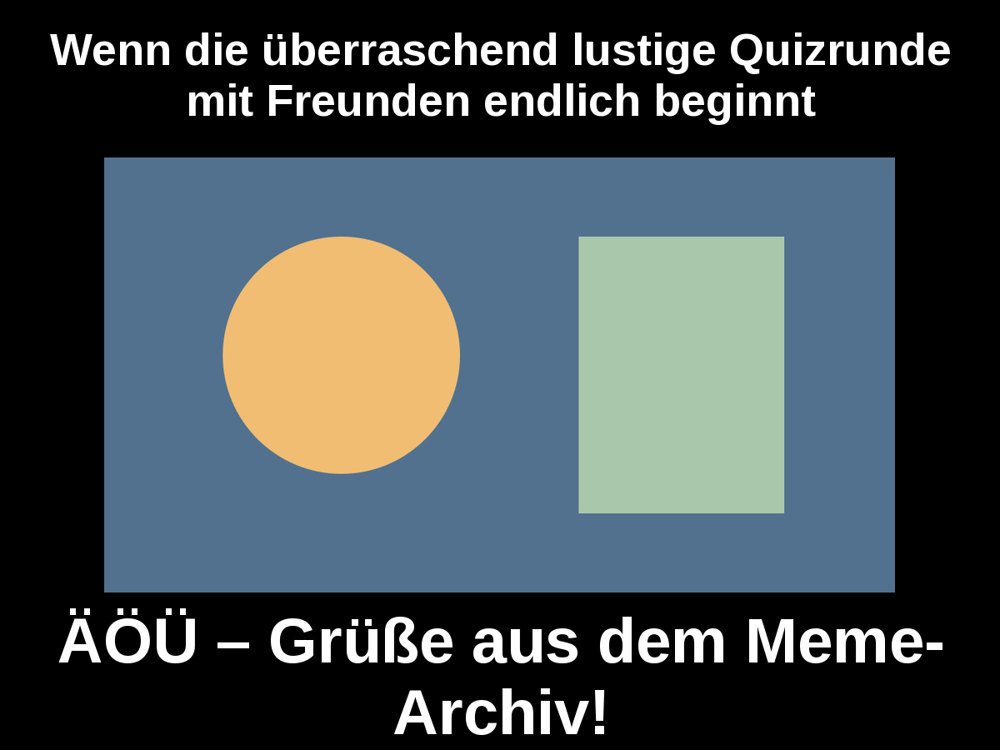
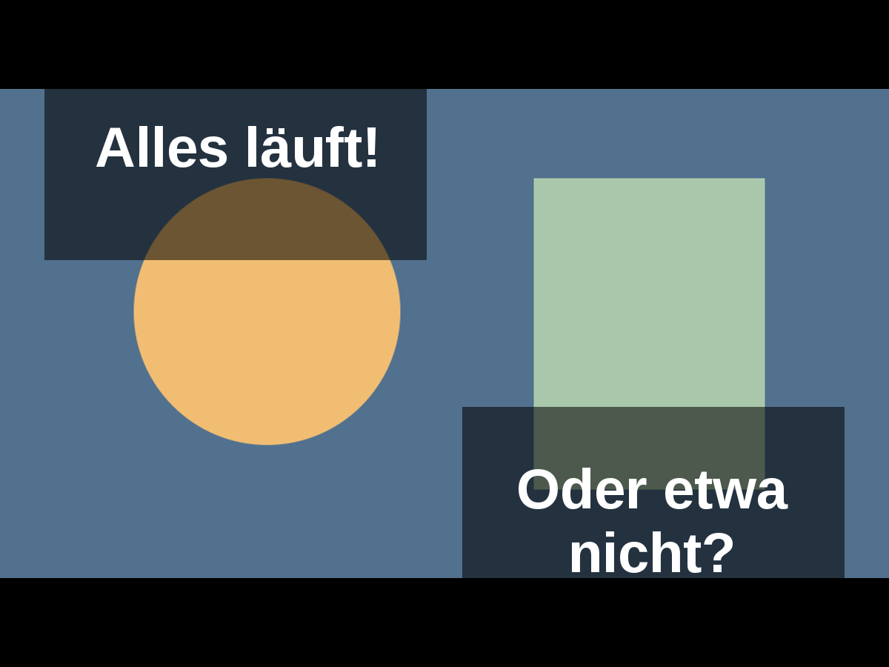
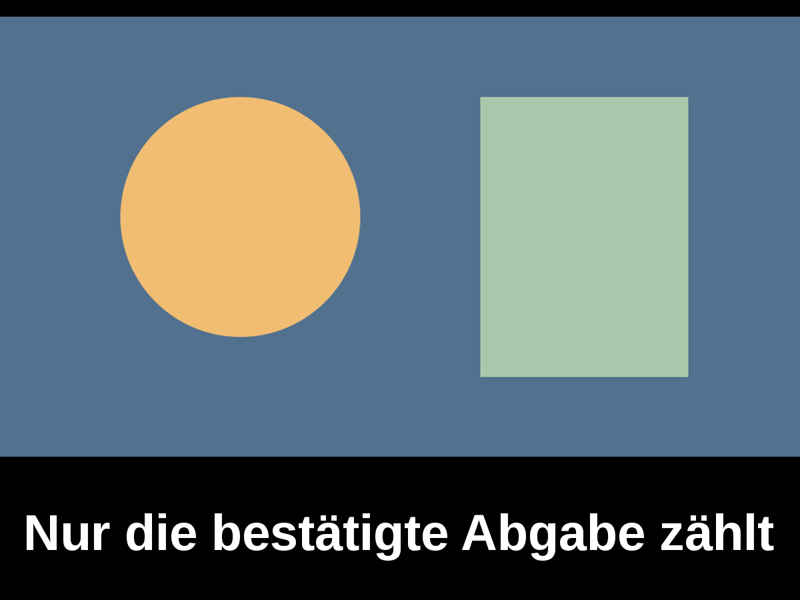

# Meme-Downloads, Archiv und Folienkorrekturen

Status: lokal geprüft; CI und Preview-Abnahme stehen noch aus. Kein Merge,
kein Production-Deployment und kein Production-Backfill.

## Umsetzung und Bedienung

- Antwortformular → „Meine Memes“ → „Mein Meme herunterladen“. Nur die letzte
  bestätigte eigene Version; ungespeicherte Änderungen verändern den Download nicht.
- Quizverwaltung → „Meme-Archiv“. Durchlauf auswählen, Vorschau, PNG oder ZIP
  herunterladen. Löschung erfordert eine zusätzliche Bestätigung und betrifft alle
  Versionen der gewählten Team-Abgabe in diesem Frage-Run.
- Neue explizite und automatisch finalisierte Abgaben werden atomar erfasst.
  Bestehende, noch vorhandene Abgaben lassen sich ausschließlich über eine separate
  bestätigte Manageraktion sichern. Keine automatische historische Übernahme.
- Schwarze Meme-Flächen/weiße Captions bleiben von Theme-Überschreibungen ausgenommen.
- TTS-Bedienhinweis entfernt, Audio- und Textschutzmechanik unverändert.
- FaceMorph-Auflösung: Original A, Morph, Original B; sortierte kanonische Namen.
  Fehlende Originale erhalten positionsgetreue Platzhalter. Nur der Morph-Slot darf
  in der Fragephase erscheinen, einschließlich der Bildvergrößerung. Die Auflösung
  bleibt auch bei noch gesetztem Vergrößerungsstatus als Dreierlayout sichtbar.
  Alle drei Medien gelangen bereits unverändert aus
  `getQuizPraesentation` in das View-Model; die Teilnehmerprojektion bleibt geschützt.

## Architektur und Migration

Bestehende Submission-, Voting-, Bewertungs- und Lifecycle-Verantwortlichkeiten
bleiben erhalten. Die separate Archivschicht sichert Snapshots, Basisbildbytes,
PNG-Erstellung, verschlüsselte Blob-Ablage und geschützte Exporte. UI-Komponenten
zeigen nur Status und Aktionen. Keine neue Paketabhängigkeit.

Additive Migration `20261016120000_meme_archive`: zwei Tabellen, atomarer
Submission-Capture-Trigger und Reset-Sicherungsprüfung. Kein Backfill. Keine
Fremdschlüssel auf zurückgesetzte Runtime-/Teamdaten. Vollständige Quizlöschung
bleibt bei vorhandenen Archiven gesperrt. Details und Auswirkungen sind vor der
Schemaänderung im [Archivvertrag](../architecture/meme-archive.md) dokumentiert.

Der bestehende öffentliche Blob-Store enthält verschlüsselte Dateien, keine
öffentlichen PNGs. Schlüssel bleiben in der DB. Bestätigte Team-Session bzw.
MANAGE_QUIZZES sind für jede Bild-/ZIP-Auslieferung erforderlich. Wiederholte
Uploads verwenden identische verschlüsselte Bytes, nicht wechselnde Schlüssel.

## Tatsächlich lokal geprüft

- Vollständiger bestehender `npm test`-Lauf erfolgreich, inklusive Chrome-Tests.
  Die zwei extern konfigurierten PostgreSQL-Tests bleiben in diesem Lauf planmäßig
  deaktiviert. Der neue Archiv-PostgreSQL-Test wurde separat tatsächlich ausgeführt.
- Neue Tests: PNG-Ausgabe mit Umlauten, langen Texten, leerer oberer/unterer Zeile
  und freien Zonen; AES-GCM-Integrität; ZIP-Inhalte, Standard-CRC und Größenlimits.
- Zugriff: Managerprüfung, signierte Team-Session, fremde IDs, andere Quiz-ID,
  veraltete Version, ungültige Session, CSRF und bestätigte Löschung.
- Uploadfehler, dauerhafte Wiederholung mit gleichem Schlüssel/Datei, kein Eingriff
  in gespeicherte Antwort/Bewertung, wiederholte Löschung und Zugriffssperre.
- Echter PostgreSQL-18-Test in isolierter lokaler Datenbank: tatsächliche Migration,
  explizite/automatische Submission, parallele Idempotenz, Rollback, Reset-Sperre,
  konkurrierende Finalisierung/Reset, Archiv nach Runtime-/Teamlöschung, RESTRICT
  bei vollständiger Quizlöschung.
- Chrome mit echtem CSS: fünf Designs, schwarze Flächen, weiße Texte, Alpha 0,55;
  FaceMorph mit unterschiedlichen Bildformaten und langen Namen bei 1280 und 360 px.
- Renderer-/Projektionsregressionen: 57 Tests erfolgreich. Typecheck, ESLint der
  geänderten Dateien und Next.js-Build erfolgreich.

Die Windows-Testumgebung benötigte für den eingefrorenen Importplan lokal dessen
ursprüngliche LF-Zeilenenden; Datei/Inhalt wurden anschließend exakt wiederhergestellt.
Es gibt keine Änderung am freigegebenen Importpool. Chrome/Compiler und der isolierte
PostgreSQL-Server liefen wegen Windows-Prozessrechten außerhalb der Ausführungssandbox.

### Visuell geprüfte tatsächliche Server-PNGs (synthetische Inhalte)

## Noch ausstehend

Die regulär geschützte Preview benötigt die spezifische temporäre Branchfreigabe.
Danach: eigenes Preview-Quiz, drei getrennte Team-Sessions, bestätigte Versionen,
Reload, Fremdzugriff, Voting/Ergebnis, tatsächliche Blob-PNGs und ZIP, Reset/neuer Lauf,
Bildquellenänderung, gezielte Löschung, TTS und FaceMorph im Browser prüfen.
Keine Tests auf realen Production-Quizzen #30/#31.

Physischer Fairphone-/Android-Download, unabhängige Smartphone-/Netztests und
tatsächlicher Hörtest sind nicht durch Desktop-/Viewport-Simulation nachgewiesen.
