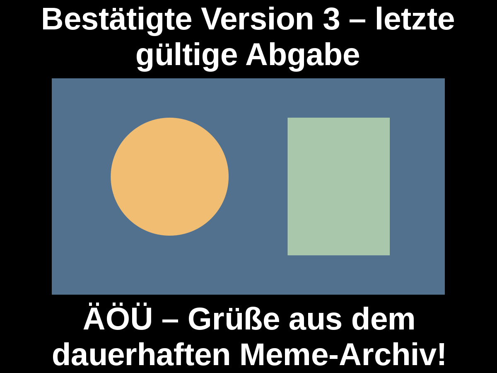
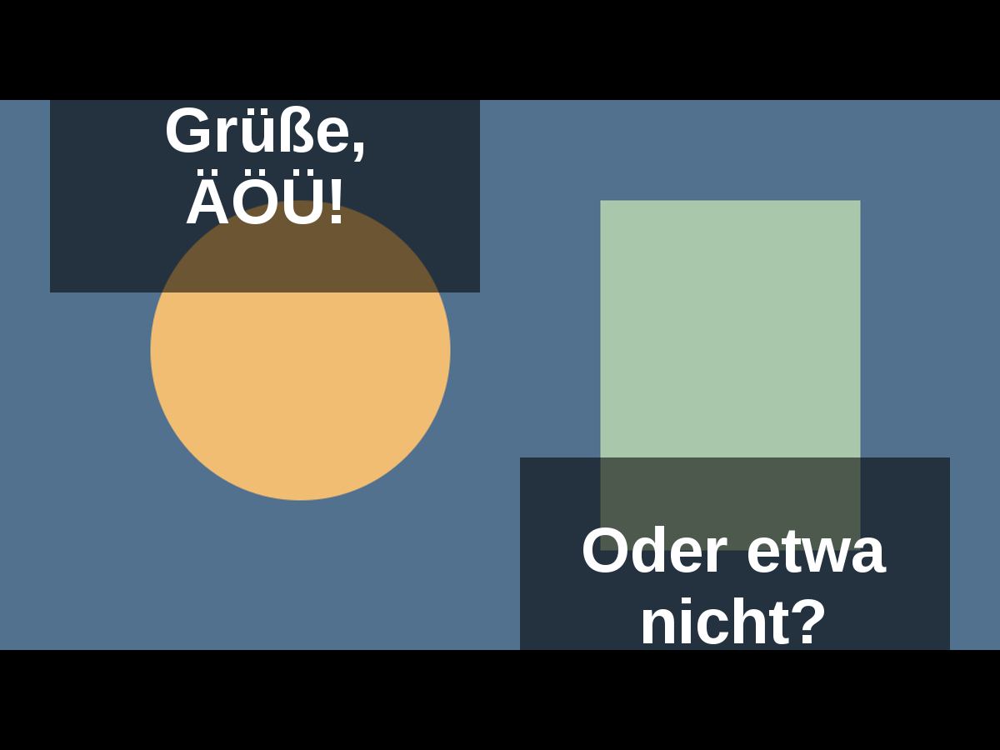
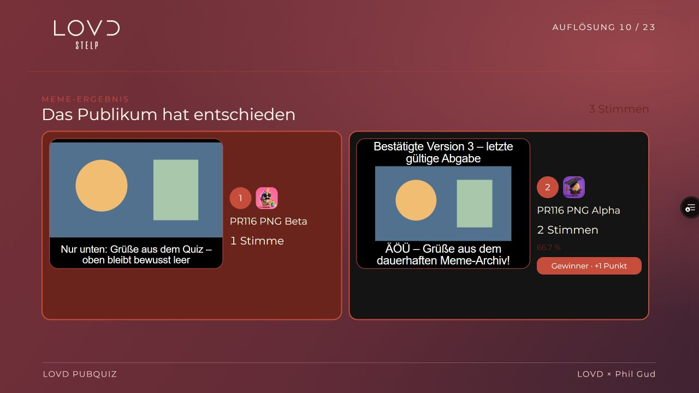
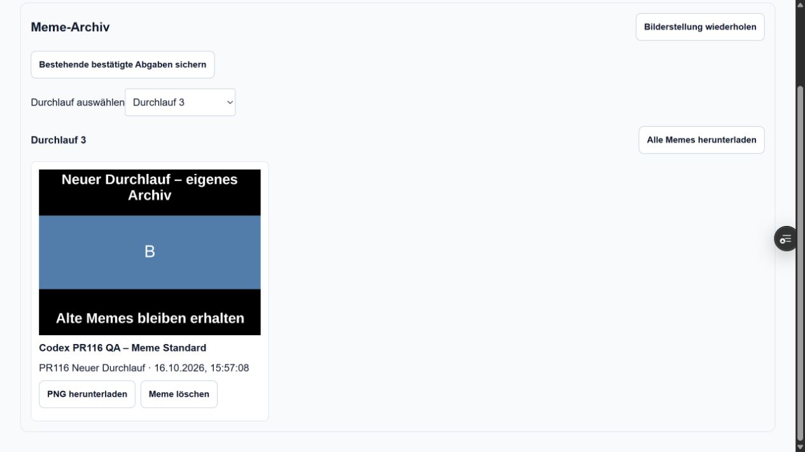
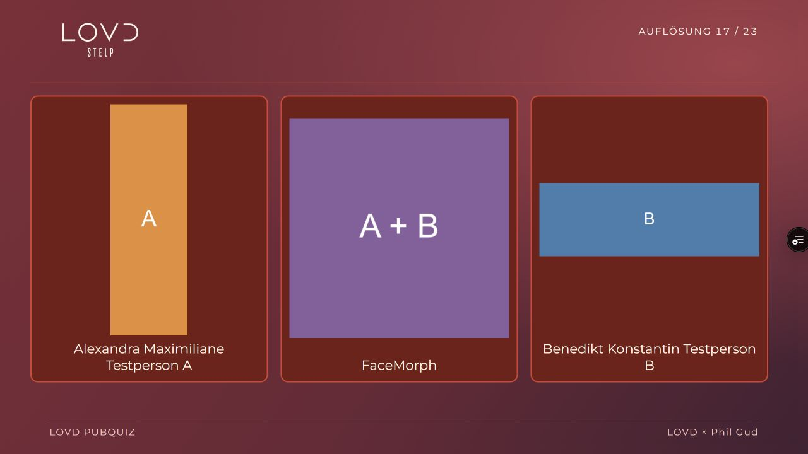
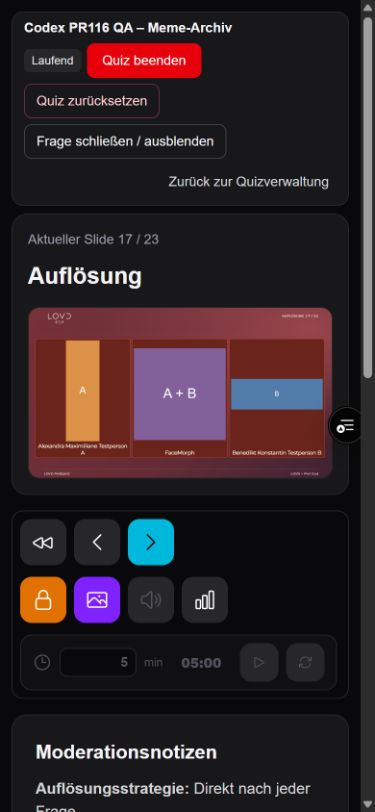

# Abnahme: Meme-Downloads, Archiv und Folienkorrekturen

PR [#116](https://github.com/justphilgud/pubquiz-web/pull/116), Ausgangspunkt
`baedd479615d33a7eb7b5e15f18f36450061dc5b`. Ausschließlich Preview;
kein Merge, Production-Deployment oder historischer Backfill.

## Bedienung

- Teams: Antwortformular → **Meine Memes** → **Mein Meme herunterladen**.
  Grundlage ist die letzte bestätigte Abgabe, auch in späteren Phasen und nach
  Reload. Ein unbestätigter Entwurf verändert den Download nicht.
- Veranstalter: Quizverwaltung → **Meme-Archiv**, Durchlauf auswählen;
  einzelne PNGs oder **Alle Memes herunterladen** als ZIP.
- **Meme löschen** öffnet den vorhandenen Bestätigungsdialog. Abbrechen erhält
  die Daten. Bestätigen entfernt alle Versionen dieser Team-Abgabe für dieselbe
  Frage und Lifecycle-Revision. Ein Reset löscht das Archiv nicht.
- **Bestehende bestätigte Abgaben sichern** ist eine separate, bestätigte Aktion.
  Es gibt keinen automatischen Import historischer Antworten.

## Architektur und Auswirkungen

Submission, Voting, Bewertung und Quiz-Lifecycle behalten ihre bestehenden
Verantwortlichkeiten. Die Archivschicht sichert Medien-/Layout-/Textsnapshots,
erzeugt PNGs, verwaltet dauerhafte Wiederholungen und liefert geschützte Exporte.
UI-Komponenten zeigen Status und lösen Aktionen aus. Keine neue Paketabhängigkeit.

Additive Migration `20261016120000_meme_archive`: zwei Archivtabellen, atomarer
AFTER-INSERT-Capture für explizite und automatische MEME_CAPTION-Finalisierungen
und Reset-Sicherungsprüfung. Ausschließlich auf Preview angewendet. Auswirkungen
wurden vor der Schemaänderung im [Archivvertrag](../architecture/meme-archive.md)
dokumentiert. Keine Runtime-/Team-Löschkaskade; vollständige Quizlöschung bleibt
bei aktiven Archiven gesperrt. Reset erfordert dauerhaft gesicherte Quellbytes.

Eine eigene PostgreSQL-Advisory-Sperre serialisiert Archivarbeit und Löschung,
ohne während Netzwerk-/Renderarbeit die Quiz-Lifecycle-Sperre zu belegen.
Verschlüsseltes PNG und zufälliger AES-GCM-Schlüssel werden vor dem Upload
festgeschrieben; Wiederholungen benutzen dieselben Bytes. Der bestehende
öffentliche Blob-Store erhält ausschließlich verschlüsselte Dateien. Schlüssel
und Blob-Adresse bleiben serverseitig. Jede PNG-/ZIP-Auslieferung prüft signierte
Team-Session oder MANAGE_QUIZZES. Keine Tokens in URLs, keine öffentliche Galerie.
ZIP-Exporte sind begrenzt und werden dateiweise gestreamt.

Die gemeinsame Meme-Darstellung ist gezielt von breiten Theme-Überschreibungen
ausgenommen. Schwarze Flächen, weiße Captions und Alpha 0,55 für freie Zonen
bleiben erhalten; das umgebende Foliendesign bleibt unverändert.

FaceMorph verwendet feste Medienrollen und sortierte kanonische Antwortfelder.
Ein reiner Presentation-Adapter ergänzt eindeutig zugeordnete Editor-Originale
aus deren `answer_image`, wenn kein expliziter Original-Slot vorliegt. Mehrdeutige
oder fehlende Originale werden nicht geraten. Die Teilnehmerprojektion und der
Schutz vor Originalen/Lösungsnamen in der Fragephase bleiben bestehen, auch bei
Bildvergrößerung. Die Auflösung zeigt A / Morph / B mit positionsgetreuen
Platzhaltern. Das Moderationsraster wird auf schmalen Ansichten begrenzt, ohne
Folienlogik oder Skalierungsberechnung zu duplizieren.

**Keine Schwierigkeitswerte für Memes, keine historischen Bewertungsänderungen.**

## In der tatsächlichen Preview geprüft

Eigenes synthetisches **Quiz #102 „Codex PR116 QA – Meme-Archiv“**;
Standard-Meme #250, freie Zonen #251, FaceMorph #252 und unverändert wiederverwendete
TTS-Testfrage #248. Drei getrennte Teams Alpha/Beta/Gamma in separaten Browser-Tabs.
Keine Reset-/Löschtests auf den realen Quizzen #30/#31. Drei Tabs ersetzen keine
unabhängigen Geräte oder Netzverbindungen.

Nach einem leeren Setup-Reset liegt der erste inhaltliche Testlauf in der UI unter
**Durchlauf 2** (Lifecycle-Revision 1), der nächste unter **Durchlauf 3** (Revision 2).

| Prüffall | Tatsächliches Ergebnis |
| --- | --- |
| Meme-Erstellung, Präsentation, Voting, Ergebnis | Schwarze Flächen/weiße Texte in LOVD; freie Zonen mit definierter Transparenz. Alle fünf Designs zusätzlich mit echtem CSS in Chrome getestet. |
| Bestätigung, Entwurf, Reload | Alpha V2 blieb nach unbestätigtem Entwurf und Reload byteidentisch; neue Bestätigung V3 ergab ein neues PNG, nur die aktuelle Version sichtbar. |
| Desktop/mobile PNGs | Tatsächliche Downloads visuell geöffnet: lange Texte, ÄÖÜ, leere obere Zeile und freie Zonen lesbar. Mobiler Viewport 390×844, kein physisches Telefon. |
| Automatische Finalisierung | Gültiger Gamma-Entwurf beim Schließen automatisch finalisiert und archiviert. |
| Nicht präsentierte Einreichung | Gamma im Standardlauf von der Präsentation ausgeschlossen, trotzdem vollständig im Archiv und ZIP. |
| ZIP | Drei echte PNGs aus dem Export mit unabhängigem .NET-ZIP-Leser entpackt; alle drei SHA-256 identisch mit Einzel-Downloads, siehe [Prüfmanifest](assets/meme-archive-20261016/preview-zip-check.json). |
| Voting mit drei Teams | Alpha→Beta, Beta→Alpha, Gamma→Alpha; eigene Wahl gesperrt. Ergebnis Alpha 2 Stimmen/66,7 %/+1, Beta 1 Stimme/33,3 %. Freie-Zonen-Lauf ebenfalls bis Ergebnis abgeschlossen. |
| Basisbildänderung | Nur eigene QA-Frage #250 auf anderes Basisbild geändert. Altes Alpha-V3-PNG unverändert, auch nach Reset. Der ursprüngliche Blob wurde nicht physisch gelöscht. |
| Reset und neuer Lauf | Vier alte Archiveinträge erhalten; alte Team-Sessions ungültig. Neues Team sah keine alten „Meine Memes“ und erzeugte ein eigenes PNG im neuen Durchlauf. Auch nach erneutem Reset abrufbar. |
| Löschbestätigung | Alpha: Abbrechen erhielt den Eintrag; explizites Bestätigen entfernte alle drei Versionen. Beta wurde bei einem vorherigen nativen Dialogversuch tatsächlich gelöscht; der native Dialog wurde anschließend durch den bestehenden Anwendungsdialog ersetzt und erneut geprüft. Gamma-Standard, Gamma-freie-Zonen und der neue Durchlauf blieben erhalten. |
| ZIP nach Löschung und Reset | Neuer Export enthält ausschließlich die zwei erwarteten Gamma-Dateien; Standard-PNG weiterhin SHA-identisch, siehe [verbleibender Export](assets/meme-archive-20261016/preview-retained-zip-check.json). |
| Zugriff nach Löschung | Ein direkter Browseraufruf der gelöschten URL wurde bereits vom Browser blockiert; kein behaupteter Browser-403-Nachweis. Serverseitige Zugriffsverweigerung ist durch Route- und echte PostgreSQL-Tests geprüft. |
| TTS | Exakter Hinweistext fehlt; Titel/Sprachangaben bleiben. Moderation Start → laufend, Pause → pausiert, Fortsetzen → laufend auf der Präsentation geprüft; anschließend pausiert. Kein physischer Hörnachweis. |
| FaceMorph Fragephase | Ausschließlich Morph, keine Originalporträts oder Lösungsnamen; auch bei aktivierter Bildvergrößerung. |
| FaceMorph Auflösung | A hochkant 240×720 / Morph 480×480 / B quer 960×320, lange kanonische Namen, alle Bilder geladen und vollständig in der 1280×720-Präsentation. |
| Schmale Moderationsvorschau | Auf dem finalen Deployment 390×844: Dokumentbreite und Scrollbreite beide 375 px; alle drei Bildflächen innerhalb des sichtbaren Rahmens, rechte Kante von B bei 337,7 px. Keine abgeschnittene Spalte. |
| Fehlende Originale | Positionsgetreue Platzhalter während der Abnahme sichtbar; gezielte Einzel-/Mehrfach-Lücken, Mehrdeutigkeiten und feste Slotpriorität zusätzlich automatisiert geprüft. Keine Ersatzbilder recherchiert. |

### Während der Abnahme gefundene und behobene Fehler

1. Vercel-Funktionslimit durch zusätzlich getracte statische Audio-/Videos.
   Nur diese Dateitypen aus dem Servertrace ausgeschlossen; Bildquellen bleiben
   enthalten. Lokale betroffene Funktion von rund 280 auf 112 MB reduziert.
2. Erstes echtes Preview-PNG zeigte Ersatzkästchen, da Serverfonts fehlten.
   Unveränderte Arimo-TTF mit OFL-Lizenz explizit eingebunden und getract;
   Quellcommit/Prüfsumme in `assets/fonts/arimo/README.md`. Kein Laufzeitdownload.
   Neue PNGs und proportional unterschiedliche Glyphen ohne Systemfonts geprüft.
3. Editor-Originale lagen an Antwortfeldern, nicht in vorbereiteten Frage-Slots.
   Der beschriebene reine Presentation-Adapter löst diese Zuordnung.
4. Schmale Moderationsvorschau wurde durch die automatische Raster-Mindestbreite
   abgeschnitten. Explizite Einzelspalte und schrumpfbare Vorschau-Spalte;
   Chrome-Regression mit produktiven Rasterklassen und schmalem 390-px-Rahmen.

## Automatisierte Prüfungen

- Typecheck und ESLint der geänderten Dateien erfolgreich.
- Vollständige CI: bestehende Tests, reale Chrome-Tests und Next.js-Build.
- Fünf Archivtests: tatsächliches PNG einschließlich Umlauten/langer/leerer Zonen,
  expliziter Font ohne Systemfonts, AES-GCM, ZIP/CRC/Größenlimits,
  Authentifizierung, fremde IDs, veraltete Versionen, CSRF und Löschbestätigung;
  Uploadfehler/Wiederholung ohne Änderung der gespeicherten Antwort/Bewertung.
- Echte PostgreSQL-Integration: tatsächliche Migration, explizite/automatische
  Erfassung, Idempotenz/parallele Worker, Rollback, unabhängige Antwortschreibvorgänge,
  Finalisierung/Reset-Konkurrenz, Reset-Sperre, Archiv nach Runtime-/Teamlöschung,
  neue interne Question-Runs, Quiz-RESTRICT und konsistente Löschung. CI PostgreSQL 17,
  zusätzlich lokal isoliert PostgreSQL 18.4. Kein Production-Datenbankzugriff.
- Renderer-/Projektionsregressionen einschließlich FaceMorph-Adapter: 88 Tests
  im gezielten Lauf. Chrome mit echtem CSS prüft fünf Designs, schwarze Flächen,
  weiße Texte, Overlay-Alpha und breite/schmale FaceMorph-Darstellung.

Die Windows-Umgebung erforderte für einen unveränderten eingefrorenen Importplan
lokal seine originalen LF-Zeilenenden; anschließend exakt wiederhergestellt,
keine Änderung am freigegebenen Importpool. Lokaler Chrome/Compiler/PostgreSQL
benötigten regulär genehmigte Windows-Prozessrechte außerhalb der Sandbox.

## Geänderte Dateien

Die vollständige [Dateiliste im PR](https://github.com/justphilgud/pubquiz-web/pull/116/files)
ist maßgeblich. Gruppen: `app/quiz/memeArchive/*` und Archivroute/-seite/-Panel;
Prisma-Schema und additive Migration; Submission-/Reset-/Quizlöschintegration;
Meme-CSS, FaceMorph-Renderer und Presentation-Adapter; gezielte Regressionen,
CI-PostgreSQL-Schritt, Fontasset/Tracing sowie Living Specifications.
Generierte lokale Prisma-Ausgaben gehören nicht zum PR.

## Erreichbare Bildnachweise aus der Preview

## Offene physische Prüfungen und Releasegrenze

Fairphone/Android-Download, unabhängige Smartphone-/Netztests und tatsächlicher
Hörtest sind offen: Desktop-Browser und Viewport-Simulation beweisen diese nicht.
Fehler-/Fremdzugriffs-/Parallelitätsfälle sind kontrolliert automatisiert getestet;
keine künstlichen Blob-/Netzausfälle in der gemeinsam genutzten Preview ausgelöst.

Vor Production sind eine gesonderte Freigabe, grüne finale Prüfungen und der
reguläre Releaseprozess einschließlich der additiven Migration erforderlich.
Kein Merge und kein Production-Deployment durch diesen Auftrag.

## Endgültiger technischer Stand

- Geprüfter Implementierungscommit: **`b1bed48c69cc6683435bb7eb4f3c3f0421306e49`**.
- [Erfolgreiche vollständige Push-CI einschließlich PostgreSQL](https://github.com/justphilgud/pubquiz-web/actions/runs/38914259372).
- [Erfolgreiches reguläres geschütztes Preview-Deployment](https://github.com/justphilgud/pubquiz-web/actions/runs/38914955083), Log bestätigt exakt diese SHA; keine ausstehende Migration.
- [Unveränderliches Deployment](https://pubquiz-o7ci5qkp3-just-phil-gud.vercel.app/)
  und [Branch-Alias](https://pubquiz-web-git-codex-meme-download-archive-just-phil-gud.vercel.app/).
- Letzte Browserkontrolle auf diesem Deployment: öffentliche FaceMorph-Auflösung,
  schmale Moderation sowie erneuter Frage-/Vergrößerungsschutz ohne Lösungsnamen
  und Originalbilder. Die ergänzte Berichtsversion verändert ausschließlich
  Dokumentation und Nachweisdateien, keinen ausgeführten Anwendungscode.
- Temporärer Eintrag aus `TRUSTED_PREVIEW_BRANCHES` und Branch-Policy `63277762`
  entfernt und erneut gelesen. Alle drei ursprünglichen Einträge/Policies erhalten;
  [nachvollziehbarer Bereinigungsnachweis](assets/meme-archive-20261016/preview-access-cleanup.json).
- PR bleibt offen. Kein Merge, kein Production-Deployment und keine Änderung realer Quizstände.
