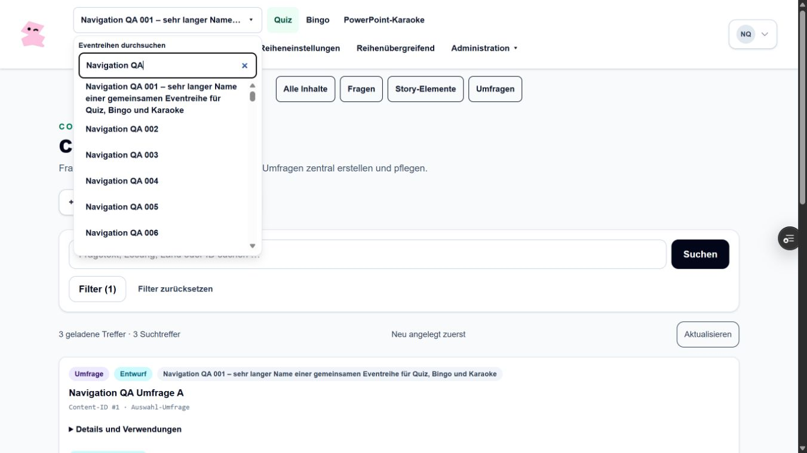
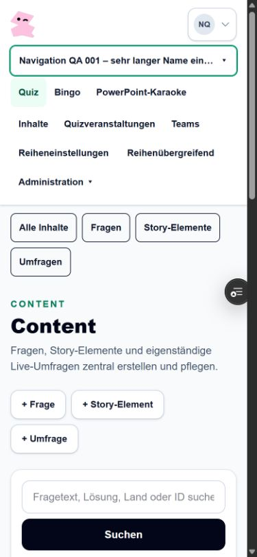
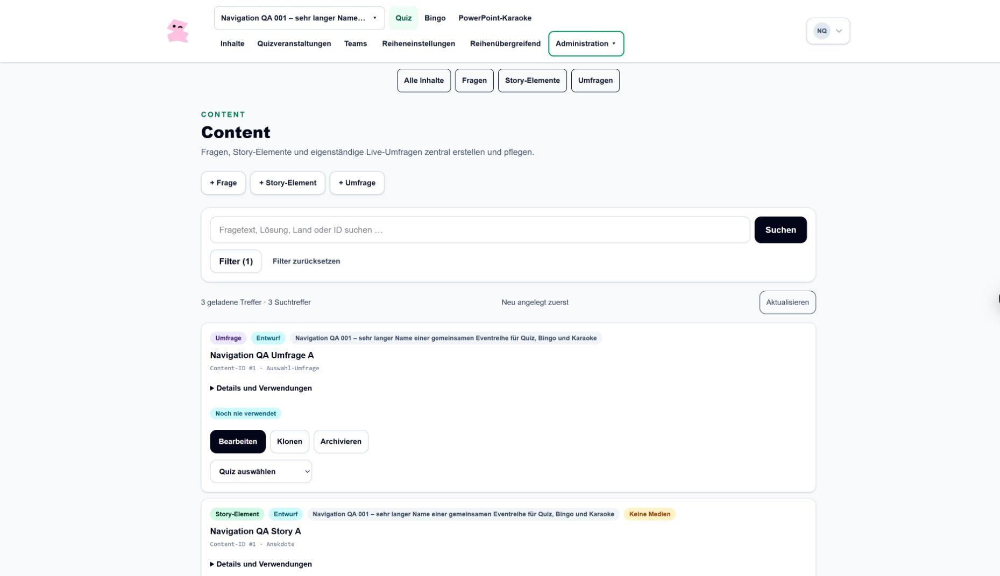

# Abnahme: Navigation mehrerer Eventarten

> **Historisch / fachlich überholt:** Die nachfolgende damalige Umsetzung bzw. Empfehlung wurde durch den neuen Auftrag vom 26.10.2026 ersetzt. Verbindlich sind die Hauptpunkte Quiz · Bingo · PowerPoint-Karaoke · Teams · Templates · Eventreihen · Administration. Teams und Templates stehen auf der Hauptebene. Siehe [aktuelle Architektur](../architecture/multi-event-navigation.md). Dieser Bericht ist keine Freigabe der früheren Navigation.

Stand: 25.10.2026. Grundlage: Main `669700e9d1668ce74345dfcc259d8aff37b2c644`, PR https://github.com/justphilgud/pubquiz-web/pull/131.

## Umsetzung

URL-basierter Arbeitskontext aus Eventreihe und Eventart; Inhalte mit Fragen, Story-Elementen und Umfragen, Quizveranstaltungen, Teams, unabhängige Reiheneinstellungen und getrennte globale Administration. Alte Direktlinks bleiben erhalten. Globale beziehungsweise mehrfach zugeordnete Objekte erhalten keinen erfundenen Reihenbesitz. Details und Entscheidungen: [Architektur](../architecture/multi-event-navigation.md).

Die vorhandenen Seitenkörper wurden für beide Routenfamilien wiederverwendbar gemacht. Datenzugriff und Schreibregeln bleiben in den bisherigen Actions und Repositories. Neu sind Navigation, Kontextkatalog, zulässige URL-Ziele und ein gemeinsamer Navigationsschutz für die betroffenen Redaktions-/Quizformulare. Es gibt keine neue Migration, Abhängigkeit, Produktdomain-/DNS-Konfiguration oder Spielfunktion.

## Isolierter Prüfbestand

Ausschließlich `pr130_review_20261025` auf dem Development-Neonhost. Kein Production-Datenbestand und keine echten Konten werden kopiert. Die vorhandenen synthetischen PR130-Fixtures bleiben bestehen. Neu hinzugefügt: 110 Reihen `Navigation QA 001` bis `110`, sechs Rollen-Testkonten, zwei Quizze, getrennte Fragen und Teamteilnahmen sowie eine globale freigegebene Frage. Bei der Abnahme wurden ein Story-Element und eine Umfrage in Reihe A normal gespeichert und erneut geöffnet.

- Reihe A: ID 117, langer Name, Quiz/Bingo/Karaoke freigeschaltet.
- Reihe B: ID 118, Quiz, eigene Frage und Teamteilnahme.
- Reihe 005: ID 121, kein freigeschaltetes Produkt, eigenständiges Verwaltungsrecht.
- Administrator sieht insgesamt 226 vorhandene synthetische Reihen; dadurch ist die Auswahl mit deutlich mehr als 100 Reihen praktisch geprüft.
- Neue Runtime-Datenbankrolle kann Development-Bestandsdaten nicht lesen und hat kein Schema-Erstellungsrecht. Die Migration verwendet getrennt den vorhandenen Eigentümer der isolierten Datenbank.
- Zugangsdaten werden ausschließlich im privaten Übergabebericht genannt, nicht im Repository gespeichert.

## Rollenabnahme im tatsächlichen lokalen Browser

Getrennte Sitzungen unter eigenen Loopback-Testhosts; zuerst Development, anschließend die relevanten Abläufe zusätzlich mit dem fertigen lokalen Build ohne Hot Reload.

| Rolle / Testkonto | Tatsächlich geprüft | Ergebnis |
| --- | --- | --- |
| Administrator `navigation.admin@example.invalid` | Suchbare Auswahl aller 226 Reihen; globale Benutzer-/Templateverwaltung; gemeinsame Einstellungen; Inhalte erstellen und wieder öffnen | Bestanden |
| Globaler Quiz-Editor `navigation.global@example.invalid` | Reihenübergreifende Bibliothek mit freigegebener globaler Frage; keine Reihenauswahl oder Administration; fremder Workspace direkt abgewiesen | Bestanden |
| Begrenzter Eventmanager `navigation.manager@example.invalid` | Erlaubte Reihen, Quizverwaltung, Inhalte und Teams; Wechsel A/B; keine Frage/Story der alten Reihe in B; Team B allein in B | Bestanden |
| Reiheneditor `navigation.editor@example.invalid` | Eigene Frage A, globale freigegebene Frage in Bibliothek; Bingo-Platzhalter; keine Karaoke-, Quizverwaltungs- oder Administrationsfunktion; fremde Frage-ID und fremde Reihe abgewiesen | Bestanden |
| Ausschließliche Reihenverwaltung `navigation.settings@example.invalid` | Einstellungen/Logo für Reihe 005 trotz fehlender Produkte und Spielrolle; keine Quizrechte; Produktfreigabe nicht bedienbar; direkter Quiz-Workspace abgewiesen | Bestanden |
| Ohne passende Rechte `navigation.none@example.invalid` | Keine Arbeitsbereiche; direkter fremder Workspace abgewiesen | Bestanden |

### Kontext, Formulare und Bestand

- Suche, Tastatur-Tab zu Treffern, Escape mit Rückkehr des Fokus und begrenzte Dropdownhöhe bei 226 Einträgen geprüft.
- Wechsel B → A aus „Inhalte“ führt direkt nach `/workspaces/117/quiz/content`; nur Frage, Story und Umfrage A erscheinen. Keine Objekt-ID der vorherigen Reihe wird übernommen.
- Browser-Zurück, Vorwärts und vollständiger Reload im fertigen Build zeigen zur URL passende Quizverwaltung beziehungsweise Inhalte. Ein während Hot Reload beobachteter Zwischenstand trat ohne Hot Reload nicht auf; es wurde kein Runtime-Router umgebaut.
- Suchfilter anwenden und „Filter zurücksetzen“ erhält Reihe A. Ein Queryfilter kann den Reihenpfad nicht überschreiben; feste Unterbereiche binden auch den Inhaltstyp.
- Fragen-, Story-, Umfrage-, Quiz- und Schnellquizentwurf: Kontextwechsel fragt nach; Abbruch erhält die Eingabe. Nach Zurücknahme der Eingabe funktioniert der normale Wechsel. Story und Umfrage wurden in A gespeichert und wieder geöffnet.
- Produkt Quiz in der eigenen synthetischen Reihe A vorübergehend über das vorhandene Formular deaktiviert: angemeldeter Editor erhält nach Reload 404. Wieder aktiviert: Zugriff kehrt ohne Session-Reset zurück.
- Eigene synthetische Editorzuordnung A über die Benutzerverwaltung entfernt: bestehende Editorsitzung erhält nach Reload 404. Anschließend Zuordnung als Editor wiederhergestellt; zweite Zuordnung und übrige Rechte bleiben erhalten. Endstand beider Rollen und aller Produktflags separat gelesen und bestätigt.
- Globale Präsentationstemplates normal geöffnet. Keine Templates, Fragen, Antworten, Punkte oder individuellen Gestaltungswerte bestehender Bestände verändert.
- Moderation, Präsentation und öffentliches Teamformular des isolierten Quiz A geöffnet. Vorbereitung/Begrüßung/Teambeitritt vorhanden, keine Verwaltungsnavigation in diesen Ansichten. Kein Quizstart und kein Reset ausgelöst. Dies ist ein gezielter Navigations-Smoke-Test, keine erneute vollständige Live-Spielabnahme.

## Projektprüfungen

- Vollständige lokale `npm test`-Suite erfolgreich. Das unveränderliche Import-Fixture wurde ausschließlich für den Lauf auf seine geprüften Git-Zeilenenden gebracht und anschließend bytegenau zurückgestellt.
- Typecheck erfolgreich; ESLint sämtlicher geänderter/neuer TS-/TSX-Dateien mit `--max-warnings 0` erfolgreich.
- Neun gezielte neue Navigationsregressionen: Rollen/Produkte, unabhängige Verwaltung, globaler Editor, Karaoke-Ausschluss, 110-Reihen-Suche, sichere Sammlungsziele, Rücksprung-URL und nicht überschreibbare Filterbindung. Über `posttest` in CI integriert.
- Betroffene Architektur-/Workflowtests aktualisiert; der mobile Navigationstest prüft die tatsächlich neue Komponente.
- Lokaler fertiger Webpack-Build erfolgreich. CI verwendet zusätzlich den regulären Projektbuild.
- Implementierungs-CI: https://github.com/justphilgud/pubquiz-web/actions/runs/40237974124 — erfolgreich, einschließlich tatsächlicher PostgreSQL-Integrationstests.
- CI der korrigierten Preview-Konfiguration: https://github.com/justphilgud/pubquiz-web/actions/runs/40238629772 — erfolgreich.

## Preview-Bereitstellung und Migrationshistorie

Der erste Lauf https://github.com/justphilgud/pubquiz-web/actions/runs/40238354966 stoppte am Prisma-Migrationsschritt, weil der neue eingeschränkte Runtime-Login auch als Migrationszugang verwendet wurde. Die Korrektur trennt Runtime- und Migrationseigentümer derselben isolierten Datenbank; keine Runtime-Rechte wurden erweitert und keine Prüfung übersprungen.

Korrigierter Lauf: https://github.com/justphilgud/pubquiz-web/actions/runs/40239103714. Die reguläre Migrationsprüfung ist erfolgreich. Alle 63 vorhandenen Historienzeilen (61 erfolgreich, zwei historisch zurückgerollt) sind unverändert: Fingerabdruck vor und nach dem Schritt `d93a751cf6b478ca8e0e18c01baa8cea`. Es wurde keine neue Migration angewandt und keine Historie zurückgesetzt oder neu markiert.

Die menschliche Branch-Vertrauensfreigabe wurde ausdrücklich erteilt. Bestehende Allowlist-/Environment-Einträge bleiben erhalten; ergänzt wurde ausschließlich `codex/multi-event-navigation`. Exakte Push-CI, zentrale Nonprod-Medienkonfiguration und Datenbankidentität werden weiterhin geprüft.

## Gehostete Browserabnahme

Bereitgestellt und tatsächlich geprüft: `8fd648ec7a364b0cd83eb276596fc19df873ac25`, Vercel `dpl_8ceJshwY9LVBiwEToJrzFwaXrEsN`, READY.

- Branch-Preview: https://pubquiz-web-git-codex-multi-event-navigation-just-phil-gud.vercel.app
- Unveränderliches Deployment: https://pubquiz-frws4g8t2-just-phil-gud.vercel.app
- Direkt zu Inhalten A: https://pubquiz-web-git-codex-multi-event-navigation-just-phil-gud.vercel.app/workspaces/117/quiz/content
- Benutzerverwaltung: https://pubquiz-web-git-codex-multi-event-navigation-just-phil-gud.vercel.app/admin/users

Alle sechs Rollen wurden auch hier tatsächlich angemeldet und geprüft. Admin: Suche, Inhalte, normaler Speicherweg und globale Verwaltung. Globaler Editor: ausschließlich freigegebene globale Frage, kein Reihen-/Adminzugriff. Manager: nur Team B im Kontext B und Abweisung der nicht zugewiesenen Reihe 106. Reiheneditor: eigene Frage A, keine Quizverwaltung/Karaoke/Administration; fremde Frage-ID abgewiesen, Bingo nur Platzhalter. Reihenverwalter: eigenes Logo-/Einstellungsziel ohne Spielrolle, Produktfreigabe nicht bedienbar. Ohne Rechte: keine Workspace-Links und direkte Reihe A abgewiesen.

Eine zusätzliche eigene Frage „Navigation QA Hosted Frage“ wurde regulär als Entwurf in A gespeichert (ID 4), aus der Liste wieder geöffnet und vollständig neu geladen. Dies bestätigt den tatsächlichen Schreib-/Lesepfad mit dem eingeschränkten Runtime-Datenbanklogin. Es wurde kein Schema-Erstellungsrecht für die Anwendung benötigt.

Widersprüchlicher Direktlink `/workspaces/117/quiz/questions?eventSeriesId=118&contentType=POLL`: ausschließlich Frage A, keine Frage B und keine Umfrage. Reihenwechsel A → B erhält „Inhalte“, alte A-Daten verschwinden. Zurück, Vorwärts und Reload bleiben korrekt. Moderation, Präsentation und öffentliches Antwortformular des vorbereiteten Quiz A wurden auch gehostet geöffnet; kein Start und kein Reset.

### Größen und Tastatur

| Angeforderter Viewport | Gemessene Dokumentbreite | Tatsächlich geprüft |
| --- | --- | --- |
| 1366 × 768 | 1351 px, inklusive normaler Scrollbar kein Überlauf | Suchauswahl mit 110 passenden Reihen, Menü vollständig im Viewport |
| 1920 × 1080 | 1905 px, kein Überlauf | Kompakte Ebenen, Administration per Tastatur öffnen/schließen, Fokus kehrt zurück |
| 390 × 844 | 375 px, kein Überlauf | Mobile Navigation, Suche, Tab zum Treffer, Escape; Menü rechts innerhalb des Viewports |

Die Screenshots dokumentieren diesen gehosteten Stand vor dem zusätzlichen Entwurf ID 4:

### Abgrenzung des Rollenwechsel-Befunds

Bei einem schnellen sequentiellen Rollenwechsel blieb einmal nach der App-Menü-Abmeldung die bisherige Managersitzung bestehen. Der erste vermeintliche Editorbefund wurde deshalb ausdrücklich verworfen. Nach regulärem Auth.js-Signout und bestätigter Editoridentität wurden dessen Prüfungen wiederholt und bestanden. Die Abmeldung aus einer vollständig geladenen Bingo-Seite beendete die Sitzung auch nach Reload korrekt.

Es wird kein allgemeiner Auth-Ursachenfix behauptet. Authentifizierung und Session-Code bleiben unverändert. Im neuen Navigator wurden die unnötigen zusätzlichen Objektkontext-Actions auf Start-/Sammlungsseiten gezielt entfernt; eine neunte Regression sichert die Beschränkung auf tatsächliche Objektseiten ab. Der nachfolgende Abschlusshead erhält erneut die vollständige erforderliche CI und Preview-Bereitstellung; sein endgültiger SHA-/Deploymentnachweis sowie die Wiederholungsprüfung der Rollenwechsel werden im PR-Übergabeprotokoll festgehalten. Die vorstehenden Screenshots und Rollenprüfungen bleiben als datierter Nachweis des genannten Deployments erhalten.

## Selbst prüfen

1. Mit dem im privaten Übergabebericht genannten synthetischen Admin anmelden. „Eventreihe auswählen“ öffnen, `Navigation QA 001` suchen und den Treffer auswählen.
2. Unter „Quiz“ zunächst „Inhalte“, dann „Fragen“, „Story-Elemente“ oder „Umfragen“ öffnen. Über die Reihensuche `Navigation QA 002` auswählen: derselbe Inhaltsbereich bleibt geöffnet, Treffer stammen aus B. Zurück/Vorwärts und Reload prüfen.
3. Unter „Quizveranstaltungen“ sind nur die Quizze der aktuellen Reihe sichtbar; „Teams“ zeigt nur deren Teilnahmebereich. „Reiheneinstellungen“ enthält gemeinsame Stammdaten und Logo, „Administration“ die globale Verwaltung. „Reihenübergreifend“ öffnet die erlaubte übergreifende Quiz-Inhaltsbibliothek.
4. „Bingo“ beziehungsweise „PowerPoint-Karaoke“ bei einem berechtigten Manager/Admin auswählen: ausschließlich „Noch nicht verfügbar“, keine Erstellen-/Starten-Funktion. Für den Reiheneditor wird Karaoke nicht angeboten.
5. Einen Entwurf beginnen und über einen Kontextlink wechseln. Die Nachfrage abbrechen: Eingaben müssen erhalten bleiben. Testdaten dürfen in der isolierten Preview verändert werden; reale Production-Konten oder Quizze gehören nicht zu dieser Abnahme.

## Bewusste Grenzen

Bingo und PowerPoint-Karaoke sind nicht spielbar. Es gibt keine gemischten Veranstaltungen, kein gemeinsames neues Theme-System und keine automatischen Templatekonvertierungen. Kein Merge oder Production-Deployment. Historischer Backup-Readback-Fehler und erster echter Wochenlauf bleiben separate, unveränderte Betriebspunkte.
