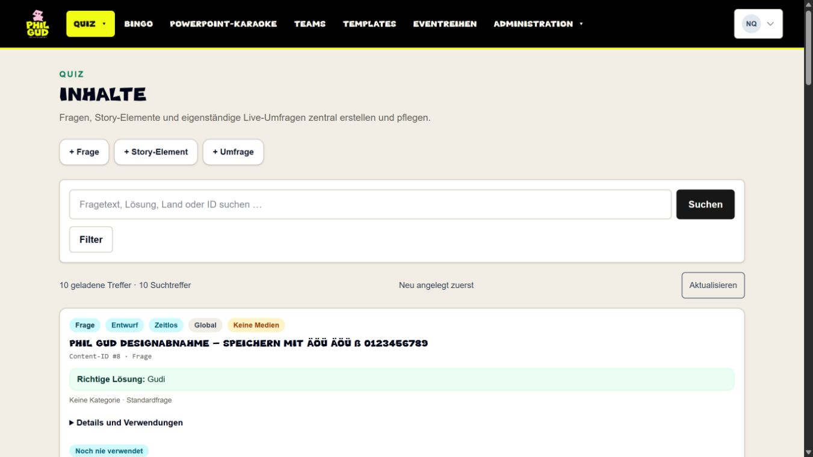
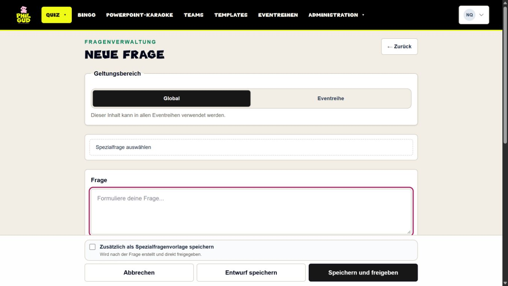
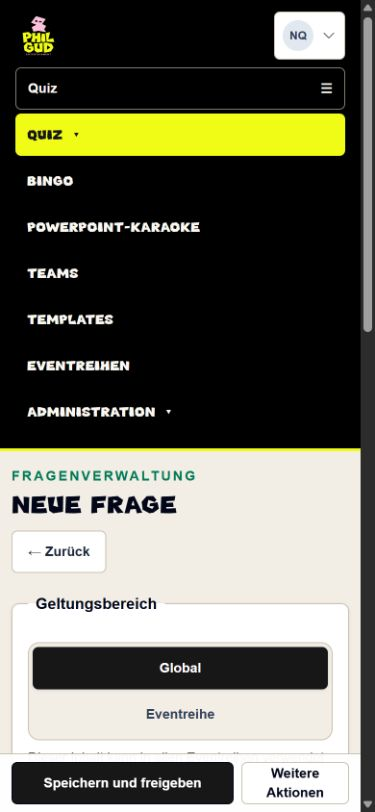
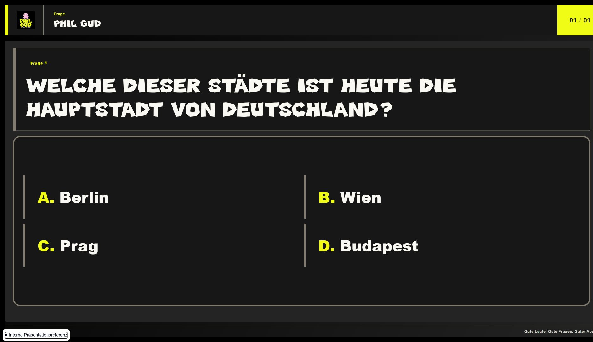
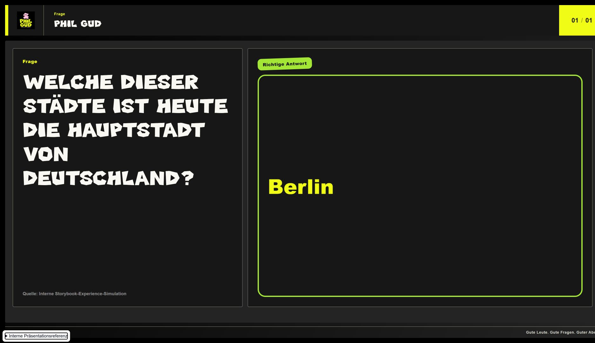

# Phil-Gud-Design: tatsächliche isolierte Abnahme

26.10.2026, PR #132. Kein Merge, kein Production-Deployment. Lokaler fertiger Build des Anwendungsstands `02379163b65db42d15d572f95f4c15de087d6968`; dieser Bericht und Screenshots sind eine anschließende Dokumentation, keine neue Anwendungsänderung.

## Referenz und Umfang

Aktuelle Website direkt im Browser geprüft. Original **Phil Gud Display Regular / PhilGudDisplay-Regular**, lokale unveränderte WOFF, Zeichenumfang ÄÖÜ äöü ß und 0–9 nachgewiesen. Tatsächliche Farben, Logo und Gudi inklusive Quellen und SHA256 in der [Spezifikation](../design/phil-gud-management-and-template.md). Bewusste eigene Markenwelt statt stiller Änderung der Serifenvorgabe des ungegoogelt-Manifests. Bestehende Quiztemplates und alle Defaults erhalten.

## Tatsächliche Browserprüfungen

Ausschließlich synthetische Daten in `pr130_review_20261025`, nie Production. Drei getrennte Cookie-Sitzungen, Identität jeweils im Kontomenü bestätigt: Admin, Eventmanager, Reiheneditor.

- Repräsentative Liste, Editor, Frage und Auflösung zuerst visuell geprüft; Schrift und funktionale Ergänzung über berechnete Styles kontrolliert. Aufbau bleibt kompakt, keine Marketinganimation.
- Laptop 1366×768: Dokument 1351 px; Mobil 390×844: 375 px; großer Bildschirm 1920×1080: 1920 px. Keine horizontalen Überläufe in den gemessenen Listen-/Editor-/Templateansichten. Templatefooter endet innerhalb des Viewports (1896 px bei 1920 px). Schrift im Editorfeld Arial, Überschriften Phil Gud Display.
- Quizdropdown per Enter/Escape bedient, Fokus kehrt auf Quiz zurück; sichtbare Fokusfarbe `rgb(163,38,97)`. Mobil stabile Reihenfolge aller sieben Adminziele.
- Admin-Reihensuche: 110 passende synthetische Reihen plus Gesamtauswahl; Manager 84 passende aktive Quizreihen plus Gesamtauswahl. Lange Namen und bestehende Rolleneinschränkungen erhalten. Editor erhält keinen Administrationsbereich; direkter Aufruf der Benutzerverwaltung wird auf den zulässigen Inhaltsbereich umgeleitet.
- Synthetische Frage ID 8 über Editor gespeichert, erneut geöffnet und vollständig neu geladen: Frage, Antwort, Umlaute, ß und Ziffern erhalten. Leeres Formular zeigt vorhandene Validierung, Lade-/deaktivierte Zustände beim Speichern beobachtet.
- Portal zur Spezialfragenauswahl im fertigen Build geöffnet: `data-admin-ui=phil-gud` am Dialog, richtige Display-Schrift; Escape schließt und fokussiert „Spezialfrage auswählen“. Overlay-/Fokus-/Schließlogik unverändert.
- Benutzerformular des synthetischen Managers mit 105 Zuordnungen geöffnet: Suche reduziert auf eine Zeile, Leeren stellt alle 105 wieder her. Tatsächlicher Mobilviewport 390 px, Dokument 375 px, Tabelle 288 px. Abbrechen schließt ohne Speicherung. Keine Rolle, Zuordnung oder Berechtigung verändert.
- Neues Quiz **Phil Gud · Designabnahme**, ID 4, drei neue Fragen IDs 5–7; beide Templatezuweisungen ausdrücklich `phil-gud`. Details zeigen Auswahlantwort, offene Frage und Bildfrage. Moderation zeigt Vorbereitung und die richtige Templatevorschau, Präsentation „Präsentation bereit“, Teamformular Vorbereitung. Auf diesen Livepfaden kein Verwaltungs-Wrapper. Kein Start, Beitritt, Antwortversand oder Reset.
- Produktiver Renderer in interner lesender Präsentationsreferenz: Frage mit vier Optionen, kurze Auflösung, lange Reihenfolge-Auflösung und geschlossene Bildfrage (vier Optionen und Bild gleichzeitig). Alte LOVD-/Neon-Referenzen ohne Phil-Gud-Marker und ohne Verwaltungs-Wrapper.

## Automatische Nachweise

- 125 gezielte Branding-/Registry-/Config-/Theme-/Header-/Readability-/Mobiltests erfolgreich.
- 21 Branding-/CI-Guard-Tests erfolgreich.
- Zwei echte Browser-Kontrast-/Resize-Regressionsprüfungen erfolgreich, jetzt zusätzlich mit Phil Gud und der neuen CSS-Datei; die bisherigen fünf Designwelten behalten ihre Prüfgrenzen.
- Bestehender Eventreihen-Formular-Browsertest nach Dialogkontextkorrektur erfolgreich. Die erste CI deckte einen Router-Hook im generischen Modal auf, den das isolierte Testharness nicht exportiert. Ursache durch rein visuellen, routerunabhängigen React-Kontext behoben; kein Mock aufgeweicht und keine Fachprüfung entfernt.
- Typecheck, striktes ESLint geänderter Dateien und lokaler Production-Build erfolgreich. Erforderliche CI läuft auf dem finalen PR-Head separat; genaue Lauf-/SHA-Belege werden in der PR-Übergabe ergänzt.
- Read-only-Abgleich der isolierten Migrationhistorie unverändert: 63 Zeilen, davon 61 erfolgreich und zwei historisch zurückgerollt, Fingerabdruck `d93a751cf6b478ca8e0e18c01baa8cea`. Bestehende synthetische Rechte/Produktflags entsprechen der Ausgangslage.

## Verbleibende Grenzen

**Branch-Vertrauensfreigabe erteilt und umgesetzt.** Ausschließlich `codex/philgud-admin-design` wurde nach ausdrücklicher menschlicher Bestätigung zur bestehenden Allowlist und Branchpolicy hinzugefügt. Separater eingeschränkter Preview-DB-Login; reguläre Development-Datenbank damit nachweislich nicht lesbar. Keine vorhandenen Credentials rotiert, keine Production-Konfiguration geändert.

Erste gehostete Preview `effdd63fec65590d9d2e86960bc2b39a8fd2ff8a`: beide CI-Läufe 40318579666/40318586139 SUCCESS, Deploymentlauf 40319096206 SUCCESS, Vercel `dpl_2iRqh3KE4hPN9xpYgXw9RBsUr2jY` READY/Preview, Immutable-URL https://pubquiz-kl5i0ghq4-just-phil-gud.vercel.app . Branch-Alias wurde als `pubquiz-web-git-codex-philgud-admin-design-just-phil-gud.vercel.app` zurückgelesen. Synthetischer Admin erfolgreich angemeldet.

Die gehostete Loginprüfung zeigte einen zu dunklen Primärbutton auf der schwarzen Anmeldekarte. Korrektur ausdrücklich nur für die markierte Brand-Anmeldekarte; eine echte Browserregression rendert AuthCard und Button und verlangt mindestens 4,5:1 für den Text und 3:1 für den Button gegenüber der dunklen Karte. Keine Grenzwerte gelockert. Für diese abschließende Korrektur sind neue CI und ein abschließendes Preview-Deployment erforderlich. Deren exakte SHA-/Laufbelege und weitere gehostete Prüfungen werden im PR-Übergabebericht ergänzt.

**Dirty-Abbruch am neuen Designstand menschlich bestätigt.** Der Nutzer prüfte in der gehosteten isolierten Phil-Gud-Preview: Eingabe unter „Frage“ ändern → „Teams“ wählen → Wechsel abbrechen. Bestätigtes Ergebnis: „Ja, Seite und Eingabe bleiben erhalten“. Nichts gespeichert. Der native Dialog war automatisiert nicht zuverlässig bedienbar; dieser Nachweis ist ausdrücklich eine menschliche Prüfung. Benutzerformular-Abbrechen und Portal-Schließen wurden zusätzlich separat geprüft.

Es gibt keine Nutzerstudie, keinen echten Beamer-/Projektortest und keinen neuen Bingo-/Karaokerenderer. Das zusätzliche Template verwendet die vorhandenen Quiz-/Phasenverträge, nicht neue Spiele oder Teamteilnahmen. Historische Backup-Readback-Ursache und echter Wochenlauf bleiben separate Betriebspunkte; kein Backup für diese UI-Abnahme gestartet.

## Screenshots des fertigen lokalen Builds

Die Aufnahmen stammen tatsächlich aus dem Browser und verwenden ausschließlich synthetische Testdaten, keine entworfenen Mockups.

