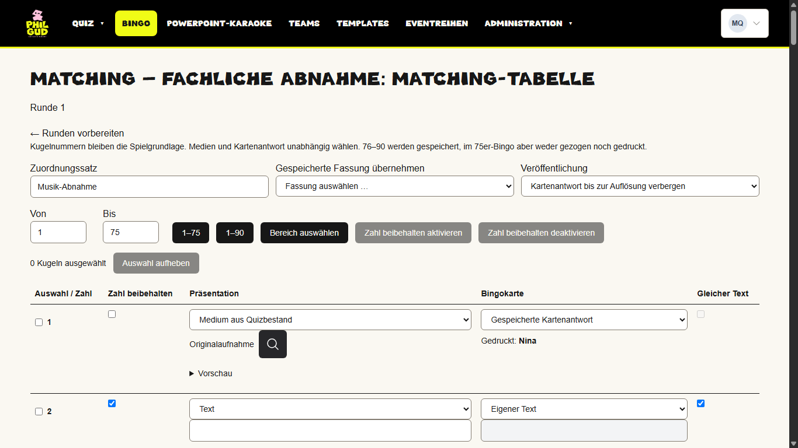
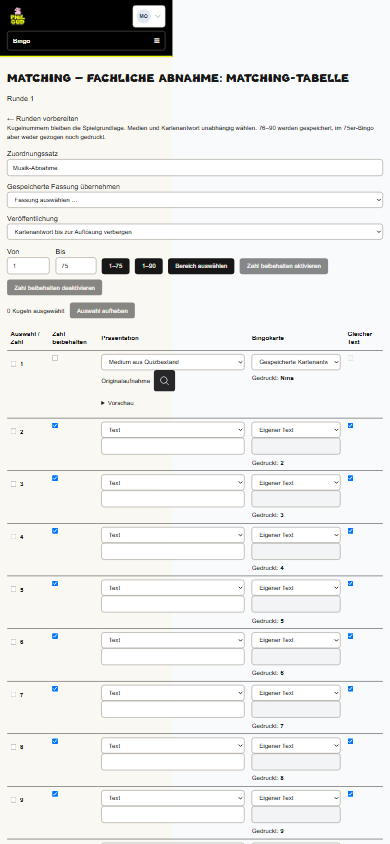
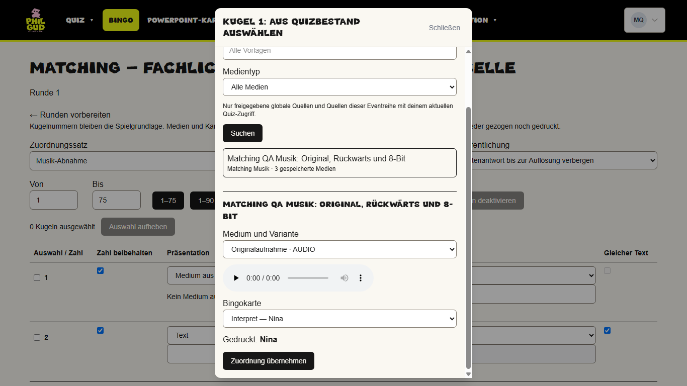
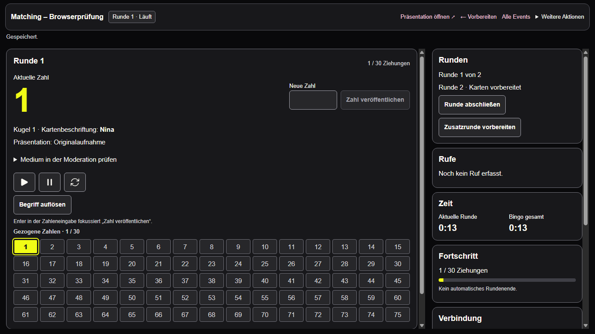
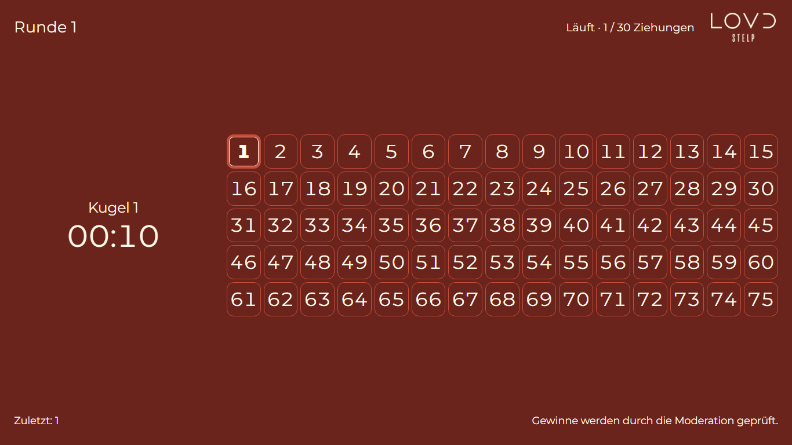
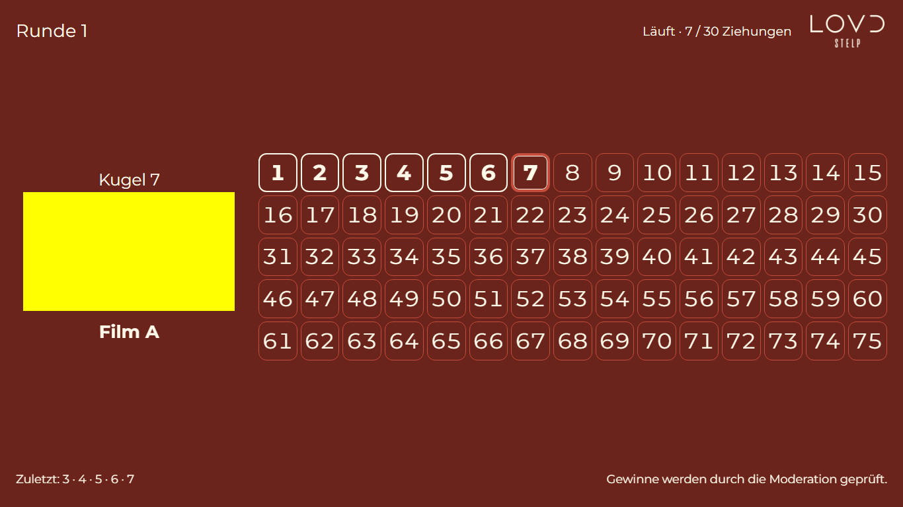
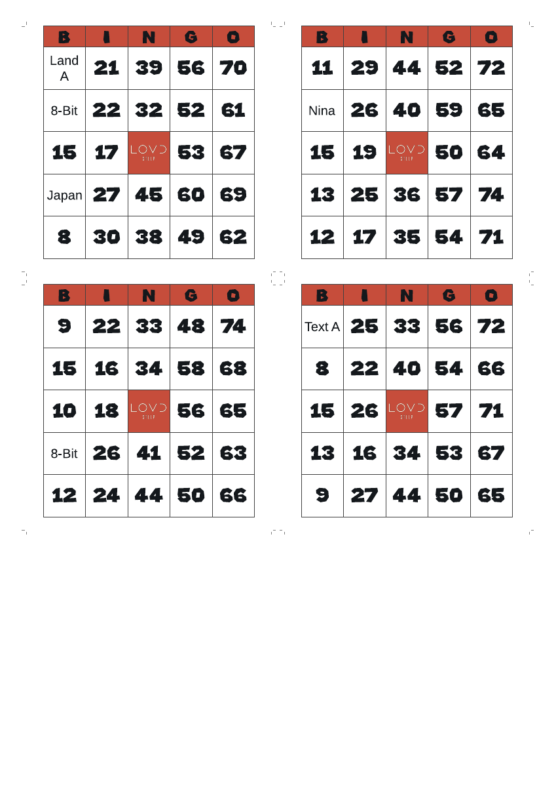
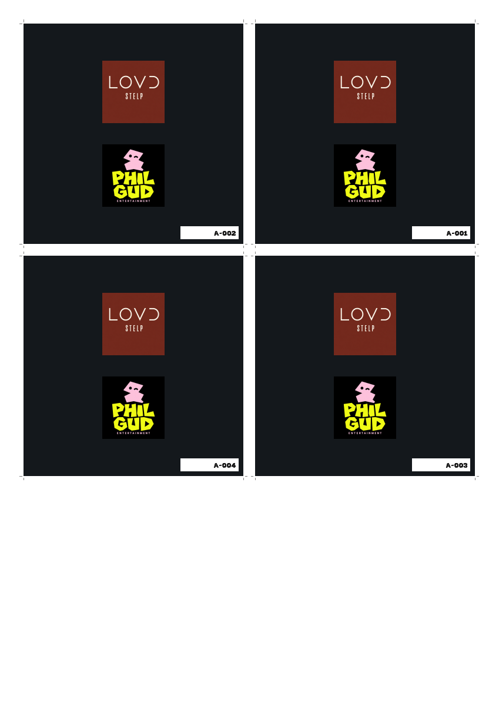

# Bingo-Matching: tatsächliche Abnahmebelege

7. November 2026, ausschließlich isolierte synthetische Preview. Keine rekonstruierten Ansichten.

[Prüfbericht und Abnahmeanleitung](../../architecture/bingo-matching-acceptance.md) · [Beispiel-Duplex-PDF](./matching-example-duplex.pdf)

Das PDF stammt aus dem tatsächlich gespeicherten synthetischen Vergleichsfall und wurde im gehosteten Browser heruntergeladen. Diese Karten gehören ausschließlich zur Preview; nicht für ein Production-Spiel verwenden. Das bestehende geerbte LOVD-/Phil-Gud-Druckdesign bleibt unverändert. Vorderseiten und die an langer Kante gespiegelten Rückseiten wurden aus dem PDF gerendert.

## Matching-Tabelle

## Unabhängige Medien- und Kartenantwort

Die vorhandenen Optionen Interpret, Titel und Kombination wurden für Original und Rückwärts im Browser separat gespeichert. Native Tab-Fokussierung ist geprüft; ein Bildschirmfoto ersetzt diesen Funktionstest nicht.

## Moderation und Publikum

## Tatsächlicher PDF-Download

